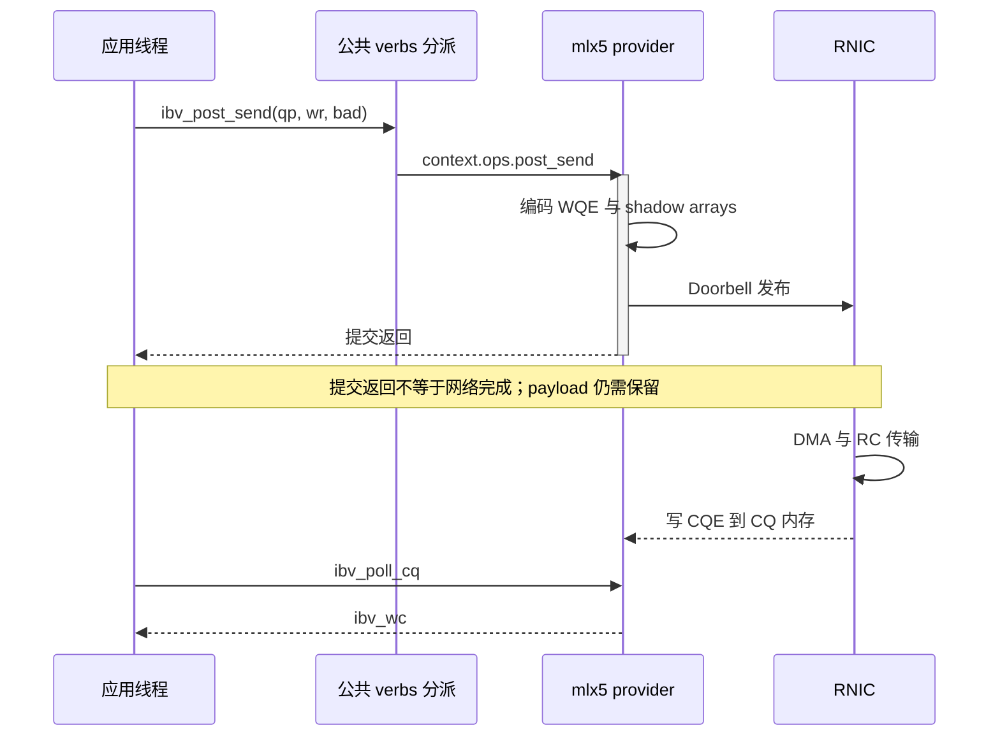
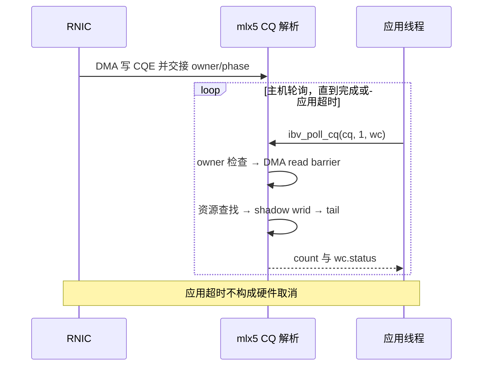

---
tags:
  - 高性能存储
  - RDMA
  - RoCE
  - rdma-core
  - 源码阅读
aliases:
  - libibverbs 到 mlx5 provider
  - WR WQE Doorbell CQE 提交路径
priority: P1
status: 笔记完成，动态实验待执行
created: 2026-09-19
updated: 2026-09-19
source_tag: v57.0
source_commit: 18696ad67a90a8e36621570d8a006abc598b6a13
provider: mlx5
---

# rdma-core 到设备 Provider 的提交路径

> **固定一条主线：应用提交一个 RC、非 inline、单 SGE 的 RDMA WRITE，追到 mlx5 WQE、Doorbell，再追踪一次发送 CQE 如何变成 `ibv_wc`。**
>
> 结论不是“verbs 很快”，而是能指出：谁分配与授权资源，谁将通用 WR 编码为设备描述符，谁发布队列，谁搬运数据，谁解释完成，以及每一道屏障究竟约束谁。

本篇将 [[4.2 Verbs 编程模型]] 的 API 对象、[[4.3 QP WQE CQ 状态机]] 的队列和 [[4.16 Inline Batching 与 Doorbell 优化]] 的优化点落实到一份固定源码。不是所有 provider 都有 mlx5 的布局、BlueFlame 或同样的 CQ 格式；也不把“常规热路径没有每 WR 系统调用”解释成“内核和 CPU 从未参与 RDMA”。

## 1. 版本与范围先写在纸上

### 1.1 阅读锚点

| 项目 | 本篇固定值 |
|---|---|
| 上游项目 | linux-rdma/rdma-core |
| 版本标签 | `v57.0` |
| 标签对应提交 | `18696ad67a90a8e36621570d8a006abc598b6a13` |
| 标签日期 | 2025-04-21 |
| 用户态设备实现 | `providers/mlx5/` |
| 主操作 | RC QP、RDMA WRITE、非 inline、普通注册 MR |
| 完成接口 | 传统 `ibv_poll_cq()`，说明 CQE v0/v1 的分支 |
| 不默认包含 | DevX、raw WQE、GPU 发起网络、ODP 缺页、多包接收等扩展 |

标签本身是 annotated tag，对应一个 tag object；**tag object SHA 不是源码 commit SHA**。本文所有源码链接固定到上表中的 commit，而不是滚动的 `master`。选择此版本是为了阅读可复现，并非推荐生产环境降级或升级到它。[^version]

在自己的源码目录中确认：

```bash
git clone https://github.com/linux-rdma/rdma-core.git
cd rdma-core
git checkout --detach 18696ad67a90a8e36621570d8a006abc598b6a13
test "$(git rev-parse HEAD)" = \
  "18696ad67a90a8e36621570d8a006abc598b6a13"
git status --short
git describe --tags --exact-match
```

若机器实际加载的是发行版补丁版本，这篇仍可用来理解机制，但不能把断点行号、结构偏移或环境变量行为直接当作那份二进制的事实。源码 commit、构建产物和进程加载对象三者要对上。

### 1.2 最小阅读地图

| 位置 | 本篇要找的入口/字段 | 读完应该回答 |
|---|---|---|
| `libibverbs/verbs.h` | `ibv_post_send`、`ibv_poll_cq`、公共对象 | 公共 API 如何进入 context ops？ |
| `providers/mlx5/mlx5.c` | `mlx5_ctx_common_ops`、`mlx5_ctx_cqev1_ops` | 谁绑定 post/poll/资源操作？ |
| `providers/mlx5/verbs.c` | `mlx5_reg_mr`、`mlx5_reg_dmabuf_mr`、create/modify 入口 | 哪些步骤是资源管理？ |
| `providers/mlx5/qp.c` | `mlx5_post_send`、`_mlx5_post_send`、`post_send_db` | WR 如何编码并发布？ |
| `providers/mlx5/cq.c` | `get_sw_cqe`、`mlx5_get_next_cqe`、`mlx5_parse_cqe` | 如何发现、解析、回收完成？ |
| `providers/mlx5/mlx5.h`、相关设备头 | `mlx5_qp`、`mlx5_wq`、队列与影子数组 | WR 数和 WQEBB 数为何不同？ |
| `providers/mlx5/mlx5dv.h`、`wqe.h` | 设备 segment 和 CQE 类型 | 哪些字段是设备格式，而非通用 verbs ABI？ |
| `util/udma_barrier.h`、`util/mmio.h` | DMA/MMIO 排序抽象 | 为什么不能拿普通线程 fence 随意替换？ |

不要先从全仓库第一页读到最后一页。先把上述函数在本地定位，再沿**一次操作的变量变化**逐个进入；非主线分支做标记，不同时学习所有卸载能力。

## 2. libibverbs、用户态 provider、内核驱动各管什么

### 2.1 三者不是三个同义词

**libibverbs** 提供公共 API、通用对象、设备发现/打开以及与 uverbs 的配合；**用户态 provider** 实现特定设备家族的资源处理和快速提交/完成逻辑；**内核 RDMA 栈与设备驱动** 管资源授权、内存映射、硬件对象生命周期和相关事件。Linux 常见的 `mlx5_ib` 是内核模块，`providers/mlx5/` 编译出的库是用户态 provider，两者不能混称“mlx5 驱动”。[^uverbs][^ops]

![[图片/SVG/8_4_4_33_1.svg|900]]

图中左侧是资源建立路径，右侧是常规热路径。热路径能直接触及队列内存与授权的 MMIO 区域，前提正是左侧已经建立合法的对象和映射。

| 动作 | 用户态库/provider 的典型工作 | 内核/设备的典型工作 |
|---|---|---|
| 打开设备/context | 发现并选择 provider，建立 context | 打开 uverbs 资源、验证访问、提供能力 |
| 创建 PD | 分配用户态对象、发资源命令 | 建立保护域资源 |
| 创建 CQ/QP | 准备队列内存、锁、索引与影子状态 | 建立关联硬件对象与合法设备映射 |
| 注册 MR | 打包地址、长度、访问标志，保存结果 | 处理映射/权限/设备 key 等资源 |
| QP 转状态 | 传入状态与路径参数 | 配置设备连接/传输上下文 |
| 热路径 post | 编码 WQE、更新软件状态、发布 doorbell | RNIC 获取描述符并执行 |
| 热路径 poll | 读取 CQE、转换 WC、推进回收状态 | RNIC 生成完成并维护硬件状态 |

这是分工图，不意味着每个创建函数都只发生一次 ioctl，也不意味着队列内存全部由某一层单独分配。具体 command 可以经过 uverbs ioctl 或兼容命令路径；对象类型、能力和版本会影响分支。

### 2.2 “绕过内核”的准确限定

对于已经建立资源、普通注册内存、正常工作的 mlx5 热路径，应用每次 post/poll 可以不通过一个对应的系统调用。这里绕过的是**每个数据操作的内核提交/完成中介**，不是绕过所有保护检查，更不是任意用户进程可写任意 NIC 寄存器。映射、PD/MR/key 与对象关联已限定设备可访问什么。[^uverbs]

内核依然参与初始化、销毁、异常处理和事件机制；使用 ODP 等功能时，还可能有缺页处理。所谓“zero-copy”也应指明是 payload 是否经 CPU 拷贝：WQE 编码、软件队列、doorbell 和 CQ 轮询仍然消耗 CPU。

## 3. 第一跳：公共 API 并没有把通用 WR 原样丢给硬件

### 3.1 `ibv_post_send` 是一个很短的分派入口

固定版本 `libibverbs/verbs.h` 中，核心分派为：[^dispatch]

```cpp
// 源码关键语句；公共头文件中的 inline 分派。
return qp->context->ops.post_send(qp, wr, bad_wr);
```

也就是说，应用编译时可能把 `ibv_post_send` 这个小包装直接内联到调用点；真正运行的是打开设备时装入 context 的函数指针。GDB 找不到一个独立的 `ibv_post_send` 栈帧，不意味着它没有执行，也不意味着提交被内核接管。

在 `providers/mlx5/mlx5.c` 的 `mlx5_ctx_common_ops` 中能核对这些绑定：[^ops]

| 公共操作槽 | mlx5 实现 |
|---|---|
| `alloc_pd` | `mlx5_alloc_pd` |
| `reg_mr` | `mlx5_reg_mr` |
| `reg_dmabuf_mr` | `mlx5_reg_dmabuf_mr` |
| `create_cq` | `mlx5_create_cq` |
| `create_qp` | `mlx5_create_qp` |
| `post_send` | `mlx5_post_send` |
| `post_recv` | `mlx5_post_recv` |
| `poll_cq` | 默认 `mlx5_poll_cq`；CQE v1 ops 为 `mlx5_poll_cq_v1` |

此表比“libibverbs 下面有一个 provider”更有价值：它给出了可以在固定源码里定位、在真实进程里核对的实现入口。

### 3.2 公共对象与 provider 私有对象之间有一层桥

应用持有 `ibv_qp*`，provider 需要 `mlx5_qp` 内的 SQ/RQ 内存、锁、WQE 计数、BF/UAR 信息和软件 shadow arrays。因此 `mlx5_post_send()` 内会通过 `to_mqp()` 等转换拿到私有表示。

不能把 `ibv_qp` 当作“完整的 NIC 队列描述”；它只是公共视图。也不能自行假设 provider 私有结构的二进制布局稳定，再用生产程序直接强转偷读。源码实验可以在**匹配构建的调试器**中观察这些字段，业务逻辑应依赖支持的 API。

## 4. 资源创建为何不属于每个 WR 的热路径

### 4.1 建立 QP 的先后关系

典型程序先打开设备/context，创建 PD、CQ 与 QP，注册缓冲区，交换连接/远端内存信息，再把 RC QP 配置到可工作的状态。实际程序可调整某些独立资源的创建先后，但依赖不能倒置：QP 要关联合法的 PD/CQ，SGE 要引用有效 MR，远端访问要有对应的地址、key 和权限。

`ibv_create_qp()` 不等于“已经连接成功”。RC 的 INIT/RTR/RTS 配置与对端信息交换另有职责；使用 librdmacm 也不会使 MR 与 rkey 的应用协议凭空消失。连接流程沿用 [[4.11 RDMA CM 与连接建立]]，本篇从已经可用的 QP 开始追踪数据操作。

### 4.2 从 MR 看到明确的慢路径边界

固定版本 `mlx5_reg_mr()` 会准备 mlx5 MR 对象，并调用 `ibv_cmd_reg_mr(...)`，传递 `pd、addr、length、hca_va、access` 等。成功后保留 provider 需要的状态并向调用者返回 MR。关键区别是：**此时在建立“以后允许设备访问的地址资源”，不是搬运某条业务 payload。**[^resource]

GPU MR 在这里可能选择 DMA-BUF import 或 peer-memory 集成。到了普通非 inline WRITE 的 WQE，核心仍然是本地 SGE 地址/长度/lkey 与远端地址/rkey。变化主要发生在“地址背后如何被映射和授权”，不是为每个 CUDA buffer 发明一种新的 RC 网络包格式；参见 [[8.26 GPU–NIC 环境验证与最小实验]]。

### 4.3 准备一次、重复使用，回收必须晚于使用结束

注册、创建和映射应与高频数据提交分离，否则基准测到的是资源生命周期成本。与此同时，不能为了缓存注册而忘记 GPU/Host allocation 代次：缓存命中不仅匹配地址，还要确认它仍属于同一个有效 allocation 和权限范围。

销毁顺序的核心不是背口诀，而是消除引用：停止新提交 → 明确 outstanding 操作的处理结果 → 销毁/隔离使用它的 QP 等资源 → 撤销 MR → 释放 payload 内存 → 释放其他依赖。出现失败时，“应用等待超时”本身不证明 RNIC 不会再 DMA。

## 5. 一条可跟踪的业务 WR

### 5.1 对象不是一回事

| 名称 | 谁使用 | 含义 |
|---|---|---|
| `ibv_send_wr` | 应用与 provider | 通用操作描述；含 opcode、flags、SGE 链与远端参数 |
| `ibv_sge` | 应用与 provider | 本地地址、长度、lkey |
| WQE | provider 与 RNIC | 设备特定的队列元素，不是 `ibv_send_wr` 的内存镜像 |
| WQEBB | mlx5 SQ 记账 | 固定大小基本块，WQE 可占多个块 |
| CQE | RNIC 与 provider | 设备特定的完成记录 |
| `ibv_wc` | provider 与应用 | 将 CQE 解释为通用完成状态后的结果 |

`wr_id` 是应用的关联标记。它能在 WC 中回来，不代表 RNIC 在所有格式的 CQE 中直接存放应用的完整 64 位 `wr_id`；mlx5 用软件影子数组关联 WQE 与应用 WR。

### 5.2 单 WR 示例：资源先决条件必须明确

下面是**可嵌入已建立连接的 RC 程序的函数**，不是独立的建连程序。调用者负责：QP 在适当状态；本地 `address` 位于对应 `lkey` 的 MR 中；远端地址/rkey 属于当前代次且范围足够；接收方的 MR 允许远端写；调用失败时按生命周期策略保留仍可能被使用的资源。

```cpp
#include <infiniband/verbs.h>
#include <cstdint>
#include <stdexcept>
#include <system_error>

void post_write(ibv_qp* qp, std::uint64_t address, std::uint32_t bytes,
                std::uint32_t lkey, std::uint64_t remote_address,
                std::uint32_t rkey, std::uint64_t id) {
    if (!qp || !bytes) throw std::invalid_argument("QP or bytes invalid");
    ibv_sge sge{};
    sge.addr = address;
    sge.length = bytes;
    sge.lkey = lkey;
    ibv_send_wr wr{};
    wr.wr_id = id;
    wr.sg_list = &sge;
    wr.num_sge = 1;
    wr.opcode = IBV_WR_RDMA_WRITE;
    wr.send_flags = IBV_SEND_SIGNALED;
    wr.wr.rdma.remote_addr = remote_address;
    wr.wr.rdma.rkey = rkey;
    ibv_send_wr* bad = nullptr;
    const int rc = ibv_post_send(qp, &wr, &bad);
    if (rc) throw std::system_error(rc, std::generic_category(),
                                    "ibv_post_send RDMA_WRITE");
}
```

为什么局部 `wr` 和 `sge` 可以离开函数？正常返回后 provider 已读取并编码描述信息，不需要继续持有这两个栈对象；**非 inline payload 的生命周期不同**，必须一直有效到相应完成边界。`ibv_post_send` 的失败返回值是错误码，示例用 `rc` 构造错误，不用可能已过期的 `errno`。



这张图刻意把函数调用返回与硬件完成拉开：前者说明 provider 已接受提交，后者才进入数据完成语义。

## 6. `_mlx5_post_send`：把 WR 链表编译成设备任务

### 6.1 逐个 WR 处理，而不是把整条链表交给 RNIC

固定版本主路径是 `mlx5_post_send()` → `_mlx5_post_send()`。后者进入 SQ 的同步区域，遍历 `wr->next`，检查 opcode、队列容量和 SGE 数等，逐条写入 SQ。大致动作顺序如下，真实源码还包含 QP 类型、原子、MW、raw packet 等分支。[^qp]

| 阶段 | 核心变量/操作 | 作用 |
|---|---|---|
| 取得私有队列 | `to_mqp()`、SQ lock | 找到本 QP 的设备队列与软件状态 |
| 检查本条 WR | opcode、`mlx5_wq_overflow`、SGE 限制 | 在编码前发现一部分错误 |
| 找到 SQ 位置 | `cur_post & (wqe_cnt - 1)` | 以硬件基本块计数定位环槽 |
| 写 control segment | opcode、index、QPN、DS、flags | 告诉设备这是什么操作 |
| 写操作专属 segment | RC WRITE 的 remote address/rkey | 指定远端目标 |
| 写 data/inline segment | `set_data_ptr_seg` 或 inline 拷贝 | 指定本地数据位置或内嵌数据 |
| 建 shadow mapping | `wrid[]`、`wqe_head[]` 等 | 以后将 CQE 还原成应用完成 |
| 推进 SQ 生产位置 | `cur_post += ...` | 按占用的 WQEBB 数前进 |
| 批量发布 | `post_send_db(...)` | 统一公布本次已成功编码的前缀 |

“在用户态检查”不等于全部错误都能提前发现。远端访问错误、传输错误等可能在设备执行后表现为失败 WC；一些错误还通过异步事件报告。

### 6.2 实际 wire data 不在非 inline WQE 里

假设 payload 为 4 KiB，非 inline、一个 SGE。WQE 中的 data segment 指向那 4 KiB，并写入长度与 lkey，而不是复制这 4 KiB。RNIC 随后根据映射 DMA 读取 payload。

这解释了两件事：小 WQE 可以描述大 payload；提交函数返回后应用仍然不能修改或释放源数据。将“WQE 已写完”和“payload 已被 RNIC 读完”混为一谈，是第一类生命周期错误。

## 7. 一次 WRITE 的 WQE 几何形状

### 7.1 本篇限定场景：48 B 描述符，消耗一个 64 B 基本块

在这条普通 RC WRITE、非 inline、一个非零长度 SGE 主线上，设备描述由 control、remote address、data 三类 16 B segment 组成。`size` 以 16 B data segment 单位记账；SQ 按 `MLX5_SEND_WQE_BB` 的 64 B 基本块分配推进。[^qp][^layout]

\[
\mathrm{descriptor\ bytes}=16+16+16=48,
\quad DS=3,
\quad WQEBB=\lceil48/64\rceil=1
\]

![[图片/SVG/8_4_4_33_2.svg|900]]

图中的空余部分是基本块对齐产生的空间，不是另一个 payload。具体控制字段还包含设备索引和标志；不同操作、SGE 数、inline 长度、卸载模式会改变结构。

### 7.2 多 SGE 时，WR 个数与环上块数立即分离

假设仍是 RC WRITE，但有 4 个非零长度 SGE：

\[
16+16+4\times16=96\ \mathrm{B},\quad DS=6,
\quad WQEBB=\lceil96/64\rceil=2
\]

它仍然是 **一个 WR**，只是在 SQ 上占两个基本块。因此不能使用 `sq.head` 的差值推导硬件环消耗的字节，也不能假设每个 WR 只使 producer index 增加 1。

为了避免单位混乱，给固定源码中的变量加上单位：

| 字段 | 本篇主线的单位 | 用途 |
|---|---|---|
| `sq.head` | 已发布的 WR 数 | 软件请求推进 |
| `sq.tail` | 已回收的 WR 进度 | 容量与 outstanding 管理 |
| `sq.cur_post` | WQEBB 数 | 硬件 SQ 写位置与 doorbell producer 位置 |
| `size` | 16 B 段数 | 设备 DS 与本 WQE 大小 |
| `sq.wrid[idx]` | 应用关联值 | 还原 `wc.wr_id` |
| `sq.wqe_head[idx]` | WR 序号 | 从 CQE 位置映射回软件回收进度 |

源码在每个成功编码的 WQE 起始位置保存 `wrid` 与 `wqe_head`，并以 `DIV_ROUND_UP(size * 16, MLX5_SEND_WQE_BB)` 推进 `cur_post`。这几行是理解后续 unsignaled 回收的关键，不应只盯着 doorbell。[^qp]

### 7.3 大小端不是装饰

WQE 是 CPU 与设备约定的二进制格式。源码对诸如 `qpn_ds`、地址、key、长度使用相应的字节序转换。调试时按本机 C 整数直接读原始队列内存，很容易把数值看反；应该同时看结构类型、转换函数和设备格式。

要给这些字段画图，但不要把它们重新手写成生产提交器。直接 WQE 编程需要满足更多 PRM、版本和资源契约，不是从这张 48 B 示例图复制几次 `memcpy` 就够了。

## 8. 两种提交失败：先区分“没接受”与“已执行失败”

### 8.1 `bad_wr` 不代表整批回滚

设一次 `ibv_post_send` 传入 `WR0 → WR1 → WR2 → WR3`，WR2 因本地可检测的问题失败。这个版本 `_mlx5_post_send()` 会跳到退出路径，而退出路径仍调用 `post_send_db()` 发布前面成功编码的 `nreq` 条请求。[^qp]

因此可发生：WR0、WR1 已被接受并发布，`bad_wr` 指向 WR2，WR2 与 WR3 没有按这次调用正常提交。**不要从 WR0 开始重发整条链，也不要释放前两条的 payload。**业务操作若非幂等，盲目重发还可能产生语义错误。

错误处理至少保留三类集合：本次明确接受的前缀、首个拒绝的 WR、尚未处理的后缀。之后结合完成与恢复策略决定重试，不把链表 API 当事务。

### 8.2 返回 0 只说明同步提交阶段没有报错

成功提交以后，RNIC 执行可能发现本地保护错误、远端访问错误、超时或重试耗尽。这些要检查 WC 的 `status`，并记录 `wr_id、qp_num、vendor_err` 等可用信息。正数 poll 返回值只表示取到了多少条完成，**不表示每条都成功**。

`ibv_poll_cq()` 的负返回与一个 `wc.status != IBV_WC_SUCCESS` 又是不同层的失败：前者是 CQ 读取/解析接口没有正常给出请求的结果；后者是得到了一条明确失败的操作完成。不要把两者写成同一个 `errno` 处理分支。

## 9. `post_send_db`：发布的不是一句“敲门铃”

### 9.1 严格区分三个对象

**SQ/WQE 内存**承载设备描述符；**Doorbell Record（DBR）**是软件维护、设备可访问的队列进度记录；**UAR 中的 MMIO doorbell/BF 区域**是已授权映射到进程的设备寄存器/写入窗口。三者地址性质不同。更新 DBR 不等于执行一次 MMIO，也不能把它们画成同一个方框。[^doorbell]

在固定版本里，`post_send_db()` 的关键顺序是：先判断 `nreq` 是否为 0；推进软件 `head`；调用 `udma_to_device_barrier()`；写 SND DBR；进入需要的写合并（Write Combining）/MMIO 同步；选择 BF 或普通 MMIO；flush WC writes；切换 BF offset 并解锁。

![[图片/SVG/8_4_4_33_3.svg|900]]

图的左半部是 CPU 向设备发布，右半部是 CPU 从设备获取完成。两处屏障方向相反；底部回收进度又形成下一轮提交的容量条件。

### 9.2 为什么先描述符、后 DBR、再 doorbell

源码注释明确要求描述符先于 DBR 更新和 doorbell 被设备观察。否则 RNIC 得知“有新任务”时，描述符内容还可能没有按所需顺序可见。`udma_to_device_barrier()` 提供的是面向设备的排序抽象；它的具体实现与架构有关，不能见到 x86 上的某种展开，就在所有平台删除它。[^doorbell]

注意：ordering 不是 completion。这里保证任务发布顺序，不保证 NIC 已读 payload、不保证网络传完、更不保证 GPU 消费者看到远端写入。应用仍需等待相应完成与消费同步边界。

### 9.3 BlueFlame 是有条件的分支，不是 doorbell 的别名

固定源码的 BF 分支检查条件包含：未禁用 BF、`nreq == 1`、相关 BF/UAR 条件、`inl || prefer_bf`、WQE 大小范围等；满足时把适当的 WQE 内容拷到 BF MMIO 区域，否则采用 `mmio_write64_be(...)` 的普通 doorbell 路径。[^doorbell]

由此得到三个重要区分：

- **发送 inline**：CPU 将 payload 拷进 WQE，用于小消息时减少一次外部 payload DMA read。
- **BlueFlame**：发布 WQE 的设备侧写入路径，可能减少设备获取描述符的开销。
- **非 inline payload DMA**：RNIC 根据 SGE 读取真正的源缓冲区。

BF 可以在非 inline 且相关偏好/条件满足时使用，所以 BF 不等于 inline；使用普通 MMIO 也不意味着 payload 要经内核拷贝。优化前先辨认自己在哪一个分支。

### 9.4 `mmio_flush_writes()` 为什么放在锁内

源码解释了一种跨 CPU 的 WC 写入风险：CPU A 的较早 doorbell 暂留在本地 write-combining buffer；CPU B 的较晚 doorbell 先被冲出；如果同步不当，设备可能以相反顺序观察二者。flush 是 CPU-local 的，因此需要在规定的临界区内完成，避免只锁了“发出 store”的代码却没有约束 store 对设备的实际出现顺序。[^doorbell]

**本节的 WC 指 Write Combining（写合并），与 `ibv_wc` 中的 Work Completion（操作完成）不是同一个缩写含义。**这是 **MMIO 写合并/发布** 的问题，不是普通 CPU L1/L2 缓存一致性问题，也不能由 GPU stream event 替代。软件工程里“释放 mutex 了，所以设备一定先看到我的写”不是无需论证的结论。

### 9.5 批量发布不等于所有硬件成本归零

一个 WR 链表可以摊薄函数调用、锁与 doorbell 发布成本。但固定版本的 BF 条件包含 `nreq == 1`，批量改变后也可能走不同发布分支；batch 越大不保证每一种消息长度下都更快。还要考虑批处理等待、队列占用、completion moderation 和 tail latency。

测量时同时记录 WR/s、payload 吞吐、每批大小、每次 poll 获得的 WC 数和 CPU 时间。不要只报告 Gbit/s 后宣称“batch 消除了提交成本”。相关实验维度见 [[4.30 RoCE Benchmark Matrix：Message Size、QP 数、Flow 数、Incast、NUMA、Multi-Rail、PFC、ECN 与 P99]]。

## 10. RNIC 执行：CPU 构造任务，设备搬运与校验

### 10.1 本地与远端各有自己的授权范围

源端非 inline data segment 包含本地地址、长度与 lkey。RNIC 在本端资源/映射约束下 DMA 读取 payload；远端 WRITE 参数包含目标地址与 rkey，接收端设备在远端 MR 权限和范围内执行写入。lkey 与 rkey 不是“一个 key 的本地/网络两种写法”，它们位于不同一侧的访问契约中。

普通注册 Host memory 与 GPU memory 的主要区别，在于映射后设备 DMA 访问的最终内存不同。WQE 中一个“地址”也不是某块内存的所有权证明；它必须和 MR、PD、范围、有效期一起解释。

### 10.2 三个常被漏掉的 CPU 成本

RNIC offload 数据搬运，不等于 CPU 成本为零。CPU 仍可能花在：WR/WQE 编码与内存写入；共享 QP/CQ 的锁或 cache-line 争用；busy polling 无完成时的空转。多线程共享一个 QP 的问题不只是不安全，还可能是同步与队列状态的争用；取舍接续 [[4.18 多线程下 QP 使用模型]]。

为了先看清机制，实验采用“一个线程拥有一对 QP/CQ”的模型，再讨论 parent domain、thread domain 或共享资源优化。不要先关闭 provider 锁却继续允许多个线程并发提交。

## 11. CQE 如何变成 `ibv_wc`

### 11.1 先判断归属，再读完整内容

`get_sw_cqe()` 根据消费索引计算环上位置，定位 64 B CQE 或 128 B CQ slot 中对应的 CQE 部分，然后检查 opcode 和 owner/phase 是否表示这条记录已交给软件。环绕后通过 phase 区分“上一圈的旧记录”和“这一圈的新完成”。不是 CPU 每次消费后把 CQE 全部清零。[^cq]

`mlx5_get_next_cqe()` 获取新 CQE 后，在读取其内容之前调用 `udma_from_device_barrier()`。这个屏障保证“已看到所有权交接”之后，再按设备到 CPU 的约定读 CQE 内容。仅在 C++ 类型上加 `volatile` 不能代替这套设备发布契约。[^cq]

为理解 phase，可做一个**教学环模型**：假设 CQ 有 8 个槽，软件消费计数 n=6、7 时期望第一圈 phase；n=8、9 会回到槽 0、1，同时期望 phase 翻转。这里的 8 是演示参数，不表示实际 `ibv_create_cq(..., 8, ...)` 就精确得到一个内部 8 槽环；实际大小可能按设备要求取整。

### 11.2 设备 ID 到用户态 QP，再到 WR

`mlx5_parse_cqe()` 获取 CQE opcode、WQE counter、资源标识等。对于发送请求的 `MLX5_CQE_REQ`，它找到对应 QP 的 SQ，再根据 WQE counter 定位软件影子数组。CQE v0/v1 在资源定位方式上存在分支：固定源码按 `cqe_ver` 选择 QPN 或相关 user index，不可硬说“任何 CQE 都只靠 QPN 找 QP”。[^cq]

关键映射如下：

| 输入 | 映射/操作 | 输出 |
|---|---|---|
| CQE 资源字段 | 查找匹配的 provider QP/context | 对应 `mlx5_qp` |
| CQE WQE counter | 按 SQ 环 mask 定位起始块 | `idx` |
| `sq.wrid[idx]` | 回填用户关联值 | `wc.wr_id` |
| CQE opcode/status/syndrome | 解释设备格式与错误 | 通用 WC 字段 |
| `sq.wqe_head[idx] + 1` | 推进软件已完成请求进度 | `sq.tail` |

这就是为什么“WR 可以占多个 WQEBB”和“一个完成可以推进多个 WR 的软件回收”必须一起学。只看到 CQE 的一个索引，无法直接假设它等于应用请求编号。

### 11.3 两个消费者进度，不要只更新一个

SQ 的 `tail` 推进表示可以回收发送请求占用的相应软件容量；CQ 的消费索引推进则表示软件已消费这些完成记录。固定 `poll` 逻辑在循环之后调用 `update_cons_index(cq)`，向设备报告相应 CQ 进度。一个属于**发送队列回收**，一个属于**完成队列回收**，不是同一个 head/tail 对。[^cq-poll]

某些 CQE 还可能带 inline scatter 数据，provider 需要将它搬到相应目标位置；这种分支与普通 CQ 元数据解析不同。在 GPU memory 实验里必须注意 CPU 不能任意解引用 device pointer，这也是不能由“GPU MR 成功”直接推出所有小包/所有接收模式都安全的原因。

### 11.4 应用侧正确的 poll 轮廓

下面函数适用于本实验的**独占 CQ、恰好等待一条指定完成**的阶段。共享 CQ 或有多个 outstanding WR 时必须使用 dispatcher，不能把其他 `wr_id` 的完成读出来后丢弃。失败时由外层执行连接/资源隔离策略，不能因抛异常就马上释放可能仍被 DMA 使用的 payload。

```cpp
#include <chrono>
#include <string>

ibv_wc wait_one(ibv_cq* cq, std::uint64_t expected_id,
                std::chrono::milliseconds timeout) {
    if (!cq) throw std::invalid_argument("null CQ");
    const auto deadline = std::chrono::steady_clock::now() + timeout;
    ibv_wc wc{};
    for (;;) {
        const int n = ibv_poll_cq(cq, 1, &wc);
        if (n < 0) throw std::runtime_error("ibv_poll_cq failed");
        if (n == 1) {
            if (wc.status != IBV_WC_SUCCESS)
                throw std::runtime_error(std::string("WC failed: ") +
                    ibv_wc_status_str(wc.status) + " vendor=" +
                    std::to_string(wc.vendor_err));
            if (wc.wr_id != expected_id)
                throw std::runtime_error("unexpected WR on exclusive CQ");
            return wc;
        }
        if (std::chrono::steady_clock::now() >= deadline)
            throw std::runtime_error("timeout; DMA is not cancelled");
    }
}
```



这里只展示忙轮询。使用 CQ event 时，还需要 arm、重新检查 CQ、事件确认等避免丢通知的流程；**event 是通知机制，CQE 是完成记录**，不能把“收到一个 event”映射成“正好完成一条 WR”。

## 12. Unsignaled 为什么最终仍然需要成功的回收点

### 12.1 不产生每条成功 CQE，仍然占用 SQ

`IBV_SEND_SIGNALED` 控制成功操作是否请求相应发送完成，QP 的 signal-all 设置也会影响行为。unsignaled 不意味着 WR 不占队列、设备不执行或永远不会出现错误完成。

假设同一个 SQ 连续提交 WR0、WR1、WR2，其中 WR2 signaled。在符合这条操作序列的完成/顺序规则时，收到 WR2 的成功 CQE 后，provider 可以根据其 `wqe_head` 推进软件 tail，覆盖已完成的前序请求。应用同样可以用受控的 sequence 边界管理对应 buffer，但不能把这种推断跨 QP、跨未知 opcode 依赖或跨失败路径随意推广。[^qp][^cq]

### 12.2 一个典型自锁式容量错误

如果 SQ 容量已经被大量 unsignaled 请求占满，再试图追加一条 signaled 请求作为回收标记，它可能根本投不进去。于是“等待一条从未提交的标记完成”会永久停滞。

正确策略是在容量预算内预留回收点，并明确最后一批的 signaled tail；发生 WC 错误时走专门的 outstanding/flush 处理，而不是按成功路径盲目释放所有地址。基础 API 语义见 [[4.15 Signaled Unsignaled WR]]，本篇增加的是它在 `wrid/wqe_head/tail` 中的实现对应。

## 13. 新旧提交 API 不要强行套同一张调用栈

rdma-core 还提供扩展 WR builder 接口，例如 `ibv_wr_start()`、操作 setter、`ibv_wr_complete()`。固定 mlx5 源码里能看到 `mlx5_send_wr_start` 保存回滚点，`mlx5_send_wr_complete` 检查构造错误并发布，abort/error 分支回滚相应软件构造状态。它可以共享 `post_send_db` 等底层机制，但不等于每次都经过传统 `mlx5_post_send()`。[^qp-builder]

因此本文传统 WR 链表的“失败前缀可能已发布”不能直接改写为所有 builder API 的统一语义；反过来，也不能把 builder 构造阶段的回滚能力用于推断传统 `ibv_post_send` 全批事务性。

阅读时在纸上写明：传统 `ibv_send_wr` 链表、扩展 builder、mlx5dv/DevX/raw WQE，究竟使用哪一个入口。性能分析中断点只打在一个入口，却看到“没有 post”，很可能只是观察位置错了。

## 14. 固定版本的源码实验：从静态证据走到动态证据

### 14.1 不覆盖系统库，先构建可调试副本

以下 CMake 构建采用 Debug，目的是断点和结构观察，不用它输出生产性能成绩。构建依赖以本版本 README、CMake 报告与发行版包为准。

```bash
cmake -S . -B build-debug \
  -DCMAKE_BUILD_TYPE=Debug \
  -DCMAKE_INSTALL_PREFIX="$PWD/local-install"
cmake --build build-debug -j"$(nproc)"
find build-debug -type f \( -name '*mlx5*.so*' -o \
  -name 'libibverbs.so*' -o -name 'ibv_rc_pingpong' \) -print
```

不要把随机一个 `libmlx5.so` 和系统 `libibverbs` 混用。实际 provider 文件名可能带 ABI 后缀，查找时不要假设固定叫 `libmlx5.so.1`。用构建树提供的运行布局、匹配安装或本次进程明确设置的库路径，随后验证进程真正加载的对象。

```bash
# PID 为已经启动并停在调试阶段的测试进程。
PID=12345  # 替换为实际 PID
awk '/libibverbs|libmlx5|ibverbs/ {print $6}' "/proc/$PID/maps" \
  | sort -u
# 若 provider 静态链接或布局不同，结合构建配置与符号表核对。
```

`/proc/PID/maps` 中发现的是系统 provider，而不是固定构建，就必须先修正运行布局；不能因为当前工作目录在源码仓库中便宣称“已调试 v57.0”。

### 14.2 六个静态检查点

用 `git grep -n` 找准确行号，避免照抄其他版本的偏移：

```bash
git grep -n 'ops.post_send' -- libibverbs/verbs.h
git grep -n 'mlx5_ctx_common_ops\|mlx5_ctx_cqev1_ops' \
  -- providers/mlx5/mlx5.c
git grep -n 'ibv_cmd_reg_mr' -- providers/mlx5/verbs.c
git grep -n '_mlx5_post_send\|post_send_db' -- providers/mlx5/qp.c
git grep -n 'sq.wrid\|sq.wqe_head\|sq.cur_post' \
  -- providers/mlx5/qp.c
git grep -n 'get_sw_cqe\|udma_from_device_barrier\|update_cons_index' \
  -- providers/mlx5/cq.c
```

每一处只需先写一条结论：公共 dispatch；mlx5 绑定；MR command；WQE 构造；软件影子映射；CQ owner/回收。能把这六条连起来，已经比泛读十几个文件更有收获。

### 14.3 动态断点以 provider 入口为中心

在双机或合适的 RDMA 测试环境中启动匹配构建的 RC sample。选择正确 NIC、port、GID；`ibv_rc_pingpong` 验证 SEND/RECV 主线，而本文 WRITE 路径需要用已建立连接的自写测试或匹配的 WRITE benchmark。不要用 SEND 断点结果冒充已执行 WRITE 的 raddr 分支。

```gdb
set breakpoint pending on
break mlx5_post_send
break mlx5_poll_cq
break mlx5_poll_cq_v1
run
bt
info sharedlibrary
```

在进入 provider 后，按当前固定源码设置 `_mlx5_post_send` 和 `post_send_db` 的源文件行断点。它们可能被内联，符号也可能不独立导出；**没有可用的动态符号不等于函数逻辑不存在**。使用匹配的 Debug 对象、DWARF 信息和源行断点更可靠。

本轮只观察一个 WR：操作前后记录 `sq.head、sq.tail、sq.cur_post、nreq、size、wrid[idx]、wqe_head[idx]`。检查 WRITE+单 SGE 是否走到预期的 raddr/data 分支，确认到底用了 BF 还是普通 MMIO。断点改变时序，不能拿这次运行的延迟估计真实性能。

### 14.4 三个安全、可判定的练习

**练习一：一个 SGE 改成四个非零 SGE。**总 payload 大小保持相同，在注册范围内切分。预测 WR 数仍加 1、DS 和 WQEBB 增大，再观察字段。这个练习验证“描述符大小与 payload 大小是不同维度”。

**练习二：传统 WR 链表中制造一个同步可检测的无效 opcode。**仅在隔离实验 QP 上进行，不使用非法任意 DMA 地址。观察 `bad_wr` 与已接受前缀的完成，验证不能整批回滚的假设。实验失败时停止该 QP，并按 outstanding 状态清理。

**练习三：调小 signaled 间隔，观察回收。**在容量可控的范围内对照每条 signaled 与周期 signaled。记录 CQE 数、tail 推进、CPU 时间，不故意填满后等待一个未能提交的标记。

### 14.5 为什么 `strace` 看不到 doorbell

`strace` 观察系统调用，不会把普通用户态 store 或授权 MMIO store 显示成 `post_send()` 系统调用。它可以帮助区分初始化阶段的文件访问、mmap、uverbs 命令与热循环，但“热循环中没有新 ioctl”只是证据之一，不证明没有 CPU 工作或没有数据传输。

要观察热路径，应结合匹配源码、provider 断点/采样、合适的 uprobe 或硬件计数器。静态/内联函数不一定能直接按导出符号挂 uprobe；工具看到的是哪一个 binary、哪种符号与优化形态，必须明确。

## 15. 把软件字段与性能症状对上

| 症状 | 对应机制 | 下一步验证 |
|---|---|---|
| post 返回队列满 | `head/tail` 与 WQE 容量管理 | 是否及时 poll，signaled 回收点是否预留 |
| 消息率低但大包带宽高 | 编码、doorbell、锁、CQ 空轮询成本 | 同 payload 比较 batch、线程拥有关系 |
| 小消息 inline 更快 | payload 拷贝进 WQE 与 DMA 成本取舍 | 同长度、同 MR/CPU 路径对照 |
| batch 增大后尾延迟恶化 | 等待凑批与队列积压 | 记录提交等待而非只看 NIC 执行 |
| QP 多时性能下降 | 设备/主机状态与 cache working set | 对照 QP 数与负载分布，接续 4.28 |
| CQE 到了但应用找错请求 | WQE counter→shadow WR 映射或应用代次错误 | 检查 wr_id、资源重建与回收顺序 |
| CPU 高而 WC 很少 | 忙轮询或 CQ/NUMA 放置不当 | poll hit rate、CPU affinity、NUMA |
| GPU 小包异常 | inline/scatter 对 device pointer 的处理 | 显式路径与对应 provider 分支 |

其中设备连接规模问题可以进一步阅读 [[4.28 RDMA 大规模连接：QP 资源成本、SRQ、连接扩展与 RNIC Cache]]。不要拿其中某一个症状直接证明硬件故障；表格是缩小观测范围的路径，不是排除其他原因的定理。

## 16. 读完应该能复述的完整链条

**一条 RC WRITE 的主链：**合法 context/PD/CQ/QP/MR 已建立；应用填通用 WR/SGE；`ibv_post_send` 分派到 mlx5；provider 检查并构造 control/raddr/data segments；影子数组保存应用 WR 与设备位置的关系；设备排序屏障后更新 DBR 并通过 BF/MMIO 发布；RNIC 获取任务、DMA 与网络执行；设备发布 CQE；CPU 检查 owner/phase，经过 device-to-CPU 读取屏障，解析资源和 WQE counter；恢复 `wr_id`、转换状态、推进 SQ tail 和 CQ consumer index；应用检查 WC，再决定 payload 和上层任务的生命周期。

**问：Doorbell Record 和 doorbell MMIO 的根本区别？**前者是可被设备访问的队列状态内存，后者是对设备映射区域的发布写入；二者都不是 payload 本身。

**问：为什么一条 WR 不一定只占一个硬件槽？**mlx5 用 64 B 基本块记 SQ；操作段和 SGE 数决定 WQE 长度，一条 WR 可以跨多个基本块。

**问：`wc.wr_id` 是如何回来的？**固定 mlx5 主线通过 CQE 标识和 WQE counter 找到 SQ shadow entry，再读取提交时保存的 `wrid`。

**问：`ibv_post_send` 失败能否立即复用整批 buffer？**不能。传统链表已接受的前缀可能已发布；必须按 `bad_wr`、成功前缀和后续完成处理。

**问：为什么 GPU MR 与 provider 提交可以分成两篇？**GPU MR 主要改变映射与生命周期条件；普通 WQE 提交仍走设备任务描述机制。GPU 可见性另有 CUDA 执行域，NIC 屏障不自动解决它。

**问：这次阅读的证据缺口是什么？**已固定并核对公开源码；本文环境没有实际 RNIC 动态断点与 GPU 双机实验。真实设备的固件执行细节、选中 BF 分支、性能和错误表现必须在匹配平台上验证，不能由静态源码捏造结果。

## 17. 源码引用

所有 rdma-core 链接固定到 `18696ad67a90a8e36621570d8a006abc598b6a13`。函数名作为主要定位点，本地使用 `git grep -n` 得到准确行号，避免页码和行号漂移。

[^version]: rdma-core [v57.0 标签](https://github.com/linux-rdma/rdma-core/releases/tag/v57.0) 与 [固定 commit](https://github.com/linux-rdma/rdma-core/commit/18696ad67a90a8e36621570d8a006abc598b6a13)。标签对象已核对其指向，阅读基线而非最新版本声明。
[^uverbs]: Linux Kernel documentation，[Userspace verbs access](https://docs.kernel.org/infiniband/user_verbs.html)，慢路径资源管理、用户态快速路径与设备 MMIO 的分工。
[^dispatch]: rdma-core，[libibverbs/verbs.h](https://github.com/linux-rdma/rdma-core/blob/18696ad67a90a8e36621570d8a006abc598b6a13/libibverbs/verbs.h)，`ibv_post_send` 与公共 verbs 对象/API。
[^ops]: rdma-core，[providers/mlx5/mlx5.c](https://github.com/linux-rdma/rdma-core/blob/18696ad67a90a8e36621570d8a006abc598b6a13/providers/mlx5/mlx5.c)，`mlx5_ctx_common_ops`、`mlx5_ctx_cqev1_ops`。
[^resource]: rdma-core，[providers/mlx5/verbs.c](https://github.com/linux-rdma/rdma-core/blob/18696ad67a90a8e36621570d8a006abc598b6a13/providers/mlx5/verbs.c)，`mlx5_reg_mr` 与资源创建/注册相关实现；[ibv_reg_mr 手册](https://github.com/linux-rdma/rdma-core/blob/18696ad67a90a8e36621570d8a006abc598b6a13/libibverbs/man/ibv_reg_mr.3) 说明 IOVA、keys 与权限。
[^qp]: rdma-core，[providers/mlx5/qp.c](https://github.com/linux-rdma/rdma-core/blob/18696ad67a90a8e36621570d8a006abc598b6a13/providers/mlx5/qp.c)，`mlx5_post_send`、`_mlx5_post_send`、segment 设置、`wrid/wqe_head/cur_post` 与错误退出路径。
[^layout]: rdma-core，[providers/mlx5/mlx5dv.h](https://github.com/linux-rdma/rdma-core/blob/18696ad67a90a8e36621570d8a006abc598b6a13/providers/mlx5/mlx5dv.h)、[wqe.h](https://github.com/linux-rdma/rdma-core/blob/18696ad67a90a8e36621570d8a006abc598b6a13/providers/mlx5/wqe.h)、[mlx5.h](https://github.com/linux-rdma/rdma-core/blob/18696ad67a90a8e36621570d8a006abc598b6a13/providers/mlx5/mlx5.h)，配合 qp.c 核对设备段定义与队列记账。
[^doorbell]: rdma-core，[qp.c 中的 post_send_db](https://github.com/linux-rdma/rdma-core/blob/18696ad67a90a8e36621570d8a006abc598b6a13/providers/mlx5/qp.c)，包含 DBR、BF 条件、MMIO 写与锁内 flush 的源码说明；架构抽象见 [util/mmio.h](https://github.com/linux-rdma/rdma-core/blob/18696ad67a90a8e36621570d8a006abc598b6a13/util/mmio.h)。
[^cq]: rdma-core，[providers/mlx5/cq.c](https://github.com/linux-rdma/rdma-core/blob/18696ad67a90a8e36621570d8a006abc598b6a13/providers/mlx5/cq.c)，`get_sw_cqe`、`mlx5_get_next_cqe`、`mlx5_parse_cqe` 与 `wq->tail` 更新。
[^cq-poll]: 同一固定版本 [cq.c](https://github.com/linux-rdma/rdma-core/blob/18696ad67a90a8e36621570d8a006abc598b6a13/providers/mlx5/cq.c)，poll 循环、`update_cons_index`、CQE v0/v1 与扩展 CQ poll 分支。
[^qp-builder]: 同一固定版本 [qp.c](https://github.com/linux-rdma/rdma-core/blob/18696ad67a90a8e36621570d8a006abc598b6a13/providers/mlx5/qp.c)，`mlx5_send_wr_start`、`mlx5_send_wr_complete`、`mlx5_send_wr_abort` 及构造阶段回滚状态。
