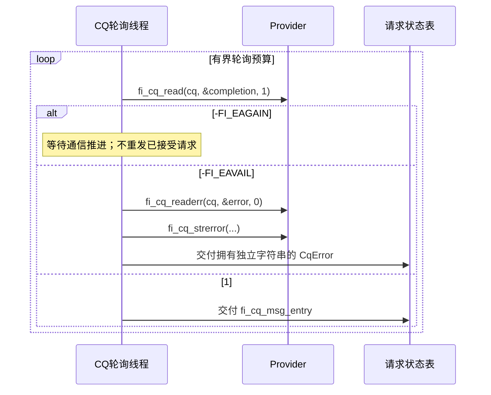
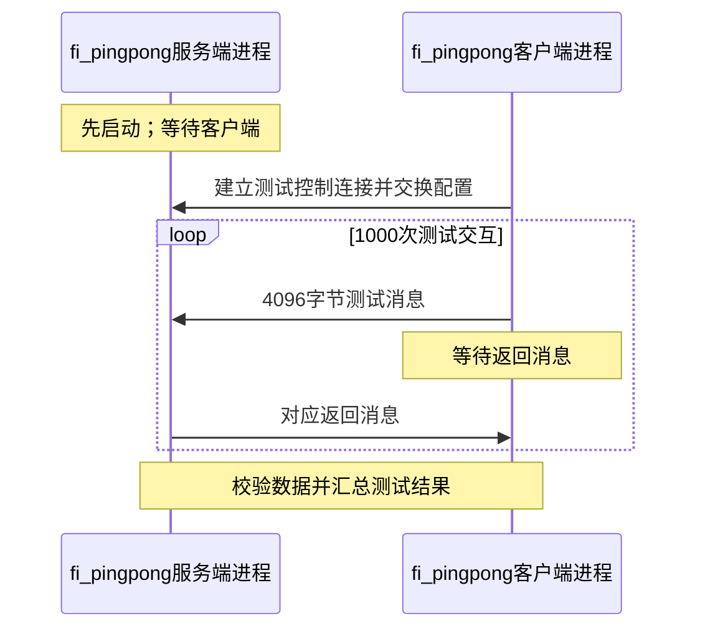

---
tags:
  - 高性能存储
  - RDMA与RoCE
  - libfabric
  - OFI
  - 通信编程
aliases:
  - libfabric OFI 编程模型
  - Fabric Domain Endpoint MR CQ EQ
created: 2026-09-19
priority: P1
阅读次数: 0
---

# libfabric / OFI 编程模型

> libfabric 的核心不是把 `ibv_post_send` 换一个函数名，而是：先协商应用能够履行的通信契约，再创建资源、提交异步操作，并把进展、完成、错误和缓冲区生命周期接成一个闭环。

**学习落点。** 已经理解 [[4.2 Verbs 编程模型]] 中的 PD、QP、MR、CQ 后，本篇向上走一层：同一套应用接口如何接到不同 provider，为什么“支持 RMA”不等于“必然走硬件 RDMA”，以及一次成功提交之后还欠哪些工作。

**版本与范围。** API 解释固定到 **libfabric 2.7.0 官方手册**，核对日期为 **2026-09-19**；默认 Linux、主机内存、普通 active endpoint。安装版本、核心 provider、utility provider 和设备能力必须另行记录。GPU HMEM、设备侧 XPU、持久内存等不是本篇默认契约。文中示例是教学代码与实验步骤，**没有在用户硬件上运行，也未把软件 provider 的结果冒充 RNIC 性能**。[^arch]

## 1. 先分清 OFI、libfabric 与 provider

OFI（OpenFabrics Interfaces）定义通信接口与使用模型；libfabric 提供实现框架和 API；provider 把这套接口落实到某种网络、设备或软件通信路径。它可以贴近硬件，也可以组合另一层 provider。上层 MPI、RPC 或存储系统使用 libfabric，并不意味着应用直接管理某个型号网卡的 WQE。[^arch]

| 层次 | 应用关心的内容 | 不能直接推出的结论 |
|---|---|---|
| OFI API | 消息、tagged、RMA、原子、完成语义 | API 名称不能说明物理数据路径 |
| libfabric 对象 | Fabric、Domain、Endpoint、MR、CQ、EQ、AV | 对象不必与硬件资源一一对应 |
| Provider | 实现哪些能力、要求哪些模式、怎样 progress | 不同 provider 不共享一套调优参数 |
| 实际运行路径 | NIC、TCP、共享内存、内存复制、内部协议 | “测试成功”不等于测试到了目标硬件 |

一个有用的例子是 **`verbs;ofi_rxm`**：RxM 在 MSG 类型的 core provider 之上提供 RDM 接口，按需建立底层连接，并为不同大小的消息选择不同传输协议。因此，RDM 的“无连接接口”不等于内部没有连接状态。首次发送遇到 `-FI_EAGAIN`，甚至可能是在等底层连接推进。[^rxm]

## 2. 对象图：创建关系与绑定关系是两回事

![[图片/SVG/8_4_4_34_1.svg|900]]

图中的外层边界表示资源所属范围，箭头表示 endpoint 使用某个对象。**CQ 不是必须“装在 endpoint 里面”的私有队列，EQ 也不应被画成 Domain 下的 CQ 别名。**

| 对象 | 负责什么 | 创建或使用入口 |
|---|---|---|
| Fabric | 一个通信 fabric 的顶层访问对象 | `fi_fabric` |
| Domain | 注册、地址和通信资源的共享边界 | `fi_domain` |
| Active Endpoint | 发起或接收数据操作；包含发送/接收上下文 | `fi_endpoint`、`fi_ep_bind`、`fi_enable` |
| MR | 允许特定内存范围参与指定类型的访问 | `fi_mr_reg` / `fi_mr_regattr` |
| CQ | 数据操作的完成和异步错误 | `fi_cq_open`、`fi_cq_read` |
| EQ | 连接管理等控制事件和相应错误 | `fi_eq_open`、`fi_eq_read` |
| AV | 将对端地址映射成本地 `fi_addr_t` | `fi_av_open`、`fi_av_insert` |
| Passive Endpoint | MSG 服务端的监听、连接接入 | `fi_passive_ep`、`fi_listen` |

Fabric 可以创建 Domain、EQ 和 passive endpoint；Domain 创建 active endpoint、CQ、MR、AV 等。Domain 常与设备相关，但不能强行解释为“一块物理 NIC 的一个端口”。对象的可共享范围以返回的属性和 provider 文档为准。[^fabric][^domain][^eq]

### 2.1 与 verbs 的类比只能帮助入门

Domain 与 PD 都涉及资源或访问边界，Endpoint 与 QP 都涉及数据操作，MR/CQ 的名字也相近。但 OFI endpoint 可能由多个底层资源实现，provider 还可能替应用处理匹配、连接、分片或注册。理解 [[4.3 QP WQE CQ 状态机]] 有助于追到底层，**不能据此把 OFI 对象直接当作 `ibv_*` 句柄使用**。

### 2.2 三种 endpoint 类型

| 类型 | 接口模型 | 应用还需要解决什么 |
|---|---|---|
| `FI_EP_MSG` | 面向连接的可靠消息 | 建连、监听/接入、连接事件、断连恢复 |
| `FI_EP_RDM` | 无连接接口的可靠数据报 | 地址交换、AV、资源与流控；内部可能有连接 |
| `FI_EP_DGRAM` | 不可靠数据报 | 丢失、重复、顺序及重传策略须按需求处理 |

Endpoint type 不是全部能力。还必须查看 `caps`、大小限制、顺序保证、完成级别和 provider 限制。例如，不能因为选择了 RDM 就断言所有 tagged、RMA、atomic 操作都可用。[^endpoint]

## 3. 能力协商：不是打开所有位，而是筛选一份能兑现的契约

![[图片/SVG/8_4_4_34_2.svg|900]]

### 3.1 `caps` 与 `mode` 的方向不同

`caps` 描述应用需要的服务，如 `FI_MSG`、`FI_TAGGED`、`FI_RMA`、`FI_ATOMIC`。方向修饰位又可限制谁发起、谁接收。`mode` 则描述**应用愿意履行的使用条件**：输入声明支持哪些条件，返回仍置位的条件必须落实，不能当作“provider 自己负责的功能”。[^getinfo]

几个需要逐项审查的条件：

| 条件 | 应用侧义务 | 常见错误 |
|---|---|---|
| `FI_CONTEXT` / `FI_CONTEXT2` | 每个相关异步操作提供足够大小、持续有效的 opaque context | 传短生命周期栈对象，或把两种结构混用 |
| `FI_ASYNC_IOV` | 对规定的多元素 IOV，完成前保留 IOV 及相关 descriptor 数组 | 只保留 payload，却让 IOV 数组销毁 |
| `FI_MSG_PREFIX` | 为消息提供规定的前缀空间，并按接口要求传入指针 | 把 payload 起点直接传给要求 prefix 的接口 |
| `FI_RX_CQ_DATA` | 对携带 remote CQ data 的操作准备相应接收资源 | 以为所有 RMA WRITE 都绝不消耗 recv |

`FI_ATOMIC` 也不是“任意数据类型、任意原子操作均可用”的保证；具体组合需使用 atomic validity 查询。[^getinfo][^atomic]

### 3.2 三个经常漏掉的协商细节

**第一，零不是统一的“随便”。** 一般 hints 字段为零可表示不限定，但 `mode = 0` 表示应用不支持这些额外模式；`mr_mode` 也应按 MR 专门规则理解，不能机械套用标量字段的通配规则。

**第二，返回的是候选链表。** 不同条目可能对应不同接口、Domain 或 provider 组合。应根据目标路径选一个条目，并把最终属性写进日志；不能只打印一个 provider 名称就结束检查。

**第三，这是本地能力发现，不是远端业务握手。** 两端仍需交换地址、协议版本、消息格式以及 RMA 元数据。`fi_getinfo` 成功不能证明对端已就绪。[^getinfo][^mr][^av]

### 3.3 建议持久化的有效契约

这是应用自己的运行清单，不是新的 OFI 数据结构：

| 类别 | 至少记录 |
|---|---|
| 身份 | libfabric 版本、API 版本、完整 provider 名称、Fabric/Domain 名称 |
| 操作 | endpoint type、caps、mode、tx/rx op_flags |
| 内存 | mr_mode、key 规则、host/GPU 类型、注册范围与 epoch |
| 完成与顺序 | 所请求的完成级别、CQ format、msg_order、顺序大小限制 |
| 资源 | inject_size、最大消息、IOV 限制、tx/rx 深度、CQ 容量 |
| 调度 | threading、progress、poller 归属、等待方式 |

**工程判断：** 能力协商失败时，先减到真正必要的服务，再逐项加回；不要把所有 hints 清空后继续跑生产，并假装获得了原来的语义。

## 4. 一个小型 C++17 探针：只发现能力，不假装已经完成通信

下面三个代码块可按顺序组成一个源文件。它使用 2.7 API，不兼容该 API 的旧运行库应明确失败；它不创建 endpoint，也不访问远端。当前交付环境没有 libfabric 开发头文件，**未编译执行此探针**。

### 4.1 用 RAII 管住查询结果，不接管借用的子指针

`fi_info` 由库分配、由 `fi_freeinfo` 释放，不能使用 `delete`。自定义 deleter 让异常路径也能释放整个候选链表；遍历时得到的条目和子结构都是借用视图。

```cpp
#include <rdma/fabric.h>
#include <rdma/fi_domain.h>
#include <rdma/fi_endpoint.h>
#include <rdma/fi_errno.h>
#include <cstdint>
#include <iostream>
#include <memory>
#include <stdexcept>
#include <string>

using InfoPtr = std::unique_ptr<fi_info, decltype(&fi_freeinfo)>;
```

### 4.2 只请求本例打算讲解的服务与模式

这份 hints 只接受 `FI_CONTEXT`，没有声称会处理 context2、消息前缀或异步多元素 IOV。MR 位表示后续应用愿意处理的注册要求，**不是强迫每个 provider 都采用这些模式**。探针本身仅打印结果，真正建链前还必须实现返回契约。

```cpp
InfoPtr discover() {
    InfoPtr hints{fi_allocinfo(), &fi_freeinfo};
    if (!hints) throw std::bad_alloc{};
    hints->caps = FI_MSG | FI_RMA;
    hints->mode = FI_CONTEXT;
    hints->ep_attr->type = FI_EP_RDM;
    hints->domain_attr->threading = FI_THREAD_SAFE;
    hints->domain_attr->mr_mode =
        FI_MR_LOCAL | FI_MR_VIRT_ADDR | FI_MR_PROV_KEY |
        FI_MR_ALLOCATED | FI_MR_ENDPOINT;
    fi_info* raw = nullptr;  // C API 输出槽；成功后立即交给 RAII
    const int rc = fi_getinfo(FI_VERSION(2, 7), nullptr, nullptr,
                              0, hints.get(), &raw);
    InfoPtr result{raw, &fi_freeinfo};
    if (rc != 0)
        throw std::runtime_error(std::string{"fi_getinfo: "} +
                                 fi_strerror(-rc));
    if (!result) throw std::runtime_error("empty candidate list");
    return result;
}
```

`-FI_ENODATA` 意味着没有候选满足此次请求，不足以证明网卡不存在。可能是 provider 未安装、接口未就绪，也可能只是能力、模式或版本筛选过严。硬编码 API 版本是为了避免重新编译时无意改变结构和语义要求。[^getinfo]

### 4.3 打印关键分歧，不把第一项自动当作最优生产配置

```cpp
int main() {
    try {
        auto infos = discover();
        for (const auto* p = infos.get(); p != nullptr; p = p->next) {
            const auto* name = p->fabric_attr->prov_name;
            std::cout << (name ? name : "(unnamed)")
                      << " mode=" << p->mode
                      << " mr_mode=" << p->domain_attr->mr_mode
                      << " progress=" << p->domain_attr->progress << '\n';
        }
    } catch (const std::exception& e) {
        std::cerr << e.what() << '\n';
        return 1;
    }
}
```

这里的 `progress` 是本篇所用 2.x 字段。为了完整查看 enum 与位掩码的名称，实验时同时保存 `fi_info -v` 输出；数值日志不是人类可读能力报告的替代品。[^info]

## 5. 从查询结果走到可用 endpoint

### 5.1 RDM 路径的最小依赖链

选择候选后，依次创建 Fabric、Domain，以及 CQ、AV 和 endpoint；把 CQ/AV 绑定到 endpoint，再 enable。随后取得本地 endpoint 地址，通过控制通道交换并插入 AV，预置接收缓冲，才进入消息循环。

CQ 绑定通常使用 `FI_TRANSMIT`、`FI_RECV` 等绑定标志，不要把能力位 `FI_SEND` 当作所有绑定场景的替代品。刚创建的 endpoint 尚未 enabled，不能把“先 post recv 再 enable”当作通用顺序。[^endpoint]

地址交换应保留 provider 返回的地址格式和长度。`fi_getname` 获得可交换的地址；`fi_av_insert` 把它转换为**本进程可使用**的 `fi_addr_t`。同步插入的成功值是插入数量，不是统一返回零；配置异步 AV 事件时还要走相应 EQ 事件路径。[^av]

### 5.2 MSG 不是把 AV 换个名字

MSG 服务端涉及 passive endpoint、监听与连接请求，客户端涉及连接发起；EQ 上的 `FI_CONNREQ`、`FI_CONNECTED`、`FI_SHUTDOWN` 驱动相应状态转换。建立好连接后，CQ 才负责数据操作的完成。EQ 上发生的连接错误，应使用 EQ 的错误读取接口，而不是到 CQ 里“捞一下”。[^cm][^eq]

## 6. MR：本地描述符、远端 key 与地址解释必须分开

[[4.4 内存注册与零拷贝]] 解释注册为什么有成本；OFI 在此基础上增加了 **provider 协商后的 MR 模式**。注册不是可选的仪式，而是访问权限、地址解释和资源有效期的合同。

| 结果或模式 | 需要落实的事情 |
|---|---|
| `fi_mr_desc(mr)` | 本地传输调用使用的 opaque descriptor；不能发给远端当 key |
| `fi_mr_key(mr)` | 在适用的普通 key 模式下，取得供远端访问使用的 key |
| `FI_MR_LOCAL` | 相关本地数据缓冲必须注册并提供有效 descriptor |
| `FI_MR_VIRT_ADDR` | 远端地址以目标虚拟地址解释；未置位时按规定使用零基偏移 |
| `FI_MR_PROV_KEY` | key 由 provider 分配，不应假定 requested_key 就是最终 key |
| `FI_MR_ALLOCATED` | 注册期内保持满足要求的内存后备，不能任意释放或改变映射 |
| `FI_MR_ENDPOINT` | MR 绑定指定 endpoint 后启用；关闭时 MR 必须先于该 endpoint |
| `FI_MR_RAW` | 走 raw key 导出、映射与解除映射流程；不是简单发送一个整数就够了 |

上表只涵盖本篇使用范围，不是全部 MR 模式。没有 `FI_MR_LOCAL` 也不代表“没有注册、复制或页固定成本”：这些工作可能由 provider 隐藏、缓存或用其他数据路径替代。[^mr]

### 6.1 一个 RMA window 应交换什么

建议控制协议至少携带：`region_id`、`epoch`、地址模式、base/offset、长度、访问方向，以及该模式需要的 key 信息。长度和权限用来检查请求范围，epoch 用来防止旧请求误用复用后的区域。

对于本篇简化的**单段连续区域**，指定偏移 `o`、传输长度 `n`，先检查 `o <= region_len` 且 `n <= region_len - o`，避免 `o + n` 整数溢出。再按协商模式形成 remote address：虚拟地址模式使用目标基址加偏移，零基模式使用偏移。不能跨端直接序列化本地 MR 句柄、descriptor 指针或包含填充字节的 C++ 对象布局。[^mr][^rma]

这与 [[4.12 rkey lkey 生命周期]] 的核心风险相同：**一个旧地址仍可访问，不意味着它仍代表同一代对象。** key 不是加密认证机制；授权、端点隔离和控制通道可信性需要单独设计。

### 6.2 “数据到了”之后，window 仍未必可以复用

![[图片/SVG/8_4_4_34_4.svg|900]]

图上有两条不同的回收线：发送方满足本地缓冲复用条件时可以回收源缓冲；接收方只有在业务已消费、没有其他访问者并返还 credit 后，才能复用目标 slot。**普通本地 WRITE 完成不等于接收者已经处理完该 slot。**[^completion][^rma]

## 7. Progress 与 threading：谁推进，谁能并发

### 7.1 先处理版本边界

旧的 1.x 示例常写 `control_progress`、`data_progress`。本篇 2.7 手册以 **`fi_domain_attr::progress` 统一描述控制面和数据面进展**，并保留 `data_progress` 的兼容引用方式。阅读旧代码时先确认实际头文件与 API 版本，不能只复制字段名。[^domain]

| 模型 | 应用需要知道的事实 | 不成立的推论 |
|---|---|---|
| `FI_PROGRESS_AUTO` | provider 无需应用持续介入便可推进通信 | 不意味着一定有一个独立后台线程，也不替你消费业务结果 |
| `FI_PROGRESS_MANUAL` | 应用需调用有关联的 CQ/EQ/counter 读取或相应 fabric 等待接口来推进 | `sleep`、普通 `poll` 或任意 libfabric 调用都不能自动替代 progress |

手动 progress 下，纯 RMA 目标端也可能要推进协议，即便它不为每次写产生应用 CQE。不能仅根据“数据由 NIC DMA”就让目标进程永远不再进入通信库。[^domain]

### 7.2 threading 与 progress 是两条轴

`FI_THREAD_SAFE` 约束并发访问的安全性，不保证通信自动推进；较弱的 threading 模型可能要求在 Domain 或共享 completion 资源范围内串行化访问。生产设计应明确“哪个线程拥有 endpoint、谁轮询 CQ、谁负责控制面”，不要把 `FI_THREAD_SAFE` 当作免费扩展到任意线程数的性能承诺。[^domain]

这与 [[4.18 多线程下 QP 使用模型]] 的问题相通：避免竞争不等于避免锁成本，也不等于避免多个 poller 之间的状态回收竞态。

### 7.3 建议的有界事件循环

一个教学上容易审计的顺序是：先读取一定预算的完成和错误，再推进待提交队列，处理控制事件和超时，最后决定继续轮询还是进入 provider 支持的等待。

预算有两个目的：防止大量完成饿死控制消息，也防止积压的应用发送请求饿死 progress。等待前必须使用所选 provider / wait-object 对应的准备与复查规则；CQ 以 `FI_WAIT_NONE` 创建时，不能直接改用 `fi_cq_sread`。[^cq]

## 8. 完成与错误：用状态机，不用一个 bool

![[图片/SVG/8_4_4_34_3.svg|900]]

### 8.1 三种“没成功”必须分开

| 观察 | 请求状态 | 下一步 |
|---|---|---|
| `fi_send` / `fi_write` 返回 `0` | 已接受，仍可能在途 | 保留所需缓冲、MR、context，等待终态 |
| 提交返回 `-FI_EAGAIN` | 本次请求尚未接受 | 推进已有操作；按预算或超时重试此请求 |
| 请求接受后从 CQ 读出错误 | 异步操作终止或发生完成异常 | 解析原因、判断影响范围；不可等同“从未发生” |
| `fi_cq_read` 返回 `-FI_EAGAIN` | 当前未读到完成项 | 继续推进或合规等待；不是重发所有请求的信号 |
| `fi_cq_read` 返回 `-FI_EAVAIL` | 有待取出的错误项 | 调用 `fi_cq_readerr`；只重复 read 会卡在同一错误门口 |

异步错误不总等同于 payload 没到：例如启用相关能力后的地址解析类完成异常，可能发生在数据已经接收之后。必须检查错误语义，而不能用 `EAVAIL → 重发` 这样的单行处理。[^msg][^rma][^cq]

### 8.2 CQ 格式与返回单位

`FI_CQ_FORMAT_MSG` 对应 `fi_cq_msg_entry`；需要 remote CQ data 时，要选择能携带该信息的格式。`fi_cq_read` 成功返回完成**项数**；`fi_cq_readerr` 成功返回 `1`；`fi_eq_read` 返回的是事件数据**字节数**。这三个返回值不能复用一套“返回 0 即成功”的判断。[^cq][^eq]

### 8.3 C++17：一次 CQ 读取，立即复制错误说明

以下是独立的**轮询适配器片段**，不是完整客户端。前提：CQ 使用 `FI_CQ_FORMAT_MSG`，已关联启用的 endpoint；调用者按 threading 契约串行使用它。`void*` 仅借用 operation context，不表达所有权。

```cpp
#include <rdma/fi_eq.h>
#include <rdma/fi_errno.h>
#include <array>
#include <stdexcept>
#include <string>
#include <variant>

struct CqError {
    void* context;
    int code;
    int provider_code;
    std::string detail;
};
using PollResult = std::variant<std::monostate, fi_cq_msg_entry, CqError>;
```

错误的 provider 数据可能只有短暂有效期，因此在下一次读取前转成自己拥有的字符串；保留 `code` 和 `provider_code`，而不是只保留一段日志文本。

```cpp
PollResult poll_once(fid_cq* cq) {
    fi_cq_msg_entry completion{};
    const auto n = fi_cq_read(cq, &completion, 1);
    if (n == 1) return completion;
    if (n == 0 || n == -FI_EAGAIN) return std::monostate{};
    if (n != -FI_EAVAIL)
        throw std::runtime_error(fi_strerror(static_cast<int>(-n)));
    fi_cq_err_entry error{};
    const auto r = fi_cq_readerr(cq, &error, 0);
    if (r == -FI_EAGAIN) return std::monostate{};
    if (r != 1)
        throw std::runtime_error("fi_cq_readerr: " +
            std::string{fi_strerror(r < 0 ? static_cast<int>(-r) : FI_EIO)});
    std::array<char, 256> text{};
    const auto* detail = fi_cq_strerror(cq, error.prov_errno,
                                      error.err_data, text.data(), text.size());
    return CqError{error.op_context, error.err, error.prov_errno,
                   detail ? std::string{detail} : std::string{}};
}
```



这个时序揭示了两个隐含点：轮询线程是在等异步通信，不是等待 `fi_send` 返回；而错误队列有自己的消费动作。返回 `CqError` 后仍需业务状态机判断重试、失败或隔离，**适配器没有自动释放 MR、context 或远端 slot**。错误 context 也可能缺失，不能盲目解引用。[^cq]

### 8.4 完成语义不是一张“越来越强”的万能保证表

| 语义或事件 | 可以据此建立的边界 | 仍不能推出 |
|---|---|---|
| inject 相关的源缓冲完成条件 | 源数据已按约定被接管，可复用源缓冲 | 对端已消费消息 |
| `FI_TRANSMIT_COMPLETE` | 达到传输完成级别 | 自动等于目标处理完成 |
| `FI_DELIVERY_COMPLETE` | 达到目标 endpoint 的处理/交付保证 | 目标应用已经执行完业务、GPU 已同步、数据已落盘 |
| 应用 `ACK / CONSUMED` | 本协议定义的业务阶段已完成 | 未定义的持久化或其他消费者也完成 |

必须先协商并按支持的接口请求相应级别，不能在普通 CQE 上事后“贴上 delivery 标签”。`FI_FENCE` 同样不是 C++ 内存栅栏；不同操作的顺序与大小限制仍需检查。尤其本篇所核对的 RxM 文档明确列出 **不支持 `FI_FENCE`**，因此通用 OFI 代码不能默认靠它实现 `WRITE → FIN`。[^completion][^rxm]

这部分应与 [[4.13 RDMA 操作顺序性]]、[[4.14 Fence 与内存可见性]] 配合阅读：网络操作顺序、目标内存可见性和应用提交点是不同层的保证。

## 9. 关闭与恢复：先停流，再拆资源

建议为资源管理器提供显式、可检查返回值的 `shutdown()`；析构只做最后兜底，而不是把所有 `fi_close` 错误静默吞掉。

正常关闭需要先拒绝新请求，与对端停止新的远端访问，处理或撤销在途请求，确认相关缓冲不再被访问，再按**实际绑定依赖**关闭对象。对 `FI_MR_ENDPOINT`，应先停流并解除在途引用，随后关闭该 MR，再关闭其 endpoint；CQ 则必须等关联 endpoint/context 关闭之后才能关闭。最后才能释放 Domain/Fabric。[^mr][^endpoint][^cq]

发生致命错误时，不能永远等待已经不可能产生的完成，也不能立即释放仍可能被 DMA 使用的内存。需要依据 provider 的关闭/撤销保证隔离端点，确认资源不再可访问，之后再回收。`fi_close` 返回 `-FI_EBUSY` 不是“差不多已关闭”。[[4.19 RDMA 故障恢复与连接重建]] 中的 epoch、旧连接隔离、在途请求裁决仍然适用。

CQ overrun 属于严重的状态丢失问题，不能仅把轮询频率调高后继续假定所有请求账目完整。应停止新增负载、记录受影响请求范围，并进入恢复流程。[^cq]

## 10. 最小实验：发现 → 正确性 → 进展 → 性能

### 10.1 保存环境，不把工具列举等同于路径验收

这些命令只做信息查询，不改变网卡配置。`-v` 用来保存完整契约，`-e` 用来发现实际安装版本的环境变量，而不是凭网上的默认值猜配置。[^info]

```bash
fi_info --version
fi_info -l
fi_info -t FI_EP_RDM -c 'FI_MSG|FI_RMA' -v
fi_info -e
```

选定 provider 后再加 `-p '完整名称'` 过滤，记录 Domain 与 NIC。引号很重要：`|` 和 `;` 都可能被 shell 当成操作符。看到 TCP 或共享内存 provider 可用于软件功能基线，不能据此证明 RoCE 性能。

### 10.2 两端消息正确性基线

下面以两端都已经查到的 `verbs;ofi_rxm` 为例；没有该 provider 时必须换成两端实际可用且兼容的名称，不要强行照抄。服务端先启动，客户端填写真实服务端地址；`-e rdm` 明确 endpoint 类型，`-c` 开启内容校验。[^pingpong]

```bash
# 终端 A：服务端
fi_pingpong -p 'verbs;ofi_rxm' -e rdm -I 1000 -S 4096 -c
# 终端 B：将地址替换成服务端实际地址
fi_pingpong -p 'verbs;ofi_rxm' -e rdm -I 1000 -S 4096 -c SERVER_ADDRESS
```



工具调用隐藏了底层收发循环，图中没有把它伪装成应用可直接调用的 API。两端参数应一致；正确性通过后，性能阶段去掉校验开销并重新记录条件。该工具的平均耗时输出不能当作 P99，也不能直接当作精确的单向网络延迟。[^pingpong]

### 10.3 再写自己的小型 RDM 应用，逐项验收

| 阶段 | 有意改变什么 | 应观察与保留的证据 |
|---|---|---|
| A：稳定消息循环 | 单发送者、预置 recv、固定小缓冲 | 提交数、完成数、序号、长度、校验结果 |
| B：进展实验 | 返回 manual 的 provider 上暂停 poller，再恢复 | 完成是否停滞、恢复时积压；不预设所有硬件都完全停传 |
| C：背压实验 | 限制窗口、延迟补 recv、限制发送预算 | 提交 EAGAIN 次数与时间，不重复计数未接受请求 |
| D：RMA window | 交换 key/address/length/epoch，加入显式消费确认 | 数据内容正确；源缓冲和目标 slot 分别何时释放 |
| E：隔离失败 | 测试环境中断对端进程或制造受控协议错误 | CQ/EQ 错误、超时、未决请求和资源回收结果 |

先在隔离环境进行故障实验，不对生产 NIC 直接注入越界 DMA 或修改共享集群配置。只有把请求账目和生命周期验证清楚，才进入 [[4.30 RoCE Benchmark Matrix：Message Size、QP 数、Flow 数、Incast、NUMA、Multi-Rail、PFC、ECN 与 P99]] 的尺寸、并发与尾延迟扫描。

## 11. 面试与自测：用一句判断加一条因果链作答

**为什么 `FI_RMA` 不足以证明走硬件 RDMA？** 它声明接口能力；provider 可以用不同底层机制实现。需要结合完整 provider 链、设备身份与数据路径证据判断。

**`fi_send` 返回 EAGAIN，能直接重试吗？** 此次提交未被接受，可以在推进已有操作后有界重试；不要忙循环占满唯一 progress 线程，也不要对已经接受的请求重复提交。

**为什么 RMA 目标端可能也需要 progress？** one-sided 描述数据操作的接口，不保证 provider 的握手、通知或软件协议无需目标 CPU 推进。

**为什么本地 descriptor 不能当 remote key？** 两者面向不同使用者：descriptor 服务本地 provider，key 与地址模式用于远端访问检查。进程内指针没有跨进程语义。

**为什么不统一在析构里逆序 `fi_close`？** 资源依赖取决于绑定，关闭还可能失败；尤其 endpoint-bound MR 的顺序与泛泛的“endpoint 先关”冲突。先停流、清理在途引用，再按依赖关闭。

**学完本篇后下一步是什么？** 在理解接口合同之后，用 [[4.32 通信协议选择：Eager、Rendezvous 与 RMA]] 分析 provider 或上层通信库如何决定“先发数据还是先协商”，以及完成语义如何限制协议设计。

## 参考资料与核对入口

以下均为官方资料。版本化的手册用于 API 语义；本篇的状态机、日志清单与实验矩阵是依据这些契约组织的工程设计，不是官方保证的性能结果。

[^arch]: OFIWG, [fi_arch(7), libfabric 2.7.0](https://ofiwg.github.io/libfabric/v2.7.0/man/fi_arch.7.html)：接口架构与抽象边界。
[^fabric]: OFIWG, [fi_fabric(3), 2.7.0](https://ofiwg.github.io/libfabric/v2.7.0/man/fi_fabric.3.html)：顶层对象与资源。
[^getinfo]: OFIWG, [fi_getinfo(3), 2.7.0](https://ofiwg.github.io/libfabric/v2.7.0/man/fi_getinfo.3.html)：hints、caps、mode、API 版本和候选链表。
[^domain]: OFIWG, [fi_domain(3), 2.7.0](https://ofiwg.github.io/libfabric/v2.7.0/man/fi_domain.3.html)：progress、threading 与 Domain 属性。
[^endpoint]: OFIWG, [fi_endpoint(3), 2.7.0](https://ofiwg.github.io/libfabric/v2.7.0/man/fi_endpoint.3.html)：endpoint 类型、绑定、启用和关闭。
[^av]: OFIWG, [fi_av(3), 2.7.0](https://ofiwg.github.io/libfabric/v2.7.0/man/fi_av.3.html)：地址向量及插入结果。
[^cm]: OFIWG, [fi_cm(3), 2.7.0](https://ofiwg.github.io/libfabric/v2.7.0/man/fi_cm.3.html)：连接管理与 endpoint 地址。
[^mr]: OFIWG, [fi_mr(3), 2.7.0](https://ofiwg.github.io/libfabric/v2.7.0/man/fi_mr.3.html)：MR 模式、descriptor、key 与生命周期。
[^cq]: OFIWG, [fi_cq(3), 2.7.0](https://ofiwg.github.io/libfabric/v2.7.0/man/fi_cq.3.html)：完成格式、错误队列、等待与关闭。
[^eq]: OFIWG, [fi_eq(3), 2.7.0](https://ofiwg.github.io/libfabric/v2.7.0/man/fi_eq.3.html)：控制事件、返回单位与 EQ 错误。
[^msg]: OFIWG, [fi_msg(3), 2.7.0](https://ofiwg.github.io/libfabric/v2.7.0/man/fi_msg.3.html)：消息调用与提交语义。
[^rma]: OFIWG, [fi_rma(3), 2.7.0](https://ofiwg.github.io/libfabric/v2.7.0/man/fi_rma.3.html)：RMA、远端地址和操作标志。
[^completion]: OFIWG, [fi_cq(3), Completion Semantics](https://ofiwg.github.io/libfabric/v2.7.0/man/fi_cq.3.html)：完成级别及其边界；亦参见 fi_msg/fi_rma 的操作标志。
[^atomic]: OFIWG, [fi_atomic(3), 2.7.0](https://ofiwg.github.io/libfabric/v2.7.0/man/fi_atomic.3.html)：原子操作与有效性查询。
[^rxm]: OFIWG, [fi_rxm(7), 2.7.0](https://ofiwg.github.io/libfabric/v2.7.0/man/fi_rxm.7.html)：RDM over MSG、连接进展、协议和限制。
[^info]: OFIWG, [fi_info(1), 2.7.0](https://ofiwg.github.io/libfabric/v2.7.0/man/fi_info.1.html)：查询参数、详细输出与环境变量。
[^pingpong]: OFIWG, [fi_pingpong(1), 2.7.0](https://ofiwg.github.io/libfabric/v2.7.0/man/fi_pingpong.1.html)：消息基线命令与参数。
