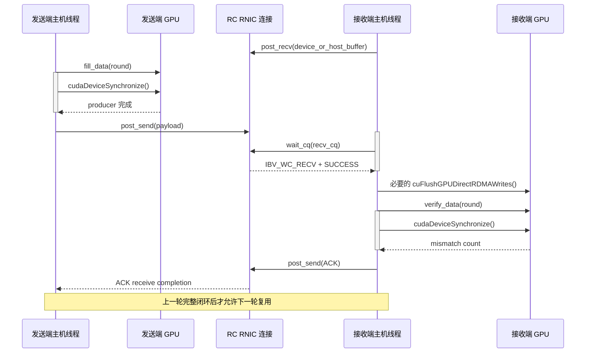
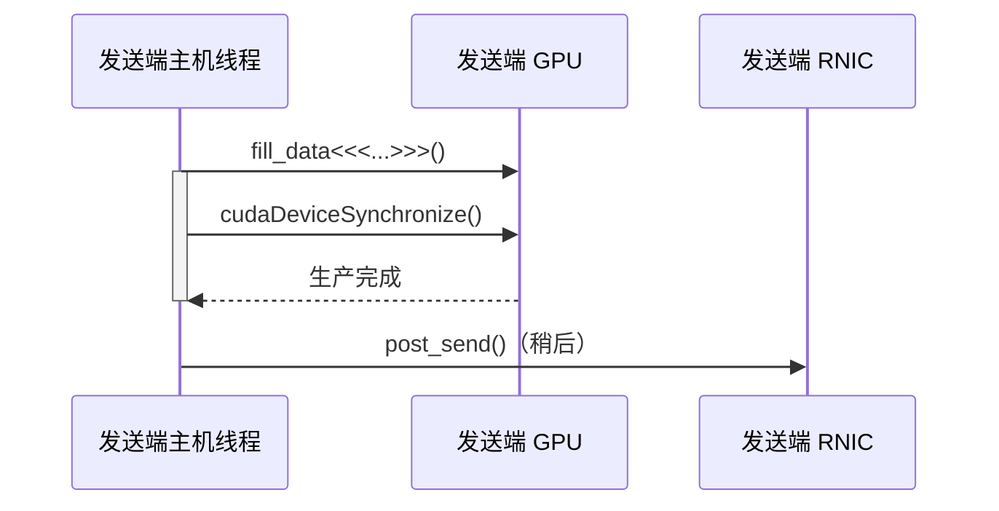
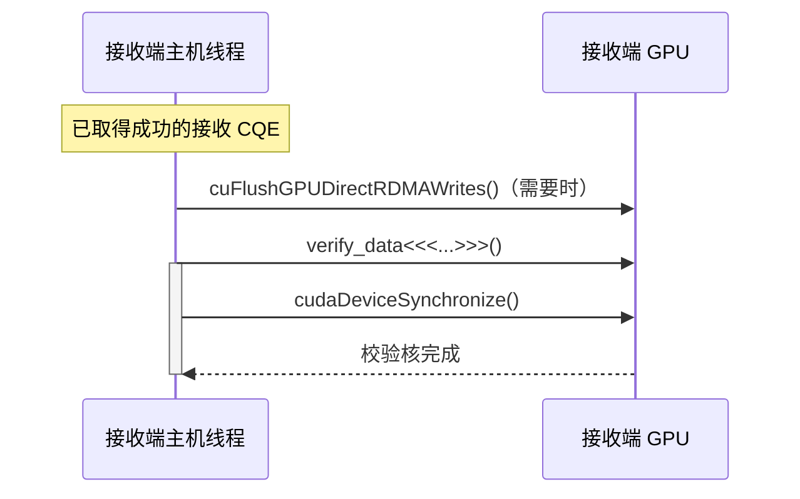
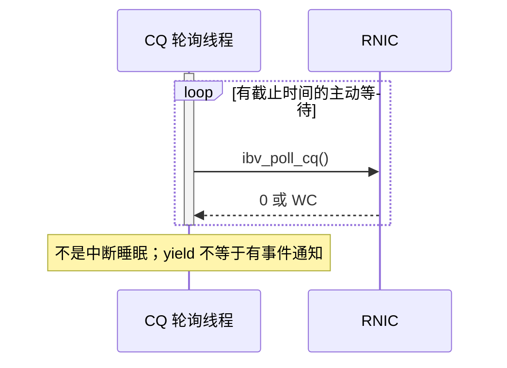
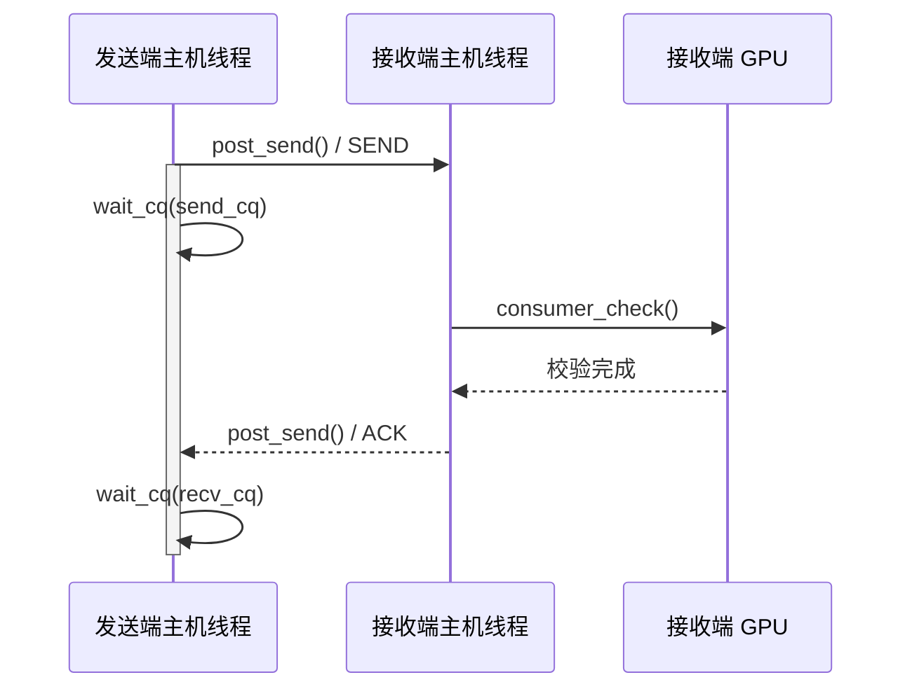
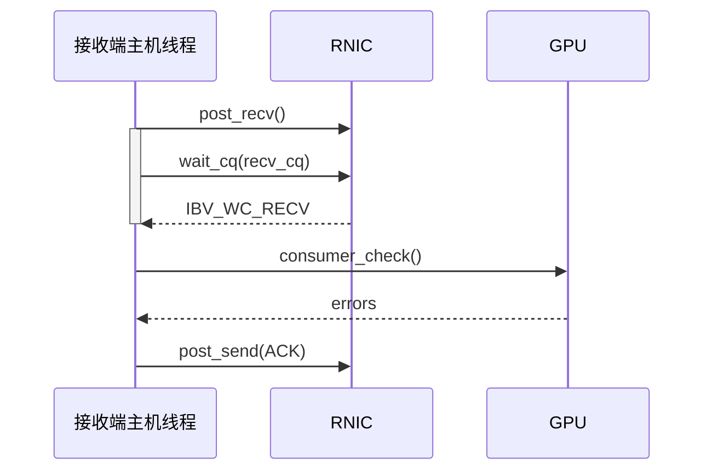

---
tags:
  - 高性能存储
  - AI-GPU-数据路径
  - GPUDirect-RDMA
  - CUDA
  - 内存可见性
aliases:
  - GPUDirect RDMA 注册与正确性实验
  - GPU MR 与 DMA-BUF
status: 已加强（硬件实验待执行）
updated: 2026-09-19
source_baseline: CUDA 12.8.1 / rdma-core v57.0
---

# GPUDirect RDMA

> **GPUDirect RDMA 不是“把普通 MR 示例的地址换成显存指针”。** 必须同时成立：这段 GPU allocation 可以被当前驱动导出或 pin；RNIC/provider 能注册该映射；生产与消费之间有明确的跨设备顺序；在途 DMA、MR 和 allocation 的生命周期相容。注册成功只回答其中一个问题。

本篇替换原笔记中“只差一个指针”“只有 peermem”“任意 CUDA API 都保证可见”“同一 switch 是唯一支持条件”等过强表述。保留原来的数据路径、资源账、队列和排障主线，将其落实成 **peer-memory / DMA-BUF 两条注册路径，以及一个 GPU→RNIC→GPU 的可执行正确性实验**。源码基线锁定 CUDA 12.8.1 和 rdma-core v57.0；不是声称它们是最新版本，也没有把所有新平台套进这一基线。[^gdr][^operator][^verbs]

> [!warning] 实验状态与适用范围
> 附录是完整的 CUDA C++17 程序，可从本 Markdown 提取后构建；本次环境没有 `nvcc`、NVIDIA GPU 或 RDMA 网卡，**未完成真实 CUDA 编译或双机执行，不提供虚构的带宽或 PASS 结果**。程序只覆盖 Linux、单 GPU/单 RC 连接、普通 device allocation、一个在途 payload、CPU 驱动 progress。它拒绝未知能力，而不自动降级。另一个笔记的 CPU 状态模型已实际运行，但不能替代这里的硬件验证。

## 1. GDR 删除了哪段搬运，又保留了什么

普通接收路径是 RNIC DMA 写入主机注册池，再由 CUDA H2D 复制到显存。直接接收路径把 RNIC DMA 的目标换成 GPU allocation，省掉 **payload 的 host staging**；WQE、CQE、控制消息和主机提交线程并不会随之消失。[[8.10 Host Device Memory 与 Pinned Memory]] 解释的是主机锁页，不能把它等同于显存注册。[^gdr]

| 路径 | payload 落点 | 额外资源 | 完成后谁能消费 |
|---|---|---|---|
| RNIC→host→GPU | 先 DRAM，再 HBM | host staging、H2D 队列 | H2D 完成并满足 CUDA 依赖后 |
| RNIC→GPU | 直接 GPU allocation | GPU 映射、MR、RNIC 翻译资源 | transport 完成并满足 GPU 可见性后 |
| GPU→host→RNIC | 先 D2H 再发送 | staging、主存带宽 | NIC 必须等 D2H 完成 |
| GPU→RNIC | NIC 读显存 | 注册源区、GPU→NIC 顺序 | NIC 必须等生产 GPU 完成 |

原笔记“存储节点先 `O_DIRECT` 读进主机池，再 WRITE 到客户端显存”的例子，**只绕开了客户端主机 payload 中转，服务端仍有 DRAM**。要说“远端盘到显存全链路无 host staging”，还必须证明存储端那一段也是直接路径，不能仅凭客户端启用 GDR 推导。

在简化的接收账本中，每个中转字节至少对应一次 NIC 对 DRAM 的写和一次 GPU 对 DRAM 的读；GDR 可移除这两次 staging 流量。实际测到的内存控制器流量还受缓存、一致性、平台实现和控制流影响，因此“0 字节主存流量”只能限定为 **payload 不经 host staging**，不能修饰整个进程。

## 2. 支持条件是一组交集，不是一条 `lsmod`

### 2.1 五道门

![[图片/SVG/8_8_8_12_1.svg|900]]

| 层 | 必须确认 | 不能据此直接推导 |
|---|---|---|
| GPU 与 allocation | 型号、驱动、device 属性、内存分配方式 | 有 CUDA/UVA 不等于支持任意 GPU MR |
| 导出/peer-memory | DMA-BUF exporter 或匹配的 peer-memory 栈 | 能导出 fd 不等于 RNIC 能 import |
| RNIC 与 provider | 内核驱动、用户态 provider、注册 API、固件 | 主机 MR 能注册不等于 GPU MR 能注册 |
| PCIe/平台 | peer DMA 路由、root complex、ACS/IOMMU、虚拟化边界 | `PIX` 不等于一定成功；`PHB` 也非必然失败 |
| 同步与生命周期 | production completion、receive completion、GPU visibility、drain | 一次成功传输不等于并发/复用也正确 |

NVIDIA GPU Operator 文档给出的 DMA-BUF 部署基线包括开放内核模块、CUDA 11.7 及以上、Linux 5.12 及以上和受支持的 GPU 类别，并推荐 DMA-BUF；legacy `nvidia-peermem` 是另一条部署路径。**这是该部署方案的兼容性表，不是跨所有操作系统、驱动和 GPU 的充分条件**。最终以目标组合的文档、能力查询和实际注册结果为准。[^operator]

### 2.2 拓扑应当优化，不能简单二分

NVIDIA 的传统 PCIe GDR 指南将仅经过 PCIe switch 的路径视为理想路径；经过 CPU/root complex 的路径可能可用但性能受限，跨 CPU 互连更不可靠。`PIX/PXB/PHB/SYS` 是拓扑诊断线索，不是通用的支持布尔值。原文“必须 PIX/PXB”“SYS 一定不成立”应改为 **核对受支持 peer path，优选更近的 GPU–NIC 配对，再实测**。[^gdr]

IOMMU 地址翻译、ACS 重定向、虚拟机直通与容器设备暴露都可能改变路径。不要在生产机上照抄“关闭 IOMMU/ACS”作为通用优化；先确认平台要求与隔离风险，再在受控环境验证。BAR1 大小、映射缓存和网卡资源需要分别监控，不能宣称所有数据中心 GPU 都能随意注册整卡显存。[^gdr]

以下命令收集的是环境证据，不会替你打开 GDR。`nvidia-smi topo -m` 与 `ibv_devinfo` 中的设备要能对应到同一套 PCIe/网卡命名；保存完整输出，不只保留一个“模块已加载”的截图。

```bash
nvidia-smi
nvidia-smi topo -m
nvidia-smi -q
uname -r
lsmod | grep -E 'nvidia|mlx5|ib_core'
ibv_devices
ibv_devinfo
rdma link
ulimit -l
```

这是静态核对脚本，没有多线程执行时序。还应保存 CUDA toolkit、驱动、内核、rdma-core/OFED、NIC 固件及 GPU/NIC PCIe BDF，作为可复现配置的一部分。`ulimit -l` 对 host MR 和进程配额仍有价值，不应因 payload 在 GPU 上就完全忽略。

## 3. 两条注册路径，两个不同的资源图

### 3.1 peer-memory：GPU allocation → pin/map → `ibv_reg_mr`

这条路径允许受支持的 GPU allocation 经 peer-memory provider 进入 RDMA 注册流程。用户态入口仍是 `ibv_reg_mr`，但**背后不再是普通主机匿名页的 pin 流程**。加载一个模块不等于分配器、GPU 驱动、RDMA 内核栈和 RNIC provider 已全部兼容。[^gdr][^operator]

顺序应是：创建 GPU context → 分配普通 device memory → 查询能力并设置所需同步属性 → 注册 → 持有 MR → 提交传输。`cudaMallocManaged`、`cudaMallocAsync` 的池化分配、外部导入内存和特殊 VMM allocation 都不能不加区分地塞进这段示例。尤其 managed memory 的迁移与副本一致性不符合传统 GDR 假设；本实验明确不用它。[^gdr]

### 3.2 DMA-BUF：显存导出 fd → `ibv_reg_dmabuf_mr`

这条路径显式把 allocation 的一个地址范围导出为本进程的 DMA-BUF fd，再让 RDMA 子系统注册这个 buffer。CUDA 12.8.1 的 `cuMemGetHandleForAddressRange` 要求地址和长度按 host page size 对齐，并要求所选范围已实际分配、映射且符合该接口的物理内存条件。应先查询 `CU_DEVICE_ATTRIBUTE_DMA_BUF_SUPPORTED`；底层映射改变后不能继续复用旧 handle。[^cuda-mem]

| 参数/资源 | 精确含义 | 常见错误 |
|---|---|---|
| CUDA `dptr` | 当前进程可访问的 device VA 范围 | 将 UVA 当成跨进程地址协议 |
| DMA-BUF `fd` | 本机内核对象的句柄 | 将 fd 数字发给远端，让远端当自己的 fd 用 |
| verbs `offset` | DMA-BUF 内的起点 | 与 CUDA VA 的低位不一致 |
| verbs `iova` | RNIC 通过 lkey/rkey 寻址的 MR 基址 | 假设它必须等于 CUDA VA |
| `length` | 此次注册范围 | 忽略边界、page offset 与 allocation 大小 |
| `lkey/rkey` | MR 权限/地址域的 key | 当成业务请求 identity 或永久授权 |

`ibv_reg_dmabuf_mr(pd, offset, length, iova, fd, access)` 要求 `iova` 与 `offset` 的页内偏移相同；它们不必具有同样的绝对数值。附录选择导出一个页对齐的子范围、`offset=0`、`iova=device_va`，让 SGE 仍可使用该 VA；这只是**显式选定的简化映射**。[^verbs]

### 3.3 三个生命周期，不能只写一个析构函数

allocation、fd/export、MR 是不同资源。正常关闭顺序是：停止新增操作 → 完成/停止所有相关 DMA 与 GPU 使用 → 注销 MR → 关闭 fd → 释放 allocation → 最后释放 PD/context 等父资源。fd 的精确引用语义依 exporter/importer 而定，本实验保守地保持它直到 MR 注销，不把“close 了 fd”当成取消在途 DMA。

注册缓存键至少要能区分 device/context、allocation identity、注册范围、权限和导出路径。只用 `(VA,length)` 会被地址复用击穿；NVIDIA 指南讨论了用 buffer ID 等信息识别 allocation 变化。缓存命中后也必须借用一个在途引用；失效先禁止新借用，再等待引用归零，不能一边 eviction 一边由网卡读写。[^gdr]

## 4. CUDA 同步与可见性：先区分方向，再找完成证据

![[图片/SVG/8_8_8_12_2.svg|900]]

### 4.1 GPU 生产 → NIC 读

当源数据由 CUDA kernel 或异步 D2D/H2D 操作产生，CPU 已经拿到指针并不代表 NIC 可以读取最终值。需要先完成 producer stream 的依赖，再提交 NIC 操作。保守实验使用 `cudaDeviceSynchronize()`；生产实现通常缩小到特定 stream/event，避免等待无关 GPU 工作。与 [[8.11 cudaMemcpy 与 CUDA Stream]] 的区别是：消费方换成了**不在 CUDA stream 内的 RNIC**。[^gdr]

`CU_POINTER_ATTRIBUTE_SYNC_MEMOPS` 使 allocation 的相关同步内存操作遵循更保守的一致性要求；它**不会把任意 kernel launch 或任意 Async API 自动变成同步操作**。它不是“注册后免同步”的开关，也不是等待远端传输的函数。[^gdr]

### 4.2 NIC 写 → GPU 消费

保守路径有三个独立条件：主机线程取得有效的 transport 完成证据；满足目标设备/映射路径所要求的写可见性；然后由满足该顺序的线程提交依赖 CUDA 工作。已经运行中的 kernel 不会因为 CPU 后来查询到 CQE 就自动重新获得正确顺序。[^gdr]

`cuFlushGPUDirectRDMAWrites(target, scope)` 可以在支持的平台上把此前远端写推进到指定 GPU 可见范围。设备的原生 `GPU_DIRECT_RDMA_WRITES_ORDERING` 已覆盖该范围时，调用可能是 no-op；否则要查询 `GPU_DIRECT_RDMA_FLUSH_WRITES_OPTIONS` 是否支持所选 flush 方式。附录只接受 **当前 GPU owner scope 原生有序，或支持 host flush** 的组合，不覆盖所有合法的高阶同步协议。[^cuda-device]

> [!important] flush 不等于网络等待
> 在包还没到之前调用 flush，不能让未来尚未发生的 DMA 凭空完成。先确认此次 receive/read/write-with-notification 对应的 transport completion，再做所需 visibility 操作，再提交 consumer。不同路径、不同设备的可见性范围也不能靠一个 CPU `atomic_thread_fence` 统一解决。

| 动作 | 可以建立/观察什么 | 不能替代什么 |
|---|---|---|
| producer stream/event 完成 | 源 GPU 工作的完成依赖 | RNIC 已发送、对端已接收 |
| 本地 SEND/WRITE CQE | 对应 opcode 的本地完成语义 | 对端应用 commit、对端任意运行 kernel 的可见性 |
| 接收 CQE | 已匹配的接收操作完成 | 目标 layout 正确、校验通过、全请求就绪 |
| `cuFlushGPUDirectRDMAWrites` | 支持范围内的远端写可见性 | 尚未到达的数据、全 rank barrier |
| `cudaEventRecord` | CUDA stream 内此前工作的顺序 | 自动等待外部 RDMA，或任意设备的 cache flush |
| GPU verify 完成后的 ACK | 本实验该轮 payload 已由 GPU 检查 | 可持久化、生产级故障恢复或全局事务提交 |

### 4.3 不要用普通 GPU 旗标轮询替换协议

一个已运行的 GPU kernel 自旋读取由 RNIC 写的 flag，牵涉到 GPU cache、compiler load、写顺序、notification 与内存域。`volatile`、CPU release/acquire 或“数据后面再写一个 1”本身都不是完整协议。GPU-initiated/GPU-resident networking 需要对应平台、指令或通信库提供的保证；本实验故意不采用它。[^gdr]

## 5. 最小实验：测正确性，不伪装成带宽基准

### 5.1 要证明的命题

发送 GPU 产生随 round 和 word index 变化的 1 MiB pattern；RNIC 将其传到接收缓冲；接收 GPU 执行 `verify_data`，逐 word 比较；主机只回读 mismatch 数，再发送 ACK。连续 32 轮复用同一 allocation 和 MR，能覆盖部分“上一轮数据仍在”的错误。

程序提供三种**显式模式**：`peer` 走已验证的 peer-memory GPU MR；`dmabuf` 走 GPU DMA-BUF MR；`host` 则由 GPU 生产后 D2H、主机 MR 传输、接收 H2D 再 GPU 校验。GPU 模式注册失败立即退出，不自动转 host，因此不会把 fallback 成功误记成 GDR 成功。

### 5.2 为什么先使用 SEND/RECV

GDR 描述的是 RNIC 能否访问 GPU memory，不限定只能使用 one-sided WRITE。此处先用 RC SEND/RECV，让接收端得到明确的 `IBV_WC_RECV`，减少“发送端 CQE 怎样通知接收端”的额外协议变量。**这仍是 GPU memory 的 RDMA verbs 实验，但不是 one-sided rkey/远端 commit 测试**。MR 只开 `IBV_ACCESS_LOCAL_WRITE`；没有给远端多余 READ/WRITE 权限。[^verbs]

![[图片/SVG/8_8_8_12_3.svg|900]]

实验的严格顺序如下。等待区间不可省，ACK 表示的是 consumer 验证完成，而不是 WQE 已经入队。



### 5.3 构建和运行

附录 A 的 C++ 代码块带有 `// GDR-LAB:` 标记。以下脚本只提取这些块，避免把说明性命令或 Mermaid 混进编译文件。提取与构建是本地操作；`CUDA_HOME` 必须指向实际安装的 CUDA 12.8.1 环境，并且系统有对应 RDMA 开发头文件/库。

```bash
python3 - <<'PYCODE'
from pathlib import Path
import re
p = Path('8.12 GPUDirect RDMA.md')
blocks = re.findall(r'```cpp\n(.*?)\n```', p.read_text(encoding='utf-8'), re.S)
code = '\n\n'.join(b for b in blocks if b.startswith('// GDR-LAB:'))
assert 'int main(' in code
Path('gdr_check.cu').write_text(code + '\n', encoding='utf-8')
PYCODE
export CUDA_HOME=/usr/local/cuda-12.8
"$CUDA_HOME/bin/nvcc" -std=c++17 -O2 gdr_check.cu -o gdr_check \
  -Xcompiler=-pthread -I/usr/include -L"$CUDA_HOME/lib64" \
  -lcuda -libverbs -lrdmacm
```

两机都运行同一份程序。示例 `192.0.2.10` 是文档占位地址，替换为接收端 **RDMA-capable 网络接口** 的真实 IP；IP 连接建立依赖实际 RDMA 路由，不是仅能 TCP ping 通就够。GPU 序号分别按每台机器的本地编号填写。先启动接收端，再启动发送端；外层 `timeout` 也为同步 CM 的 listen/connect 等待设上限。

```bash
# 接收端机器；把地址替换成该机器的 RDMA 网络 IP。
timeout 120s ./gdr_check server 192.0.2.10 7471 0 dmabuf
# 发送端机器；地址仍然是接收端的 RDMA 网络 IP。
timeout 120s ./gdr_check client 192.0.2.10 7471 0 dmabuf
```

成功判据不是单个 `REG_OK`：两个进程都必须以状态码 0 退出，两端均打印预期 route，所有 WC 状态、opcode、length 和 wr_id 检查通过，并各自出现 `PASS ... rounds=32`。这些是**待实机验证的期望输出**，不是本次执行记录。同步 connect/accept 属于主机等待；数据 transfer 后的等待关系见上一张时序图。[^cm]

重新启动两个进程，把最后一个参数同时换成 `host` 做 staging 对照；只有目标环境确实具备 peer-memory 路径时再使用 `peer`。二者不是 DMA-BUF 失败后的自动重试。

### 5.4 必须运行的负例

开启 `CORRUPT` 会在发送端第二轮翻转一个 word 的一位，而接收端仍按正确 pattern 校验。期望接收端 mismatch 非零、发送端收到失败 ACK，两端非零退出。这个负例证明校验路径确实在工作，不仅仅证明连接建立。

```bash
# 先重新启动一个未设置 CORRUPT 的接收端。
# 然后在发送端执行；预期失败，不应出现最终 PASS。
CORRUPT=1 timeout 120s ./gdr_check client 192.0.2.10 7471 0 dmabuf
```

进一步在隔离环境测试：错误的接收 IP/不可用 GPU、未支持的注册模式、发送中断开连接、缩小 memlock 导致 host MR 失败。不要通过释放仍在途的真实 GPU buffer 制造 use-after-free；取消/地址复用的危险 interleaving 先用 [[8.16 PD 分离（Prefill-Decode Disaggregation）下的 KV Cache 网络传输架构]] 的 CPU 状态模型验证，再设计受控硬件 fault injection。

### 5.5 如何扩展为 one-sided WRITE

下一步不是把 `IBV_WR_SEND` 改一个枚举就结束。目标 MR 需合适的 REMOTE_WRITE 权限，目标需发布 `address/rkey/length` 与业务 epoch；源收到 descriptor 后检查边界，再提交 WRITE。目标还需要一个完成通知，例如同一 RC QP 上的 WRITE_WITH_IMM，并预先提供必要 RQ credit；普通 WRITE 不消耗 payload receive WQE，也不自动产生目标 receive CQE。多 QP/multi-rail 则还需聚合所有相关操作，不能把某一个 QP 的尾通知当成全局 barrier。[^verbs]

即使已经有目标通知，仍必须执行本篇第 4 节的 GPU 可见性与 consumer 依赖。要测远端权限撤销、旧 rkey 与取消，另加独立 state machine；不要让这份单连接最小实验背负尚未实现的生产承诺。

## 6. 并发与背压：资源上限要对应具体 opcode

| 资源 | 对应限制 | 应监控/拒绝的条件 |
|---|---|---|
| 接收 WQE/credit | SEND、WRITE_WITH_IMM 等的接收通知路径 | RNR、RQ 水位、未补回 receive |
| READ 在途资源 | RDMA READ/Atomic 相关的 initiator/responder 限制 | 读并发受限；不能当作所有 WRITE 的通用阀门 |
| SQ/CQ | WQE、完成处理与轮询预算 | post 失败、poll 滞后、CQ 溢出风险 |
| GPU MR 池 | allocation、映射、注册缓存、在途引用 | 池空后等待/拒绝；不在请求关键路径反复注册 |
| host staging | 锁页与 D2H/H2D 进度 | 显存有空但 staging 已满 |
| GPU consumer | 可见性、ingest 和计算 stream | transport 已完成但消费排队 |

Little 定律是稳定系统的均值恒等式 `L = λW`，不能由“固定 L，λ 上升”直接推出 W 上升；那样代数方向反了。过载时延迟增加的原因是服务能力不足以匹配实际到达过程、队列积累及排队分布变化。**有界池的价值是限制并发占用并把压力显式反馈，而不是凭 Little 定律保证低延迟。**

生产系统可以让提交与 progress 线程分离，但必须明确谁持有 buffer lease、谁处理 CQ、何时把 completion 交给 CUDA 提交线程。注册缓存引用应覆盖最后一个相关 WR，而不是仅覆盖 `post_send()` 的函数调用时间。

## 7. 排障：成功注册、成功传输、正确消费是三个测试层次

| 症状 | 优先检查 | 证据/反证 |
|---|---|---|
| host 成功，GPU MR 失败 | exporter/peer-memory/provider/GPU allocation | 打印 route、CUDA 错误、errno；不静默切换 |
| DMA-BUF export 成功，verbs import 失败 | RNIC import、offset/iova、权限/驱动组合 | fd 存在不等于 GDR MR 成立 |
| 小段能注册、大段失败 | BAR/映射、RNIC 表项、配额和碎片 | 保存量级扫描，不先断言“只能是 BAR1” |
| SEND 卡住或 RNR | 接收是否先 post、QP/网络、有限重试 | 本例第一轮在 accept 前 post receive |
| transport 正常，GPU mismatch | producer 同步、接收可见性、地址/长度、复用 | 按方向定位；不是只看 `cudaDeviceSynchronize` 是否出现 |
| 第一轮正确，后续旧数据 | lease/round 标识、复用过早、缓存身份 | 改变每轮 pattern，重复注册/地址复用另测 |
| 只有带宽低 | GPU–NIC 路径、PCIe、NUMA、WR 深度、消息大小 | 正确性程序有整卡同步和 ACK，不应拿它测峰值 |
| 存在 host 流量 | 控制面与 staging 区分 | CQE/ACK 流量不等于 payload fallback |

验证顺序建议固定为：host 功能 → 明确选定的 GPU 注册路径 → GPU payload 正/负例 → 复用与错误关闭 → 多在途 → 性能 sweep。这样才不会把平台不支持、协议错误和单纯没有足够并发混在一起。

## 8. 与 PD KV 传输的接口

GDR 层只能接收“哪些已注册字节要传”，它不知道 block 代表多少 token、属于哪个 TP rank，也不知道 request 是否已经取消。上层必须给它带生命周期的 descriptor，而不是可永久复用的裸地址。[[8.14 分层缓存与 KV Cache 生命周期]] 中的 allocation/prefix 生命周期，在跨节点场景还要加上在途 DMA 的物理占用约束。

下一个落点是 [[8.16 PD 分离（Prefill-Decode Disaggregation）下的 KV Cache 网络传输架构]]：block 的逻辑顺序决定 descriptor 配对；rank/head 切分决定地址范围；transport 完成之后还有 layout/visibility 和全 rank 发布；取消必须先隔离在途区域，再回收空间。GDR 省掉 staging，不省掉这些正确性条件。

## 附录 A. 完整 CUDA C++17 实验源码

各段按顺序拼接就是 `gdr_check.cu`，不是互相独立的小程序。资源所有权使用 RAII；结构体中的 `device/wire` 是借用视图，不负责释放。错误路径停止 QP，MR 注销失败则 fail-stop，避免继续释放仍可能被注册的 allocation。这个策略用于最小实验，不代表生产系统的恢复策略。

### A.1 头文件与固定实验边界

固定 1 MiB 和 32 轮，避免两端命令行长度不一致造成误诊；编译时同时链接 CUDA driver/runtime 与 RDMA 库。

```cpp
// GDR-LAB: 01
// Teaching baseline: CUDA 12.8.1 + rdma-core v57.0; Linux, RC SEND/RECV.
// GPU/RNIC execution has NOT been performed by the note author.
#include <cuda.h>
#include <cuda_runtime.h>
#include <rdma/rdma_cma.h>
#include <infiniband/verbs.h>
#include <arpa/inet.h>
#include <unistd.h>
#include <array>
#include <chrono>
#include <cstdint>
#include <cstdlib>
#include <iostream>
#include <memory>
#include <stdexcept>
#include <string>
#include <system_error>
#include <thread>
#include <utility>
#include <cerrno>
constexpr std::size_t BYTES = 1024 * 1024;
constexpr unsigned WORDS = BYTES / sizeof(std::uint32_t);
constexpr unsigned ROUNDS = 32;
```

### A.2 区分 CUDA、系统调用与 verbs 错误

verbs 的返回值常常就是错误码，而系统调用依赖 errno；混用会把真正的失败原因丢掉。失败不触发隐式 fallback。

```cpp
// GDR-LAB: 02
void ck(cudaError_t e) {
    if (e != cudaSuccess) throw std::runtime_error(cudaGetErrorString(e));
}
void cu(CUresult e) {
    if (e == CUDA_SUCCESS) return;
    const char* text = nullptr;
    cuGetErrorString(e, &text);
    throw std::runtime_error(text ? text : "CUDA driver error");
}
void sys(int rc, const char* name) {
    if (rc != 0) throw std::system_error(errno, std::generic_category(), name);
}
void verb(int rc, const char* name) {
    if (rc != 0) throw std::system_error(rc, std::generic_category(), name);
}
int attr(CUdevice d, CUdevice_attribute a) {
    int value = 0;
    cu(cuDeviceGetAttribute(&value, a, d));
    return value;
}
```

### A.3 所有权与失败即停止

GPU allocation、host allocation、MR 与 endpoint 有不同释放函数。尤其 MR 注销失败不能继续 free backing memory。

```cpp
// GDR-LAB: 03
struct EndpFree { void operator()(rdma_cm_id* p) const {
    if (p) rdma_destroy_ep(p);
}};
struct GpuFree { void operator()(void* p) const { if (p) cudaFree(p); } };
struct HostFree { void operator()(void* p) const { if (p) cudaFreeHost(p); } };
struct MrFree { void operator()(ibv_mr* p) const {
    if (p && ibv_dereg_mr(p) != 0) std::terminate();
}};
using Endp = std::unique_ptr<rdma_cm_id, EndpFree>;
using Gpu = std::unique_ptr<void, GpuFree>;
using Host = std::unique_ptr<void, HostFree>;
using Mr = std::unique_ptr<ibv_mr, MrFree>;
struct Fd {
    int value = -1;
    ~Fd() { if (value >= 0) ::close(value); }
    Fd() = default;
    Fd(const Fd&) = delete;
    Fd& operator=(const Fd&) = delete;
};
Gpu gpu_alloc(std::size_t n) {
    void* p = nullptr; ck(cudaMalloc(&p, n)); return Gpu(p);
}
Host host_alloc(std::size_t n) {
    void* p = nullptr; ck(cudaMallocHost(&p, n)); return Host(p);
}
```

### A.4 资源父子关系与关闭顺序

Session 首先停止本 QP，再由成员逆序销毁 MR、fd 和 backing allocation；endpoint 最后销毁，使 PD 不早于 MR 失效。

```cpp
// GDR-LAB: 04
struct Session {
    Endp ep;
    Gpu allocation;
    Host staging;
    Host ack;
    Fd fd;
    Mr data_mr;
    Mr ack_mr;
    Gpu error_count;
    void* device = nullptr;    // Borrowed aligned view, not an owner.
    void* wire = nullptr;      // Borrowed GPU view or pinned host view.
    bool host_mode = false;
    bool flush_needed = false;
    explicit Session(rdma_cm_id* p) : ep(p) {}
    ~Session() {
        (void)cudaDeviceSynchronize();
        // Normal path: all WRs completed. Error path: stop this QP first.
        if (ep && ep->qp) rdma_destroy_qp(ep.get());
    }
};
Mr checked_mr(ibv_mr* p) {
    if (!p) throw std::system_error(errno, std::generic_category(), "register MR");
    return Mr(p);
}
```

### A.5 能力查询不是支持的猜测

打印真实 NIC、driver、ordering 与 flush bits，并让这个保守实验拒绝它不理解的可见性组合。host 对照不要求 GDR 属性。

```cpp
// GDR-LAB: 05
void check_capabilities(Session& s, const std::string& mode) {
    CUdevice dev;
    cu(cuCtxGetDevice(&dev));
    int driver = 0; cu(cuDriverGetVersion(&driver));
    std::cout << "driver=" << driver << " gpu=" << dev
              << " nic=" << ibv_get_device_name(s.ep->verbs->device)
              << " mode=" << mode << '\n';
    if (mode == "host") return;
    if (!attr(dev, CU_DEVICE_ATTRIBUTE_GPU_DIRECT_RDMA_SUPPORTED))
        throw std::runtime_error("GPU reports no GPUDirect RDMA support");
    int ordering = attr(dev, CU_DEVICE_ATTRIBUTE_GPU_DIRECT_RDMA_WRITES_ORDERING);
    int options = attr(dev, CU_DEVICE_ATTRIBUTE_GPU_DIRECT_RDMA_FLUSH_WRITES_OPTIONS);
    s.flush_needed = ordering < CU_GPU_DIRECT_RDMA_WRITES_ORDERING_OWNER;
    std::cout << "ordering=" << ordering << " flush_options=" << options << '\n';
    if (s.flush_needed && !(options & CU_FLUSH_GPU_DIRECT_RDMA_WRITES_OPTION_HOST))
        throw std::runtime_error("this strict experiment needs native owner ordering or host flush");
    if (mode == "dmabuf" && !attr(dev, CU_DEVICE_ATTRIBUTE_DMA_BUF_SUPPORTED))
        throw std::runtime_error("DMA-BUF export not supported");
}
```

### A.6 分配与对齐

只使用普通 device allocation；对齐后的指针是借用视图。SYNC_MEMOPS 不取代后续显式 producer/consumer 同步。

```cpp
// GDR-LAB: 06
void prepare_memory(Session& s, const std::string& mode) {
    s.host_mode = mode == "host";
    check_capabilities(s, mode);
    long page_result = sysconf(_SC_PAGESIZE);
    if (page_result <= 0) throw std::runtime_error("cannot get host page size");
    auto page = static_cast<std::uintptr_t>(page_result);
    if (BYTES % page != 0) throw std::runtime_error("BYTES must be page aligned");
    s.allocation = gpu_alloc(BYTES + page);
    auto raw = reinterpret_cast<std::uintptr_t>(s.allocation.get());
    auto aligned = ((raw + page - 1) / page) * page;
    s.device = reinterpret_cast<void*>(aligned);
    s.wire = s.device;
    if (!s.host_mode) {
        unsigned enabled = 1;
        cu(cuPointerSetAttribute(&enabled, CU_POINTER_ATTRIBUTE_SYNC_MEMOPS,
                                static_cast<CUdeviceptr>(raw)));
    } else {
        s.staging = host_alloc(BYTES);
        s.wire = s.staging.get();
    }
    s.ack = host_alloc(2 * sizeof(std::uint32_t));
    s.error_count = gpu_alloc(sizeof(unsigned));
    ck(cudaMemset(s.device, 0xA5, BYTES));
    ck(cudaDeviceSynchronize());
}
```

### A.7 实际注册两条路径

DMA-BUF 使用显式 export/import；peer 模式才允许 GPU 指针进入 ibv_reg_mr。只开 SEND/RECV 所需权限，注册失败立即退出。

```cpp
// GDR-LAB: 07
void register_memory(Session& s, const std::string& mode) {
    constexpr int access = IBV_ACCESS_LOCAL_WRITE; // SEND/RECV only.
    if (mode == "dmabuf") {
        auto address = static_cast<CUdeviceptr>(reinterpret_cast<std::uintptr_t>(s.device));
        cu(cuMemGetHandleForAddressRange(&s.fd.value, address, BYTES,
                 CU_MEM_RANGE_HANDLE_TYPE_DMA_BUF_FD, CU_MEM_RANGE_FLAG_DMA_BUF_MAPPING_TYPE_PCIE));
        s.data_mr = checked_mr(ibv_reg_dmabuf_mr(s.ep->pd, 0, BYTES,
                 address, s.fd.value, access));
    } else {
        // GPU pointer here is legal ONLY on the explicitly selected peer route.
        s.data_mr = checked_mr(ibv_reg_mr(s.ep->pd, s.wire, BYTES, access));
    }
    s.ack_mr = checked_mr(ibv_reg_mr(s.ep->pd, s.ack.get(),
                                  2 * sizeof(std::uint32_t), access));
    std::cout << "REG_OK route=" << mode << " bytes=" << BYTES << '\n';
}
```

### A.8 GPU 生产与逐 word 模式

pattern 同时依赖 round 和 index，可以识别旧轮次与错位置；CORRUPT 负例故意只改一位。NIC 读取前必须等 GPU 生产完成。

```cpp
// GDR-LAB: 08
__host__ __device__ std::uint32_t pattern(unsigned round, unsigned index) {
    return 0x9e3779b9u * (index + 1u) ^ (0x85ebca6bu * (round + 1u));
}
__global__ void fill_data(std::uint32_t* p, unsigned round, bool corrupt) {
    unsigned i = blockIdx.x * blockDim.x + threadIdx.x;
    if (i < WORDS) p[i] = pattern(round, i) ^ ((corrupt && i == 17u) ? 1u : 0u);
}
__global__ void verify_data(const std::uint32_t* p, unsigned round, unsigned* errors) {
    unsigned i = blockIdx.x * blockDim.x + threadIdx.x;
    if (i < WORDS && p[i] != pattern(round, i)) atomicAdd(errors, 1u);
}
void producer_ready(Session& s, unsigned round, bool corrupt) {
    fill_data<<<(WORDS + 255) / 256, 256>>>(
        static_cast<std::uint32_t*>(s.device), round, corrupt);
    ck(cudaGetLastError());
    ck(cudaDeviceSynchronize()); // Producer GPU work is complete BEFORE NIC reads.
    if (s.host_mode) ck(cudaMemcpy(s.wire, s.device, BYTES, cudaMemcpyDeviceToHost));
}
```



图中等待边界是必要依赖；不能用“函数已经返回/已经提交”替换对应的完成条件。

### A.9 接收后的 GPU 校验

调用者已经取得本轮接收 CQE；native ordering 不足时执行 host flush，再由 GPU 校验。只回读错误计数，不能用纯 CPU 检查替代 GPU 可见性检查。

```cpp
// GDR-LAB: 09
unsigned consumer_check(Session& s, unsigned round) {
    if (s.host_mode) {
        ck(cudaMemcpy(s.device, s.wire, BYTES, cudaMemcpyHostToDevice));
    } else if (s.flush_needed) {
        cu(cuFlushGPUDirectRDMAWrites(CU_FLUSH_GPU_DIRECT_RDMA_WRITES_TARGET_CURRENT_CTX,
                                    CU_FLUSH_GPU_DIRECT_RDMA_WRITES_TO_OWNER));
    }
    ck(cudaMemset(s.error_count.get(), 0, sizeof(unsigned)));
    verify_data<<<(WORDS + 255) / 256, 256>>>(
        static_cast<const std::uint32_t*>(s.device), round,
        static_cast<unsigned*>(s.error_count.get()));
    ck(cudaGetLastError());
    ck(cudaDeviceSynchronize());
    unsigned errors = 0;
    ck(cudaMemcpy(&errors, s.error_count.get(), sizeof(errors), cudaMemcpyDeviceToHost));
    return errors;
}
```



图中等待边界是必要依赖；不能用“函数已经返回/已经提交”替换对应的完成条件。

### A.10 提交单 SGE

不启用 IBV_SEND_INLINE，避免 provider 用 CPU 直接读取 GPU payload；SGE 指向已注册区域且 wr_id 对应本轮操作。

```cpp
// GDR-LAB: 10
void post_recv(Session& s, void* p, unsigned n, ibv_mr* mr, std::uint64_t tag) {
    ibv_sge sg{}; sg.addr = reinterpret_cast<std::uintptr_t>(p);
    sg.length = n; sg.lkey = mr->lkey;
    ibv_recv_wr wr{}; wr.wr_id = tag; wr.sg_list = &sg; wr.num_sge = 1;
    ibv_recv_wr* bad = nullptr;
    verb(ibv_post_recv(s.ep->qp, &wr, &bad), "ibv_post_recv");
}
void post_send(Session& s, void* p, unsigned n, ibv_mr* mr, std::uint64_t tag) {
    ibv_sge sg{}; sg.addr = reinterpret_cast<std::uintptr_t>(p);
    sg.length = n; sg.lkey = mr->lkey;
    ibv_send_wr wr{}; wr.wr_id = tag; wr.sg_list = &sg; wr.num_sge = 1;
    wr.opcode = IBV_WR_SEND; wr.send_flags = IBV_SEND_SIGNALED;
    ibv_send_wr* bad = nullptr;
    verb(ibv_post_send(s.ep->qp, &wr, &bad), "ibv_post_send");
}
```

### A.11 有截止时间的完成轮询

同时验证 WC status、opcode、wr_id 和接收长度，防止把无关 CQE 当成本轮完成；yield 是主动等待策略，不是中断事件。

```cpp
// GDR-LAB: 11
void wait_cq(ibv_cq* cq, std::uint64_t tag, ibv_wc_opcode opcode, unsigned bytes) {
    auto until = std::chrono::steady_clock::now() + std::chrono::seconds(10);
    while (std::chrono::steady_clock::now() < until) {
        ibv_wc wc{};
        int n = ibv_poll_cq(cq, 1, &wc);
        if (n < 0) throw std::runtime_error("ibv_poll_cq failed");
        if (n == 0) { std::this_thread::yield(); continue; }
        if (wc.status != IBV_WC_SUCCESS)
            throw std::runtime_error(ibv_wc_status_str(wc.status));
        if (wc.wr_id != tag || wc.opcode != opcode)
            throw std::runtime_error("unexpected completion identity/opcode");
        if (opcode == IBV_WC_RECV && wc.byte_len != bytes)
            throw std::runtime_error("receive length mismatch");
        return;
    }
    throw std::runtime_error("CQ deadline exceeded");
}
```



图中等待边界是必要依赖；不能用“函数已经返回/已经提交”替换对应的完成条件。

### A.12 发送端的复用屏障

本地 SEND 完成之后仍等接收端校验 ACK；这比最低 transport 复用要求更严格，是为了让每轮实验结果可归因。

```cpp
// GDR-LAB: 12
void run_sender(Session& s, bool inject) {
    for (unsigned r = 1; r <= ROUNDS; ++r) {
        post_recv(s, s.ack.get(), 8, s.ack_mr.get(), 2 * r + 1);
        producer_ready(s, r, inject && r == 2);
        post_send(s, s.wire, BYTES, s.data_mr.get(), 2 * r);
        wait_cq(s.ep->send_cq, 2 * r, IBV_WC_SEND, 0);
        wait_cq(s.ep->recv_cq, 2 * r + 1, IBV_WC_RECV, 8);
        auto* a = static_cast<std::uint32_t*>(s.ack.get());
        if (ntohl(a[0]) != r || ntohl(a[1]) != 0)
            throw std::runtime_error("GPU verification ACK failed");
    }
    std::cout << "PASS sender rounds=" << ROUNDS << '\n';
}
```



图中等待边界是必要依赖；不能用“函数已经返回/已经提交”替换对应的完成条件。

### A.13 接收端的验证与 ACK

ACK 必须在 verify kernel 完成以后发送；校验失败也先通知发送端，再以失败结束，避免发送端无谓等待到截止时间。

```cpp
// GDR-LAB: 13
void run_receiver(Session& s) {
    for (unsigned r = 1; r <= ROUNDS; ++r) {
        // Round 1 was posted before accepting the connection.
        if (r > 1) post_recv(s, s.wire, BYTES, s.data_mr.get(), 2 * r);
        wait_cq(s.ep->recv_cq, 2 * r, IBV_WC_RECV, BYTES);
        unsigned errors = consumer_check(s, r);
        auto* a = static_cast<std::uint32_t*>(s.ack.get());
        a[0] = htonl(r); a[1] = htonl(errors);
        post_send(s, s.ack.get(), 8, s.ack_mr.get(), 2 * r + 1);
        wait_cq(s.ep->send_cq, 2 * r + 1, IBV_WC_SEND, 0);
        if (errors) throw std::runtime_error("GPU payload mismatch: " + std::to_string(errors));
    }
    std::cout << "PASS receiver rounds=" << ROUNDS << '\n';
}
```



图中等待边界是必要依赖；不能用“函数已经返回/已经提交”替换对应的完成条件。

### A.14 同步 CM 建立连接

rdma_create_ep 用路由找到实际 RDMA 设备；服务端继承 QP 属性。外层 timeout 约束没有内部 deadline 的建连等待。

```cpp
// GDR-LAB: 14
Endp make_endpoint(bool server, char* ip, char* port) {
    rdma_addrinfo hints{}; hints.ai_port_space = RDMA_PS_TCP;
    hints.ai_qp_type = IBV_QPT_RC; hints.ai_flags = server ? RAI_PASSIVE : 0;
    rdma_addrinfo* raw = nullptr;
    int result = rdma_getaddrinfo(ip, port, &hints, &raw);
    if (result != 0) throw std::runtime_error("rdma_getaddrinfo failed: " + std::to_string(result));
    auto info = std::unique_ptr<rdma_addrinfo, decltype(&rdma_freeaddrinfo)>(raw, rdma_freeaddrinfo);
    ibv_qp_init_attr qa{}; qa.qp_type = IBV_QPT_RC;
    qa.cap.max_send_wr = 4; qa.cap.max_recv_wr = 4;
    qa.cap.max_send_sge = 1; qa.cap.max_recv_sge = 1;
    rdma_cm_id* id = nullptr;
    sys(rdma_create_ep(&id, info.get(), nullptr, &qa), "rdma_create_ep");
    return Endp(id);
}
```

### A.15 连接、运行与最终回收

服务端在 accept 前预贴第一轮 receive；其余轮次由有界 RNR 重试衔接。成功与失败都通过 Session 关闭本地资源。（同一逻辑段续接，提取时保持顺序。）

```cpp
// GDR-LAB: 15
int main(int argc, char** argv) {
    try {
        if (argc != 6) throw std::runtime_error("usage: gdr_check server|client IP PORT GPU peer|dmabuf|host");
        std::string role = argv[1], mode = argv[5];
        if (role != "server" && role != "client") throw std::runtime_error("bad role");
        if (mode != "peer" && mode != "dmabuf" && mode != "host") throw std::runtime_error("bad mode");
        cu(cuInit(0)); ck(cudaSetDevice(std::stoi(argv[4]))); ck(cudaFree(nullptr));
        bool server = role == "server";
        Endp ep = make_endpoint(server, argv[2], argv[3]);
        Endp listener;
        if (server) {
            listener = std::move(ep);
            sys(rdma_listen(listener.get(), 1), "rdma_listen");
            rdma_cm_id* child = nullptr;
            sys(rdma_get_request(listener.get(), &child), "rdma_get_request");
            ep.reset(child);
        }
        Session s(ep.release());
        prepare_memory(s, mode); register_memory(s, mode);
        rdma_conn_param cp{}; cp.retry_count = 3; cp.rnr_retry_count = 3;
        if (server) {
            post_recv(s, s.wire, BYTES, s.data_mr.get(), 2);
            sys(rdma_accept(s.ep.get(), &cp), "rdma_accept");
            run_receiver(s);
        } else {
            sys(rdma_connect(s.ep.get(), &cp), "rdma_connect");
            run_sender(s, std::getenv("CORRUPT") != nullptr);
        }
```

### A.16 连接、运行与最终回收

服务端在 accept 前预贴第一轮 receive；其余轮次由有界 RNR 重试衔接。成功与失败都通过 Session 关闭本地资源。

```cpp
// GDR-LAB: 16
        (void)rdma_disconnect(s.ep.get()); // Peer may already be disconnected.
        return 0;
    } catch (const std::exception& e) { std::cerr << "FAIL: " << e.what() << '\n'; return 1; }
}
```


## 参考资料与版本

[^gdr]: NVIDIA, GPUDirect RDMA Documentation，重点为 GPU memory pinning、registration cache、PCIe topology、SYNC_MEMOPS 和 synchronization/memory ordering；在线文档访问于 2026-09-19。<https://docs.nvidia.com/cuda/gpudirect-rdma/index.html>。动态文档并非本实验构建版本。
[^operator]: NVIDIA GPU Operator, GPUDirect RDMA，DMA-BUF 与 legacy peer-memory 支持矩阵；访问于 2026-09-19。<https://docs.nvidia.com/datacenter/cloud-native/gpu-operator/latest/gpu-operator-rdma.html>。
[^cuda-mem]: NVIDIA CUDA Driver API **12.8.1**, Memory Management，`cuMemGetHandleForAddressRange` 的对齐、handle 类型与映射要求。<https://docs.nvidia.com/cuda/archive/12.8.1/cuda-driver-api/group__CUDA__MEM.html>。
[^cuda-device]: NVIDIA CUDA Driver API, Device Management，`cuFlushGPUDirectRDMAWrites` 的 scope、支持位与原生 ordering；实验使用 CUDA 12.8.1 中同名 API/枚举。<https://docs.nvidia.com/cuda/cuda-driver-api/group__CUDA__DEVICE.html>。相关枚举：<https://docs.nvidia.com/cuda/cuda-driver-api/group__CUDA__TYPES.html>。
[^verbs]: linux-rdma/rdma-core **v57.0**, `libibverbs/man/ibv_reg_mr.3`，MR 权限、DMA-BUF offset/iova 与完成语义。<https://github.com/linux-rdma/rdma-core/blob/v57.0/libibverbs/man/ibv_reg_mr.3>。
[^cm]: linux-rdma/rdma-core **v57.0**, `librdmacm/man/rdma_get_request.3`，同步连接等待及监听端 QP 属性继承。<https://github.com/linux-rdma/rdma-core/blob/v57.0/librdmacm/man/rdma_get_request.3>。

本次加强的仓库基线为 `495229520/obsidian_notes@0c03bd4d883c123ff00310740c420d66d3093051`，原文件 blob 为 `ebd4866dbf95f400333a1417da574ddb4005baf5`。原有过强结论在正文中纠正，没有把它们当作当前事实保留。
