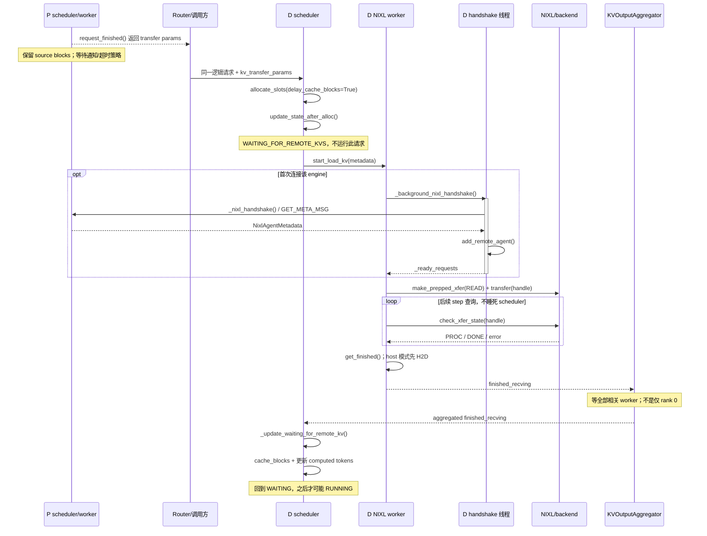

---
tags:
  - 高性能存储
  - AI-GPU-数据路径
  - LLM-Inference
  - KV-Cache
  - RDMA
  - PD-Disaggregation
  - vLLM
  - NIXL
aliases:
  - Prefill Decode Disaggregation
  - P/D 分离
  - KV Cache Transfer
  - vLLM NixlConnector 完整路径
status: 已加强（CPU 模型已验证，框架硬件集成待验证）
updated: 2026-09-19
framework_baseline: vLLM v0.11.0
framework_commit: b8b302cde434df8c9289a2b465406b47ebab1c2d
---

# PD 分离（Prefill-Decode Disaggregation）下的 KV Cache 网络传输架构

> **把 Prefill 算出的 KV 交给 Decode，至少有六个问题：block 对不对、rank 对不对、布局能不能直接消费、目的地有没有容量、取消后谁仍能碰内存、什么事件才允许调度恢复。** 传输库的一个 `DONE` 只处在这条链中间。

原笔记已经建立字节预算、reservation/credit、chunk/slice、GDR/fallback 和故障恢复框架。本次保留这些分析维度，但用一个可复查的真实实现逐项落地：**vLLM v0.11.0 的 V1 NixlConnector**，固定到提交 `b8b302cde434df8c9289a2b465406b47ebab1c2d`。这是教学快照，不是“最新 vLLM”；运行依赖的 NIXL/UCX 版本仍须单独记录。[^nixl]

全文区分 **【源码事实】**、**【推导】** 和 **【加固设计】**。后者不是声称 vLLM 这个版本已经实现了通用 generation、业务 checksum 或分布式 commit。尤其本版本是 **D 端请求级 READ/pull**，`save_kv_layer` / `wait_for_layer_load` 不实现原笔记里的逐层 push；不能用一张理想流水图替代源码。[^nixl-interface][^nixl-read]

> [!info] 阅读顺序与验证范围
> 先读第 2 节的一次请求，再沿第 3–8 节检查六个接口。附录 A 是纯 Python 的 CPU 参考模型，16 个测试已在本次环境实际通过；**不是 vLLM/NIXL 集成测试**。没有可用 GPU/RNIC，本次没有启动真实推理服务、量测 TTFT 或执行网络故障注入。

## 1. 先保留一份能对账的容量与时间模型

对于一个假设的未压缩普通 GQA 模型，单 token 的逻辑 KV 字节数为

$$S_{token}=2L H_{kv}D_{head}B_{dtype}.$$

取 `L=80、Hkv=8、head_dim=128、BF16=2 B`，得到 **320 KiB/token**。8,192 token 是 2.5 GiB；32,768 token 是 10 GiB。这是给定参数的算术示例，不把它归因成某个线上模型的实际 wire size。[[8.4 KV Cache Offload]] 的复用/重算账，在 PD 场景还要加入在途保留与目的地容量。

| 假设 payload | 400 Gb/s 原始下界 | 800 Gb/s 原始下界 |
|---:|---:|---:|
| 2.5 GiB | 53.69 ms | 26.84 ms |
| 10 GiB | 214.75 ms | 107.37 ms |

这些是 `bytes / line_rate` 的理想下界，未含协议、PCIe、调度、布局、同步或争用。各 rank 实际搬多少，需从 **本地 KV head 数、复制分片、page padding 和 descriptor list** 求和；不能一律将全局大小除以 TP。MLA/复制 KV 走不同分支，不能沿用普通 GQA 的分片公式。[^nixl-remote]

定义本请求的关键路径：

$$T_{handoff}=Q_{reserve}+T_{metadata}+T_{transport}+T_{layout/visibility}+Q_{resume}.$$

若某实现真正支持计算/传输重叠，可进一步拆 visible tail；**本版本 NIXL 的请求级 pull 不能被直接记成逐层 overlap 已实现**。首 token 由谁对外发布必须跟 router/proxy 契约一起定义：P 先发首 token 时 handoff 常表现为首二 token 间隙；D 才发布时会进入 TTFT。不能只报一个“传输耗时”就说明体验改善。

## 2. 一次真实请求：从 block 分配到调度恢复

![[图片/SVG/8_8_8_16_1.svg|900]]

### 2.1 建立源码地图

所有源码链接固定同一个 commit。表中函数用于定位，避免随默认分支变化读到不同实现。

| 责任 | 文件/真实符号 | 这一步决定什么 |
|---|---|---|
| 框架接口 | `NixlConnector` | scheduler/worker 职责、层级接口是否实现 |
| P 完成和 source 保留 | `NixlConnectorScheduler.request_finished` | `delay_free_blocks`、交给 D 的 transfer params |
| D 外部命中 | `get_num_new_matched_tokens` | 外部 token 数与异步 load 标志 |
| D 先分配 | `Scheduler.schedule` → `KVCacheManager.allocate_slots` | 是否有目标 block；未准备好时不运行请求 |
| descriptor 请求账 | `update_state_after_alloc` / `build_connector_meta` | 本地未命中 block 与远端 block 的来源 |
| 注册与握手 | `register_kv_caches` / `_nixl_handshake` / `add_remote_agent` | region、block 长度、backend/layout、rank/head 切片 |
| 数据提交 | `_read_blocks` | `make_prepped_xfer("READ", ...)`、异步 handle |
| worker 完成 | `_pop_done_transfers` / `get_finished` | DONE/PROC/error，host staging 时的 H2D |
| 多 worker 汇合 | `KVOutputAggregator.aggregate` | 不能只等 rank 0 |
| scheduler 发布 | `_update_from_kv_xfer_finished` / `_update_waiting_for_remote_kv` | 更新 computed tokens、cache blocks，回到可调度状态 |

前四项入口见 connector 与 scheduler；descriptor/transfer 在同一 connector 文件；全 worker 汇合是独立工具类，不能漏掉这一层。[^nixl][^sched-alloc][^aggregate][^sched-finish]

### 2.2 P 端提供的不是一个永久有效的裸地址

【源码事实】`request_finished` 只有符合 `do_remote_decode` 且 `FINISHED_LENGTH_CAPPED` 的分支才返回远端拉取信息；含 `remote_block_ids`、`remote_engine_id`、`remote_host`、`remote_port`、`tp_size` 等，并设置 `do_remote_prefill=True` 给 D。存在源 block 时，返回 `delay_free_blocks=True`，由 worker 的通知/超时路径决定何时报告可释放。[^nixl-scheduler]

因此一个 P 只生成一个 token 的 handoff 实验，应让请求按预期长度结束，并检查这些返回字段确实存在。不能假设任何 EOS/abort 都会留下可拉取 KV。HTTP 代理还必须维持 request identity、prompt/token 序列和首 token 的转交规则；仅配置 connector 不等于已经得到完整 PD 路由服务。

### 2.3 D 先占目标 block，再触发外部读取

【源码事实】scheduler 先计算本地 prefix 命中，再问 connector 外部已计算 token 数；调用 `allocate_slots(..., delay_cache_blocks=load_kv_async)`。若返回 `None`，此次不能调度。只有分配成功后才调用 `update_state_after_alloc`，异步 load 请求进入 `WAITING_FOR_REMOTE_KVS`，尚未进入正常 RUNNING。[^sched-alloc]

这是**本地内存准入**，不是“Router 在 P 开始算之前已经为所有 D 预订资源”的全局协议。全局 admission 仍需要单独设计，见第 6 节。

### 2.4 真实时间线

下面的阻塞与等待不是按理想系统编造的：握手运行在线程池，scheduler 对远端 KV 未就绪的请求跳过，transfer 自身是异步 handle，由后续 step 查询完成。[^nixl-handshake][^nixl-read][^nixl-finish]



图中的返回 WAITING 不代表立即执行；它还受 token budget、batch 上限和其他调度条件约束。原笔记泛化的 `Committed→DecodeReady`，在这里分布在 worker、聚合器和 scheduler 三个边界中。

## 3. Block 映射：数字相同不是同一个物理对象

### 3.1 从逻辑块到本地 physical block

用一个可手算请求：prompt 38 token、block size 16，因此逻辑块 `[b0,b1,b2]` 的有效 token 数为 `[16,16,6]`。假设 P 的 physical IDs 是 `[7,2,9]`，D 新分配的是 `[11,4,6]`。完整读取映射是 `P7→D11、P2→D4、P9→D6`，不是对两侧数字排序后配对。

![[图片/SVG/8_8_8_16_2.svg|900]]

【源码事实】`_read_blocks` 接收 local/remote block lists；如果 local list 比 remote 短，会截取 remote 的 **后缀** `remote[-num_local_blocks:]`。D 若本地已缓存首块，只需读取 `[4,6]`，对应的 P 源是 `[2,9]`，而不是 `[7,2]`。这是 contiguous prefix 命中语义；任意中间挖洞的命中集合不能直接套用这条后缀规则。[^nixl-read]

全部命中时 `local_block_ids=[]`：没有 payload READ，但仍发送 notification，告诉 P 不必继续保留这些源块。Python 的 `remote[-0:]` 等于整个列表，因此实际代码有独立零长度分支，不能在重写时把它“简化”掉。

### 3.2 descriptor index 不是字节地址

【源码事实】`_get_block_descs_ids` 按 region-major 生成

$$desc\_id = region\_id\times num\_blocks_{engine}+physical\_block\_id.$$

例如两个 region、D pool 有 20 个 block、请求 local IDs `[4,6]`，descriptor indices 为 `[4,6,24,26]`。P、D 的 pool block 数可以不同，必须各自使用所属 engine 的 `num_blocks`。把这个 index 当偏移乘一个通用“KV block bytes”会漏掉 region 和 backend 差异。[^nixl-read]

### 3.3 尾块和 padding 必须单独记录

上述请求的第三块只有 6 个有效 token，但注册与 descriptor 通常仍以物理块范围组织。transport 可能搬整块，attention 只能消费有效 token；“多搬了 padding”与“多计算了 10 个假 token”不是一回事。校验时要分别记录 `logical_valid_tokens`、`physical_block_bytes`、`wire_bytes`，不能只比较总字节数。

为构造容易诊断的测试数据，可以让每个元素编码 `(layer,K/V,global_head,logical_block,token_in_block,dim)`。这样即使所有 block 长度相等，错 rank、错块序或错布局仍能被识别；全零 tensor 无法发现这些问题。

## 4. Rank 配对：从 TP 比例推导真正需要的 head 区间

### 4.1 本版本允许的普通分片方向

【源码事实】`add_remote_agent` 用可整除的 D/P TP 比例，要求 Decode TP 不能小于 Prefill TP；异构 TP 分支还要求相同 KV layout、block size、兼容 block length 和 attention backend。`_nixl_handshake` 只连接本 D rank 要读取的那个 P rank。[^nixl-remote][^nixl-handshake]

令 `q=D_TP/P_TP`，普通未复制 GQA 分支有

$$P\_rank=\lfloor D\_rank/q\rfloor,\quad split=D\_rank\bmod q.$$

取 `Hkv=8、P_TP=2、D_TP=4`：

| D rank | P rank | split | D 所需 global KV heads | P 何时可释放该源分片 |
|---:|---:|---:|---|---|
| 0 | 0 | 0 | 0、1 | 等 D0 与 D1 都完成读取 |
| 1 | 0 | 1 | 2、3 | 同上 |
| 2 | 1 | 0 | 4、5 | 等 D2 与 D3 都完成读取 |
| 3 | 1 | 1 | 6、7 | 同上 |

这不是 rank 0 汇总完整 KV 再广播；head slice 在 remote descriptor 中已经体现。对一个普通 K 或 V region，局部源地址可推导为

$$addr_P = base_{region}+block_P\cdot bytes_{Pblock}+split\cdot bytes_{Dblock}.$$

假设 P 每块 4 heads、D 每块 2 heads、16 token、head_dim 128、2 B/元素，则 `bytes_Pblock=16,384`、`bytes_Dblock=8,192`。P physical block 7 的第二段起点相对 region base 是 `7×16,384+8,192=122,880 B`，它与某个 D block ID 的数值没有直接关系。

### 4.2 哪些情况不能直接除

MLA 与已经复制的 KV 在源码中有单独逻辑：`rank_offset` 可为 0，要求相应 cache block 长度匹配。模型 head 数少于 TP、复制策略、混合 attention、不同 dtype/量化 scale、不同 block size、P_TP>D_TP 都需要重新分析。**附录的 CPU 模型故意只接受 Hkv 可被 D_TP 整除的未复制 GQA 子集；这比框架所有分支更窄，不是在宣称 vLLM 完全不支持复制 KV。**[^nixl-remote]

建议部署时把 `model revision、attention backend、KV dtype、layout、block size、P/D TP、head ownership` 组成兼容性描述；注册成功只说明可搬字节，不说明字节属于这个模型。

## 5. 布局转换：真实实现优先避免重排，不是自动转换任意布局

![[图片/SVG/8_8_8_16_3.svg|900]]

### 5.1 HND 的价值来自地址连续性

考虑单个 K/V block：`HND=[head,token,dim]`；`NHD=[token,head,dim]`。选一段连续 head 时，HND 的每个 head 及其全部 token 可以合成连续字节段；NHD 中这些 head 散布在各 token 行，不能仅复制相同长度的一段内存。

【源码事实】`get_kv_connector_cache_layout` 读取 connector 对 layout 的要求；NIXL 路径选择适合其传输的布局。异构 TP 的 `add_remote_agent` 通过 descriptor 的 rank offset 切连续 head，而不是在每次 READ 后通用 transpose。相同 backend/layout 的前置约束，是此快路径的一部分。[^aggregate][^nixl-interface][^nixl-remote]

对上面的普通 region，HND 元素偏移为

$$offset(h,t,d)=((h\cdot N+t)\cdot D+d)\cdot B.$$

NHD 则为 `((t×H+h)×D+d)×B`。只调用 `view/reshape` 改 shape 不改变底层顺序；除非实际 stride 与消费者访问规则吻合，否则读取的 token/head 会交换。

### 5.2 K/V region 也受 backend 影响

【源码事实】常见分离 K/V 的 backend 为每层各准备 K 和 V 的 region；FlashInfer 的联合 KV block 在注册时可共用物理 region，但构建 transfer descriptors 时会分出 K/V 的虚拟 region，V 的地址还要加该物理 block 的相应偏移。`get_backend_aware_kv_block_len` 专门处理这个长度差异。不能用一个 `[2,blocks,heads,tokens,dim]` 假设覆盖所有 backend。[^nixl-register][^nixl-remote]

### 5.3 确实不匹配时：拒绝，或新增有完成依赖的转换步骤

【加固设计】本笔记的部署基线要求双方 layout 一致；检测出不支持的组合就拒绝，不把截然不同的 tensor 当连续字节直写。要支持 NHD→HND，必须真正执行 gather/transpose/scatter，并计入临时内存、额外 HBM 流量和 CUDA completion：

`transport into staging → layout kernel → CUDA event 完成 → 发布目标 block`。

这条转换 pipeline **不是所选版本 NixlConnector 已实现的通用功能**。附录 `nhd_to_hnd` 是独立的 CPU 参考实现，用来证明元素映射；同样的索引关系可供 CUDA 转换核验证，而不是建议线上用 Python 搬 KV。

host staging 也不是 layout conversion 的同义词。源码的 `sync_recved_kv_to_device` 在报告接收完成前调用配置的 `copy_blocks(...,"h2d")`；它说明有 host→device ingest，但不能因此宣称它自动支持任意 TP、量化或 tensor layout 转换。[^nixl-finish]

## 6. 容量准入：分清“已经分配的块”和“还需要的块”

### 6.1 框架已有的本地准入

【源码事实】D scheduler 通过 `allocate_slots` 实际申请目标 block，分配失败则本步不能调度；异步接收使用 `delay_cache_blocks`，避免尚未 ready 的块提前进入可复用 prefix cache。之后才形成 connector 所需映射。[^sched-alloc]

【推导】对每个 D rank，令 `free_i` 是**尚未分配**的物理 block 数，`reserve_i` 是运行安全余量，`need_i` 是考虑本地 prefix 复用后新增的物理块需求。一个保守准入条件是

$$\forall i:\quad free_i-reserve_i\ge need_i.$$

`free_i` 已经扣掉正在接收的 reservation，不能再把这部分计作一个额外减项，否则重复扣账。反过来，仅把“有几个 cache hit”转成字节加回来，也可能忽略共享块引用与不能立即淘汰的活跃块。

| 池/预算 | 准入时保留什么 | 何时归还 |
|---|---|---|
| D device block | 新增物理 KV 目标页 | 请求释放、或安全取消完成后 |
| D staging | host/转换临时区 | H2D/转换完成并不再被 DMA 触碰后 |
| P source retention | D 拉取前必须稳定的源 KV | 对应全部 reader 完成，或安全终止后 |
| transfer in-flight | 请求数、bytes、handle/WR 配额 | 实际操作完成/退役后 |
| scheduler budget | token/batch/concurrency 配额 | 按调度周期与请求生命周期 |

### 6.2 connector 没有替 Router 做全局预订

如果 P 已经完成才发现 D 长期没有空间，积压会转移到 P 的 source retention，最终耗尽 P HBM。**pull 让接收方掌握发起节奏，不意味着整个系统天然不会过载。** 全局 admission 可以在路由前限制预计 KV bytes、P retention、D 空闲容量与请求 deadline；这需要额外的协调策略，不是当前 `remote_block_ids` 消息里已经存在的分布式 byte-credit 协议。

一个实际验收场景是：D 四个 rank 中只有一个少一块空间，其余三个充足。整体请求应等待/拒绝，不能三个 rank 开始读取后才发现最后一个无法完成。跨 rank 原子预订、失败回滚和租约失效都应有单独测试；附录只测试准入谓词，不假装实现了分布式 allocator。

## 7. 完成与发布：五个位置，不要压成一个回调

![[图片/SVG/8_8_8_16_4.svg|900]]

### 7.1 Worker 对 NIXL handle 的处理

【源码事实】`_read_blocks` 创建预处理 transfer，调用 `transfer(handle)`，将 handle 记在 `_recving_transfers[request_id]`。`_pop_done_transfers` 查询状态：`PROC` 继续留待后续 step；`DONE` 释放 handle 并记完成；其他状态抛出 RuntimeError。**本版本这里没有“遇到错误就无损自动切 TCP/另一 rail”的实现**。[^nixl-read][^nixl-finish]

直接 VRAM 路径把 backend 的 DONE 当作其传输完成接口；host buffer 路径还会在返回 done_recving 前调用 H2D ingest。本次源码核对没有等同于对所有 NIXL/UCX/provider/GPU 组合的内存顺序认证；部署仍须验证 backend 的 DONE 对显存可见性的契约，参照 [[8.12 GPUDirect RDMA]] 的 receiver-side 实验。不能把裸 verbs 的本地 CQE 直接替换为框架所需的完成语义。

### 7.2 多个 D reader 与多个本地 worker 是两种不同 barrier

【源码事实】D 发给 P 的 notification 内容是 `request_id:tp_ratio`。P 的 `_get_new_notifs` 为 request 统计 consumer notification，达到比例后才报告源块可释放。例子中 P0 要等 D0/D1，P1 要等 D2/D3。这个 barrier 保护 **P 源块仍可能被读取**。[^nixl-finish]

另一个 barrier 位于 `KVOutputAggregator`：对发送/接收分别维护每请求剩余 worker 数，在聚合计数归零后才报告整个实例完成。它保护的是 **调度器不能只看到某一个 D rank 就继续**。源码使用计数而非本笔记 CPU 模型中的 rank 集合；新实现若允许通知重投，还要保证去重，否则两个相同通知不能冒充两个不同 reader。[^aggregate]

### 7.3 scheduler 最后发布

【源码事实】`_update_from_kv_xfer_finished` 将 aggregated `finished_recving` 放入接收完成集合；后续 `_update_waiting_for_remote_kv` 才调用 `cache_blocks` 并更新 `request.num_computed_tokens`。该版本按 block 数估算后还会 clamp 到 request token 数，并在全部 token 都已计算时减一，保留必要的后续计算位置。**“收到全部 KV”不必等于“完全不再进行任何 prompt 相关计算”**。[^sched-finish]

因此能在日志中核对的发布链是：

`NIXL DONE → worker ingest/finished_recving → all-worker aggregation → scheduler cache_blocks → WAITING → RUNNING`。

框架并没有在这条链上自动提供业务级 checksum、持久化保证或原笔记假想的独立 `CommitChunk` RPC。应用需要这些语义时必须显式实现，而不是给 DONE 重新起一个“commit”名字。

### 7.4 源内存安全释放与保留恢复副本不是同一件事

当所有 reader 的读取确实完成，P 源区可能已经可以物理复用，即使 D 还没完成消费者 kernel。是否继续保留源副本以便校验失败重试，是**恢复策略**，不是所有 RDMA 应用都必须等“业务 commit ACK”才能释放的底层定律。

本笔记建议把 `source_dma_safe` 与 `source_recovery_needed` 拆成两列。前者由实际读操作/reader barrier 决定；后者由重试预算、是否可重算和持久副本决定。否则“永远等业务 ACK”可能造成无谓 retention，而“读完就丢一切”又可能不满足服务恢复目标。

## 8. 取消与迟到完成：generation 不会追上已经发出的 DMA

### 8.1 先写清本版本究竟做了什么

【源码事实】D 请求在 `do_remote_prefill` 仍为真时结束，scheduler 会登记一个空 local block list 的接收请求，用来发送通知释放 P，而不执行 payload read。P 源保留还受 `VLLM_NIXL_ABORT_REQUEST_TIMEOUT` 控制；worker 对过期 request 报告 `done_sending` 并日志记录已经收到的 reader 通知数。[^nixl-scheduler][^nixl-finish]

这说明该版本有“避免源块永远滞留”的取消/超时机制；**不说明 timeout 等同于远端 DMA 已经退役，也不说明这里实现了 epoch 撤权协议**。该代码还会对无法识别的迟到 request 通知报错。评审时要继续问：进程重启、route 变更、迟到 reader、缓存 agent 元数据和设备操作退出的保证在哪里；仅凭这个 timeout 分支无法证明所有故障交错都安全。

### 8.2 修正原笔记中的危险省略

原来“generation 作废后即可清理”“迟到 CQE 被丢弃，所以旧传输不会写入复用 slot”的叙述缺了一步：**丢弃的是控制面的完成消息，不是网卡已经提交的 DMA**。

对当前 pull 路径，旧 READ 可能仍在读取 P 的源区，并写入 D 的目标区。P 过早重用源块会让 D 读到混合新旧数据；D 过早重用目标块会被旧 READ 的本地 DMA 覆盖。generation 能在提交前拒绝旧 descriptor、在发布时拒绝旧 completion，但不能让已经在硬件里的 WR 根据你的新字段自动失效。

### 8.3 可检查的加固状态机

![[图片/SVG/8_8_8_16_5.svg|900]]

【加固设计；不是所选版本已有全部状态】

| 状态转换 | 条件 | 内存是否允许回收 |
|---|---|---|
| RESERVED→INFLIGHT | identity/layout/容量检查通过，操作登记在途 | 否 |
| INFLIGHT→ARRIVED | 对应操作 transport 成功 | 仍需 visibility/consumer 依赖 |
| ARRIVED→READY | 所需 ranks/blocks 完整、GPU 可见、layout 可用 | 请求可消费，但还不能释放其工作集 |
| RESERVED→QUARANTINED | 提交前取消，禁止新操作 | 确认没有在途者后可回收 |
| INFLIGHT→QUARANTINED | 取消、错误、timeout | **不可仅因取消而回收** |
| QUARANTINED→RECLAIMED | 所有相关操作已退役/被安全停止，无读写者 | 可以回收并提升 epoch |

先封闭 admission/descriptor 发放，再冻结 reservation，等待或主动终止 transport 并验证其退役，最后回收。对于共享 QP、共享 MR 或整个 slab，不能为了取消一个请求随意注销所有人的 MR；需要 operation-level 跟踪、引用计数，或受控的更大故障域关闭。

**软件 epoch 与硬件 rkey 不是同一东西。** 注销 MR/更换授权涉及硬件资源与在途请求；更新 request epoch 仅改变软件身份判定。推理框架、NIXL handle、UCX request 与 verbs WR 的取消成功分别代表什么，必须逐层定义。

### 8.4 哪些“恢复”不能从源码中推导

| 表象 | 实际还缺的证据 |
|---|---|
| timeout 后 free block | 远端不会再提交/在途操作已安全停止 |
| 新 engine_id | 旧 agent/descriptor 缓存已正确失效 |
| request_id 相同 | 重试 epoch、去重与幂等规则一致 |
| handle 释放 | 这是 DONE 后的释放，还是取消了运行中的操作 |
| 某 rank finished | 其他 reader/rank 也完成，通知没有重复计数 |
| 切 host/TCP 成功 | layout、GPU copy completion 和剩余 SLO 仍满足 |

本版本 `add_remote_agent` 对已有 agent 有缓存复用，并留有 scaling/recovery 相关 TODO；不要把静态部署中能工作的缓存直接解释成动态扩缩容、进程重启下已完备的恢复协议。[^nixl-remote]

## 9. 从源码走到实机：验证矩阵与插桩位置

### 9.1 先固定整个实验身份

为第一轮选择：同一模型 revision、同一 attention backend、BF16、相同 block size、HND、同 TP、每机一条已验证的 GDR 路径；再扩大到 `P_TP=2/D_TP=4` 的兼容 GQA 组合。保存 vLLM commit、NIXL/UCX/provider 版本、GPU/NIC/驱动/拓扑和实际配置。不能只写“vLLM+NIXL 最新版”。

以下命令固定源码身份并在本地定位函数，不是推理服务启动脚本。它避免复制易过期的部署参数；后续运行应使用**同一 tag 的官方示例与匹配依赖**，并记录真实 resolved versions。

```bash
git clone --branch v0.11.0 --depth 1 https://github.com/vllm-project/vllm.git
cd vllm
git rev-parse HEAD
# 应为 b8b302cde434df8c9289a2b465406b47ebab1c2d
rg -n 'request_finished|update_state_after_alloc|_read_blocks|add_remote_agent' \
  vllm/distributed/kv_transfer/kv_connector/v1/nixl_connector.py
rg -n 'WAITING_FOR_REMOTE_KVS|delay_cache_blocks|_update_waiting_for_remote_kv' \
  vllm/v1/core/sched/scheduler.py
rg -n 'class KVOutputAggregator|remaining_count' \
  vllm/distributed/kv_transfer/kv_connector/utils.py
```

### 9.2 沿同一 request 串起证据

| 位置 | 要记录的最小信息 | 验证的问题 |
|---|---|---|
| `request_finished` | request status、params、源 block list、delay_free | 源区是否真的被保留 |
| `allocate_slots` 后 | 本地命中、新增 block、external tokens | 目标容量是否先落实 |
| `add_remote_agent` | engine/rank、TP ratio、backend/layout、block lengths | 配对/布局是否兼容 |
| `_read_blocks` | local/remote suffix、descriptor ids、handle | 每一个目标 block 从哪里来 |
| `_pop_done_transfers` | state、完成时间、失败分支 | 没有把 PROC 当 DONE |
| `get_finished` | host/device 模式、ingest 前后时刻 | H2D 是否被遗漏 |
| `_get_new_notifs` | expected readers、received count、expiry | 源释放条件能否解释 |
| 聚合器/scheduler | 各 worker 完成、cache_blocks、WAITING/RUNNING | 发布顺序是否正确 |

地址/rkey/远端 metadata 属于敏感运行信息，调试日志仅在隔离环境保留，正式服务应脱敏并限制访问。这里的 identity 检查解决错配，不替代控制面认证与授权。

### 9.3 最小验收矩阵

| 场景 | 必须检查的结果 |
|---|---|
| 无 prefix 命中、非连续物理块 | block 顺序与 payload 编码一致 |
| 部分命中 | 只取远端后缀；本地命中块不被覆盖 |
| 全命中 | 零 payload 仍释放 P source retention |
| prompt 非 block 整数倍 | 只消费尾块有效 token，wire padding 单独计量 |
| 同 TP→兼容异 TP | 按 global head 验证，不只比总 bytes |
| 错 backend/layout/block size | 提前拒绝，不能“先搬再说” |
| 一个 D rank 容量不足 | 不出现部分 rank 已发布请求 |
| 传输前取消 | 不建立 payload DMA，源能归还 |
| 传输中取消/错误 | reservation 隔离，晚到完成不发布，也不覆盖复用块 |
| 延迟/重复通知 | reader barrier 不被重复消息提前凑满 |
| P/D 进程重启 | 旧 agent/descriptor 失效策略可解释 |
| 显式 host 对照 | D2H/H2D 成本与完成依赖均可见 |

生成文本对比应固定输入 token IDs、采样/随机设置；浮点非确定性需要定义容差或比较适当的 logits/结果。它是端到端补充，不能替代 block/head/布局级验证。只看“输出看起来合理”容易掩盖 KV 错位。

### 9.4 性能报告要报告什么

区分 `reservation_wait`、`metadata_cold/warm`、`transport_ms`、`ingest/layout_ms`、`resume_queue`、`source_retention_ms`。同时报告 logical bytes、wire bytes、TP、block size、有效 token、prefix hit、CPU/GPU/NIC 资源和 p50/p99。`T_visible` 是否被隐藏，应由真实事件时间线计算；不能因为系统名字带 PD，就默认计算与传输已经重叠。

## 10. 六项要求的落地结论

**Block 映射**落到 local/remote physical IDs、prefix 后缀与 region-major descriptor；**rank 配对**落到 D/P TP 比例、remote rank 和 head offset；**布局**落到 HND 的连续 head 切片、backend K/V region 以及不匹配时的拒绝/显式转换设计；**容量**落到 allocate_slots 与延迟缓存发布；**取消**必须把版本已有的空通知/超时策略和所需 quiescence 加固分开；**完成发布**落到 NIXL handle、worker ingest、全 worker 聚合、scheduler cache_blocks 和状态恢复。

一句话收口：**传输库负责按 descriptor 搬字节；框架负责字节的意义、所有权、容量和何时能计算。** 做到“请求取消但内存仍被隔离”“一个 rank 完成但请求仍不可运行”，才真正理解这两个边界。

## 11. 更大的架构视角：不要把一个 connector 当成整个 PD 系统

### 11.1 Block、pipeline chunk、transport slice 仍是三种单位

Block 是 allocator/attention 的管理单位；pipeline chunk 是生产就绪与计算重叠的单位；transport slice 是网络提交、负载分配和重试的单位。它们可以刚好相等，但不能默认相等。本版本的 request-level pull 解决了现有 KV 块怎样拉取；要新增 layer/chunk 流水，还必须把 producer readiness、分段 descriptor、完成聚合和源 lease 拆到对应粒度，而不只是缩小每次发送的 bytes。

对可流水的设计，可以用 `inflight_bytes ≳ goodput × RTT` 估算保持链路繁忙所需的在途窗口，同时受下游 credit、可用 source retention、staging 和 WR/handle 预算约束。前者是带宽时延积的工程估算，不是“分块越小越快”或“无限增大在途数就能消除排队”的保证。

### 11.2 Multi-rail 带宽不能只做加法

【加固设计】一批 descriptor 分配给多个 NIC/QP 后，需要额外维护 slice identity、每条 rail 的在途占用、失败集合与全请求完成位图。一次路由故障可以只重试尚未安全完成的 slice，但必须保证目标仍属于同一 reservation，旧路径不会继续覆盖已交给新请求的区域。不同 rail 的最后一个 CQE 之间没有天然的全局顺序；这正是第 7、8 节 barrier 与 quarantine 的扩展，而不是另一个独立性能开关。

拓扑选择也要按实际 GPU–NIC PCIe 路径和 NUMA 来做。已经在一张 GPU 上注册的 allocation，不代表经所有 NIC 都能获得同等访问路径。框架只保存“使用了 NIXL”不足以证明 backend 真的选择了预期的 GDR/rail。

### 11.3 HBM、host staging 与可重算状态各自有生命周期

P HBM 是最短源路径，P host buffer 可以承接保留压力；D HBM 是最终工作集，D staging 服务于接收/转换/搬入。共享 DRAM/NVMe 中是否另有完整副本决定重试策略，但这些层次不是当前 connector 的一个 DONE 就自动维护好的缓存系统。

失败后的候选动作包括等待有限预算、换可用路径、重新选择 D、显式 host staging、从可靠副本恢复或重新 Prefill。每一步都要重算剩余服务预算、撤销旧路由的所有权并建立新 reservation。能继续搬数据不代表仍能满足 TTFT/TPOT；对不可能完成的请求及时拒绝，有时比把整个集群拖进 source retention 和重算风暴更合理。

这些是原笔记宏观架构的保留边界：**connector 给出一个具体可读的数据路径，而系统仍需要路由、全局容量、恢复副本、deadline 与故障域设计。** 不把这些责任全部归给 RDMA，也不从框架名称反推它们已经实现。

## 附录 A. 可运行的 CPU 参考模型与 16 项测试

本模型复现可手算的 block 后缀、descriptor index、未复制 GQA rank/head 和 HND 转换关系；另加入**比当前源码更显式的** reservation/visibility/quarantine 状态，验证本文加固不变量。它不导入 vLLM、NIXL、CUDA，不模拟 RDMA 时序，也不能证明 GPU 可见性或硬件取消实现正确。

以下命令从带 `# KV-MODEL:` 标记的 Python 块提取完整文件。运行结果应为 `Ran 16 tests ... OK`；本次已实际得到该结果。模型中的错误路径用 `ValueError`/状态返回表达，不是框架的异常 API。

```bash
python3 - <<'PYCODE'
from pathlib import Path
import re
p = Path('8.16 PD 分离（Prefill-Decode Disaggregation）下的 KV Cache 网络传输架构.md')
blocks = re.findall(r'```python\n(.*?)\n```', p.read_text(encoding='utf-8'), re.S)
code = '\n\n'.join(b for b in blocks if b.startswith('# KV-MODEL:'))
Path('kv_contract_test.py').write_text(code + '\n', encoding='utf-8')
PYCODE
python3 kv_contract_test.py
```

### A.1 模型边界与依赖

只用标准库；这个程序是索引和状态不变量的参考模型，不连接网络，也不代表所选框架真实运行。

```python
# KV-MODEL: 01
"""CPU reference model, NOT vLLM/NIXL runtime code or an integration test."""
from dataclasses import dataclass, field
import unittest
```

### A.2 逻辑顺序与 descriptor

零 block 单独处理，部分 prefix 取远端后缀；descriptor 的 region-major 编码要使用各自 engine 的 pool 大小。

```python
# KV-MODEL: 02
def pairs(local: list[int], remote: list[int]) -> list[tuple[int, int]]:
    if len(local) > len(remote):
        raise ValueError("local suffix exceeds remote blocks")
    if len(set(local)) != len(local) or any(b < 0 for b in local + remote):
        raise ValueError("bad physical block ids")
    return [] if not local else list(zip(local, remote[-len(local):]))

def descriptor_ids(blocks: list[int], regions: int, pool_blocks: int) -> list[int]:
    if regions < 1 or pool_blocks < 1 or any(not 0 <= b < pool_blocks for b in blocks):
        raise ValueError("descriptor index outside registered pool")
    return [r * pool_blocks + b for r in range(regions) for b in blocks]
```

### A.3 TP 与 head 切片

拒绝不支持的比例和复制场景，而不是用整除截断悄悄错配。offset 的单位是字节，不是 token。

```python
# KV-MODEL: 03
def rank_pair(p: int, d: int, rank: int, kv_heads: int) -> tuple[int, int, range]:
    if min(p, d, kv_heads) < 1 or d % p or not 0 <= rank < d or kv_heads % d:
        raise ValueError("unsupported TP/head split in reference model")
    q = d // p
    heads = kv_heads // d
    return rank // q, rank % q, range(rank * heads, (rank + 1) * heads)

def source_offset(block: int, split: int, p_heads: int,
                  d_heads: int, tokens: int, dim: int, width: int) -> int:
    if min(p_heads, d_heads, tokens, dim, width) < 1 or block < 0 or split < 0:
        raise ValueError("negative or empty geometry")
    if (split + 1) * d_heads > p_heads:
        raise ValueError("head slice exceeds P block")
    return (block * p_heads + split * d_heads) * tokens * dim * width
```

### A.4 实际重排与有效尾块

NHD→HND 要重排元素；尾块只规定有效 token 数，不意味着网络只搬有效字节。

```python
# KV-MODEL: 04
def nhd_to_hnd(values: list[int], n: int, h: int, dim: int) -> list[int]:
    if min(n, h, dim) < 1 or len(values) != n * h * dim:
        raise ValueError("bad tensor size")
    return [values[(token * h + head) * dim + k]
            for head in range(h) for token in range(n) for k in range(dim)]

def valid_tokens(prompt: int, block_size: int) -> list[int]:
    if prompt < 0 or block_size < 1:
        raise ValueError("bad token count")
    return [min(block_size, prompt - i)
            for i in range(0, prompt, block_size)]
```

### A.5 全部 rank 的容量判据

need 是新增分配量，free 已排除既有分配；staging 与 device 分开检查。这是谓词，不是分布式 reservation 实现。

```python
# KV-MODEL: 05
def admit(free: list[int], reserve: list[int], need: list[int],
          stage_free: int = 0, stage_need: int = 0) -> bool:
    if not (len(free) == len(reserve) == len(need)) or not free:
        raise ValueError("rank count mismatch")
    if any(x < 0 for x in free + reserve + need + [stage_free, stage_need]):
        raise ValueError("negative capacity")
    return stage_need <= stage_free and all(
        f - r >= n for f, r, n in zip(free, reserve, need))
```

### A.6 在途操作登记

epoch 校验必须发生在提交前；提交后仍需保留 outstanding 集合。取消后不能仅凭 epoch 增加立即回收。

```python
# KV-MODEL: 06
@dataclass
class Reservation:
    epoch: int
    ranks: int
    state: str = "RESERVED"
    outstanding: set[int] = field(default_factory=set)
    arrived: set[int] = field(default_factory=set)
    visible: set[int] = field(default_factory=set)

    def submit(self, epoch: int, rank: int) -> None:
        if epoch != self.epoch or self.state not in {"RESERVED", "INFLIGHT"}:
            raise ValueError("stale or closed reservation")
        if not 0 <= rank < self.ranks or rank in self.outstanding | self.arrived:
            raise ValueError("rank already submitted or invalid")
        self.outstanding.add(rank)
        self.state = "INFLIGHT"

    def retire(self, epoch: int, rank: int, success: bool = True) -> bool:
        if epoch != self.epoch or rank not in self.outstanding:
            return False
        self.outstanding.remove(rank)
        if success:
            self.arrived.add(rank)
        else:
            self.state = "QUARANTINED"
        return True
```

### A.7 可见性、发布与隔离

完成和 visible 拆开，全部 rank 达成后才 READY；重复 rank 不重复计数。真实系统应把集合事件接到实际 transport/CUDA 完成。

```python
# KV-MODEL: 07
    def mark_visible(self, epoch: int, rank: int) -> bool:
        if epoch != self.epoch or self.state == "QUARANTINED" or rank not in self.arrived:
            return False
        self.visible.add(rank)
        return True

    def publish(self) -> bool:
        if (self.state != "INFLIGHT" or self.outstanding
                or self.visible != set(range(self.ranks))):
            return False
        self.state = "READY"
        return True

    def cancel(self) -> None:
        if self.state == "READY":
            raise ValueError("READY needs consumer lifetime tracking, outside this model")
        self.state = "QUARANTINED"

    def reclaim(self) -> int:
        if self.state != "QUARANTINED" or self.outstanding:
            raise ValueError("DMA can still touch these blocks")
        self.epoch += 1
        self.state = "RECLAIMED"
        return self.epoch
```

### A.8 映射与 rank 断言

固定小例子能定位错后缀、错 region、错 rank。不同错误分别测试，不让“总大小恰好相等”遮蔽错配。

```python
# KV-MODEL: 08
class ContractTests(unittest.TestCase):
    def test_01_block_order(self):
        self.assertEqual(pairs([11, 4, 6], [7, 2, 9]), [(11, 7), (4, 2), (6, 9)])
    def test_02_partial_prefix_suffix(self):
        self.assertEqual(pairs([4, 6], [7, 2, 9]), [(4, 2), (6, 9)])
    def test_03_full_prefix_no_payload(self):
        self.assertEqual(pairs([], [7, 2, 9]), [])
    def test_04_descriptor_ids(self):
        self.assertEqual(descriptor_ids([4, 6], 2, 20), [4, 6, 24, 26])
        with self.assertRaises(ValueError):
            descriptor_ids([20], 2, 20)
    def test_05_rank_pairing(self):
        result = [(p, o, list(h)) for p, o, h in
                  (rank_pair(2, 4, r, 8) for r in range(4))]
        self.assertEqual(result, [(0, 0, [0, 1]), (0, 1, [2, 3]),
                                  (1, 0, [4, 5]), (1, 1, [6, 7])])
    def test_06_reject_unsupported_tp(self):
        for p, d, h in [(4, 2, 8), (2, 3, 12), (1, 4, 2)]:
            with self.assertRaises(ValueError):
                rank_pair(p, d, 0, h)
```

### A.9 布局、容量与发布断言

raw-copy 的布局负例必须失败；一个 rank 或 staging 容量不足就不能通过整体准入。transport 完成仍不能替代 visible。

```python
# KV-MODEL: 09
    def test_07_head_offset(self):
        self.assertEqual(source_offset(7, 1, 4, 2, 16, 128, 2), 122880)
    def test_08_layout_conversion(self):
        nhd = [0, 1, 10, 11, 100, 101, 110, 111]
        hnd = nhd_to_hnd(nhd, 2, 2, 2)
        self.assertEqual(hnd, [0, 1, 100, 101, 10, 11, 110, 111])
        self.assertNotEqual(nhd, hnd)  # raw-copy/relabel is the negative control.
    def test_09_tail_mask(self):
        self.assertEqual(valid_tokens(38, 16), [16, 16, 6])
    def test_10_all_rank_admission(self):
        self.assertTrue(admit([8, 8], [2, 2], [6, 6]))
        self.assertFalse(admit([8, 7], [2, 2], [6, 6]))
        self.assertFalse(admit([8, 8], [2, 2], [6, 6], 15, 16))
    def test_11_wait_for_visibility(self):
        r = Reservation(5, 2)
        for rank in range(2):
            r.submit(5, rank)
            r.retire(5, rank)
        self.assertFalse(r.publish())
        r.mark_visible(5, 0)
        self.assertFalse(r.publish())
        r.mark_visible(5, 1)
        self.assertTrue(r.publish())
```

### A.10 取消、失败与迟到事件断言

在途期间 reclaim 必须被拒绝；退役后才允许回收并升 epoch；旧完成不发布，重复 rank 不补齐全 rank barrier。（同一逻辑段续接，提取时保持顺序。）

```python
# KV-MODEL: 10
    def test_12_cancel_inflight(self):
        r = Reservation(5, 1)
        r.submit(5, 0); r.cancel()
        with self.assertRaises(ValueError):
            r.reclaim()
        self.assertTrue(r.retire(5, 0))
        self.assertFalse(r.mark_visible(5, 0))
        self.assertFalse(r.publish())
        self.assertEqual(r.reclaim(), 6)
        self.assertFalse(r.retire(5, 0))
    def test_13_duplicate_rank_not_barrier(self):
        r = Reservation(5, 2)
        r.submit(5, 0); r.retire(5, 0)
        r.mark_visible(5, 0); r.mark_visible(5, 0)
        self.assertFalse(r.publish())
    def test_14_failure_quarantines(self):
        r = Reservation(5, 2)
        r.submit(5, 0); r.submit(5, 1)
        r.retire(5, 0, success=False)
        self.assertFalse(r.publish())
        with self.assertRaises(ValueError):
            r.reclaim()
        r.retire(5, 1)
        self.assertEqual(r.reclaim(), 6)
    def test_15_stale_submit_rejected(self):
        r = Reservation(5, 1)
        with self.assertRaises(ValueError):
            r.submit(4, 0)
```

### A.11 取消、失败与迟到事件断言

在途期间 reclaim 必须被拒绝；退役后才允许回收并升 epoch；旧完成不发布，重复 rank 不补齐全 rank barrier。

```python
# KV-MODEL: 11
    def test_16_cancel_before_submit(self):
        r = Reservation(5, 1); r.cancel()
        self.assertEqual(r.reclaim(), 6)

if __name__ == "__main__":
    unittest.main(verbosity=2)
```


## 参考资料：固定版本源码，而不是浮动的 main

[^nixl]: vLLM v0.11.0，commit `b8b302cde434df8c9289a2b465406b47ebab1c2d`，完整 NixlConnector 实现。<https://github.com/vllm-project/vllm/blob/b8b302cde434df8c9289a2b465406b47ebab1c2d/vllm/distributed/kv_transfer/kv_connector/v1/nixl_connector.py>。
[^nixl-interface]: 同一文件，`NixlConnector` 接口、`get_required_kvcache_layout`、`save_kv_layer`、`wait_for_layer_load`。代码和按符号展开的固定版 API 文档互相核对：<https://docs.vllm.ai/en/v0.11.0/api/vllm/distributed/kv_transfer/kv_connector/v1/nixl_connector.html>。
[^nixl-scheduler]: 固定提交的 `NixlConnectorScheduler`，`get_num_new_matched_tokens`、`update_state_after_alloc`、`request_finished`，重点约第 300–455 行。<https://github.com/vllm-project/vllm/blob/b8b302cde434df8c9289a2b465406b47ebab1c2d/vllm/distributed/kv_transfer/kv_connector/v1/nixl_connector.py#L300-L455>。
[^nixl-register]: 同一文件 `register_kv_caches`，物理 region、FlashInfer 虚拟 K/V region 与预处理 descriptor list，重点第 790–905 行。<https://github.com/vllm-project/vllm/blob/b8b302cde434df8c9289a2b465406b47ebab1c2d/vllm/distributed/kv_transfer/kv_connector/v1/nixl_connector.py#L790-L905>。
[^nixl-remote]: 同一文件 `add_remote_agent`，异构 TP、复制 KV/MLA、backend/layout/block-size 检查与 rank offset，重点第 908–1058 行。<https://github.com/vllm-project/vllm/blob/b8b302cde434df8c9289a2b465406b47ebab1c2d/vllm/distributed/kv_transfer/kv_connector/v1/nixl_connector.py#L908-L1058>。
[^nixl-handshake]: 同一文件 `_nixl_handshake`、`_background_nixl_handshake`，remote rank、engine identity、单 worker 握手线程与 ready queue。<https://github.com/vllm-project/vllm/blob/b8b302cde434df8c9289a2b465406b47ebab1c2d/vllm/distributed/kv_transfer/kv_connector/v1/nixl_connector.py#L500-L715>。
[^nixl-read]: 同一文件 `_read_blocks`、`_get_block_descs_ids`、`get_backend_aware_kv_block_len`，重点第 1238 行之后。<https://github.com/vllm-project/vllm/blob/b8b302cde434df8c9289a2b465406b47ebab1c2d/vllm/distributed/kv_transfer/kv_connector/v1/nixl_connector.py#L1238>。
[^nixl-finish]: 同一文件 `sync_recved_kv_to_device`、`get_finished`、`_get_new_notifs`、`_pop_done_transfers`，接收完成、source notification 计数、expiry 与异常。<https://github.com/vllm-project/vllm/blob/b8b302cde434df8c9289a2b465406b47ebab1c2d/vllm/distributed/kv_transfer/kv_connector/v1/nixl_connector.py#L1060-L1190>。
[^sched-alloc]: 固定提交 `vllm/v1/core/sched/scheduler.py`，`allocate_slots`、`delay_cache_blocks` 与 `WAITING_FOR_REMOTE_KVS`。<https://github.com/vllm-project/vllm/blob/b8b302cde434df8c9289a2b465406b47ebab1c2d/vllm/v1/core/sched/scheduler.py#L450-L540>。
[^sched-finish]: 同一 scheduler，`_update_waiting_for_remote_kv` 与 `_update_from_kv_xfer_finished`。<https://github.com/vllm-project/vllm/blob/b8b302cde434df8c9289a2b465406b47ebab1c2d/vllm/v1/core/sched/scheduler.py#L1237-L1296>。
[^aggregate]: 固定提交 `vllm/distributed/kv_transfer/kv_connector/utils.py`，`get_kv_connector_cache_layout` 与 `KVOutputAggregator`。<https://github.com/vllm-project/vllm/blob/b8b302cde434df8c9289a2b465406b47ebab1c2d/vllm/distributed/kv_transfer/kv_connector/utils.py#L110-L178>。

仓库原笔记基线为 `495229520/obsidian_notes@0c03bd4d883c123ff00310740c420d66d3093051`，原文件 blob `dcc2984c499cfb38e25fe949b3e97c35f5af7cbe`。本次重组了原有宏观设计与实现关系：没有声称已逐项复现论文系统或完整验证所有框架/backend 分支。
