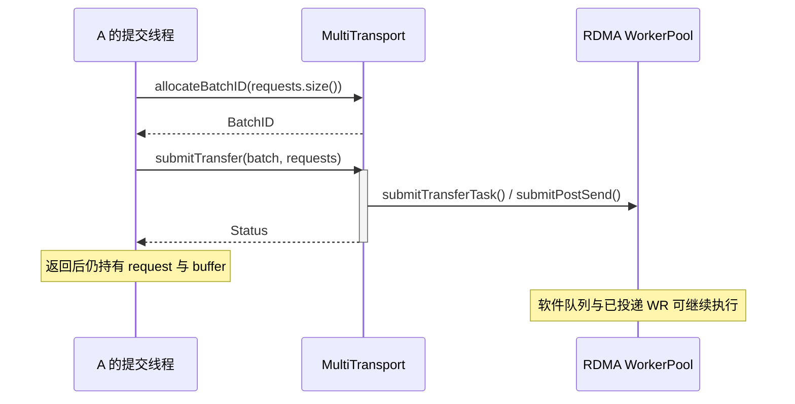
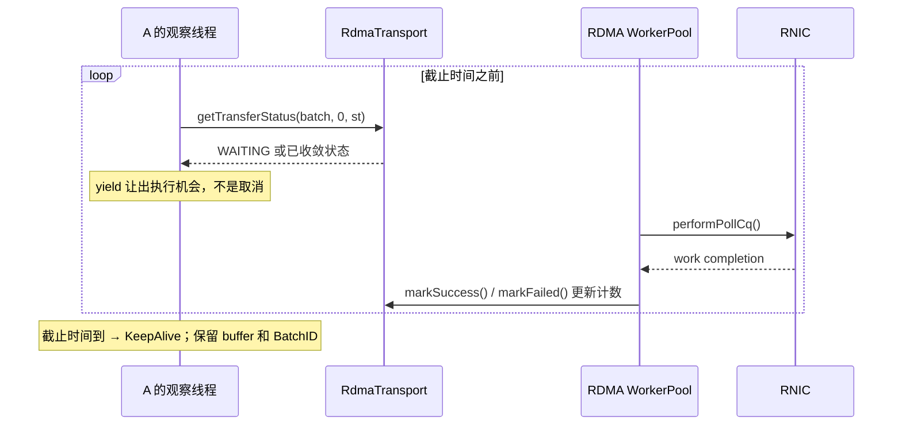

---
tags:
  - 高性能存储
  - AI-GPU-数据路径
  - Mooncake
  - RDMA
  - 源码阅读
aliases:
  - Mooncake Transfer Engine 全路径
  - Mooncake Segment BatchTransfer Task Slice
priority: P0
阅读次数: 0
created: 2026-09-19
source_commit: 97030cacfbf8db7d0098e35da46c58abbae04593
implementation_scope: classic Transfer Engine / 非 USE_TENT / RDMA / CPU DRAM
---

# 8.23 Mooncake Transfer Engine：一次传输的完整路径

> 本篇只追一件事：**进程 A 如何把进程 B 已注册内存中的 1 MiB 数据，读进 A 的本地缓冲区，并证明这次操作已经可以收尾。**
>
> 阅读基线为 Mooncake commit `97030cacfbf8db7d0098e35da46c58abbae04593`，核对日期 2026-09-19。主线是未定义 `USE_TENT` 时的 classic TE、RDMA transport、CPU DRAM。TENT、CUDA/NVLink、Scatter API、Store 对象生命周期是其他分支，不把它们拼成一条虚假的调用链。文中“BatchTransfer”指批量传输概念；本条 C++ 路径实际使用 `BatchID`、`BatchDesc`、`TransferTask` 和 `Slice`。[^M1][^M2]

[[8.5 LMCache 与 Mooncake]] 解释了为什么推理系统需要搬运 KV。本篇从“块在哪里、目标地址是什么”已经由上层确定之后开始，落到注册、路由、提交和回收。前置的 MR、CQ、rkey 可以分别回看 [[4.4 内存注册与零拷贝]]、[[4.3 QP WQE CQ 状态机]]、[[4.12 rkey lkey 生命周期]]。

## 1. 先把一次传输的契约写完整

贯穿案例是一个 **READ**：B 持有稳定的只读数据区，A 持有足够大的已注册接收区。上层已经知道 B 的 segment 名称、远端虚拟地址 `remote_base` 和长度。成功后的目标是 `A.local[0..N)` 与本次指定版本的 `B.remote[0..N)` 相同。

这里有两条需要调用方自己保证的前提。第一，B 在传输期间不注销或复用这段内存；第二，若要读到一个一致的对象版本，B 不能一边无版本地修改、一边让 A 分片读取。TE 搬运字节，不替你完成 KV 查找、对象锁、事务提交或快照隔离。底层传输成功不等于上层读到了同一版本。[^M2][^M4]

**本篇的完成标准分为三层：**提交 API 返回成功；所有相关 slice 进入可回收的终态；应用验证内容并按自己的协议发布或消费。只满足第一层，不能释放 buffer；只满足前两层，也不能声称远端业务处理或持久化已经完成。

![[图片/SVG/8_8_8_23_1.svg|900]]

图 1 的横轴表示先后，不表示耗时比例。注册和首次建连属于冷路径；同一块已注册内存、同一对可用端点的后续传输，可以复用这些准备工作。

## 2. 这些对象分别管理什么

| 对象 | 在本条路径中的作用 | 不要把它当成 |
|---|---|---|
| `TransferEngine` | 对外 API，classic 分支委托给 `TransferEngineImpl` | KV 存储的完整服务 |
| `TransferMetadata` / `SegmentDesc` | 段名称、设备、buffer 地址范围、访问所需描述信息 | 数据载荷本身，或全局事务日志 |
| `BufferDesc` / MR | 某段中的内存范围及各注册上下文对应的 key | 整个 segment 只能有一个 MR |
| `SegmentID` / `SegmentHandle` | 当前引擎解析目标段所用的句柄 | 跨进程可直接传递的远端地址 |
| `BatchID` / `BatchDesc` | 一批任务的容量、任务列表和回收边界 | 原子事务或单次 doorbell |
| `TransferRequest` | 调用方提交的一次 READ/WRITE 描述 | 一个网络包或一个固定大小 WR |
| `TransferTask` | 跟踪请求的 slice、字节数、成功/失败计数 | 一个独立线程 |
| `Slice` | 切分后可绑定地址、key、路径并重试的传输单元 | KV page 或以太网 MTU |
| `RdmaContext` | 一个本地 NIC 上的注册、CQ、端点等资源 | UCX 的 `ucp_context_h` |
| `RdmaEndPoint` | 到某个 peer NIC 路径的连接资源，可包含多个 QP | 整个 batch 的一对一连接 |

以上对象名与关系来自本版本的公开接口、transport 定义和 RDMA 实现。普通 `submitTransfer()` 路径通常是一条 request 对应一个 task，再切出多个 slice；分组 scatter 的 `request_count` 路径另论。[^M1][^M2][^M3][^M5]

![[图片/SVG/8_8_8_23_2.svg|900]]

### 2.1 `source` 与 `target_offset` 的名字会误导你

在这里，`source` 一直描述**本地缓冲区**。对 WRITE，它是本地发送源；对 READ，它实际是本地接收目的地。`target_offset` 在本文的 RDMA 内存路径里是**远端虚拟地址值**，不是“从 segment 起点算起的偏移”。源码直接把 `request.target_offset + offset` 放进 slice，最终写入 `wr.wr.rdma.remote_addr`。[^M4][^M6]

| 字段 | READ | WRITE |
|---|---|---|
| `source` | A 的本地接收地址 | A 的本地发送地址 |
| `target_id` | B 的 segment 句柄 | B 的 segment 句柄 |
| `target_offset` | B 的远端读取地址 | B 的远端写入地址 |
| `length` | 要读的字节数 | 要写的字节数 |

这只是这条 **RDMA memory** 路径的语义，不能据此推导磁盘类 transport 的 offset 语义。地址也不是从 `openSegment()` 返回值强行转换出来的：segment 解析解决“哪个进程/段”，对象位置协议解决“其中哪一段地址”。

### 2.2 两个需要格外保护的生命周期

`BatchID` 在此实现中编码了 `BatchDesc` 的指针值；它不是可以随便探测有效性的安全句柄表。重复释放、释放后查询、把它交给另一个进程，都是错误用法。`freeBatchID()` 会检查任务是否 `is_finished`，未完成返回 `BatchBusy`。[^M2][^M3]

`MultiTransport::submitTransfer()` 还把 `TransferTask::request` 指向调用方 `entries` 中的元素。**保守且容易审计的用法是：请求 vector 在 batch 完成前不销毁、不扩容、不修改；本地 buffer 在完成前也不移动或释放。**不要用一个临时 `std::vector` 提交完就认为引擎深拷贝了全部状态。[^M3]

## 3. 准备阶段：注册、发布、发现、建连是四件事

### 3.1 先注册内存，再发布可访问描述

A 的本地 READ 接收区需要有效的本地注册和访问权限；B 的源区要允许远端读。`TransferEngineImpl::registerLocalMemory()` 检查非零长度和重叠区间，然后对已安装的 transports 执行注册。它并不是只调用一次 `ibv_reg_mr` 就结束：RDMA 层会按设备上下文处理注册，大区间还可能按 `max_mr_size` 分成多个 MR。[^M7][^M8]

本地 `lkey` 用来校验本地 SGE 所引用的注册；远端 `rkey` 与远端地址共同用于远端访问校验。一个用户 buffer 在多个 NIC 上注册，可能有多组 key。因此“我知道这个 buffer 的 rkey”还不够，必须知道它对应哪块目标 NIC、哪段地址范围。注册也不等于数据已经完成生产；生产者写入与消费者访问之间仍要有同步。

这一版的注册入口在某个 transport 失败时，会按逆序尝试撤销已尝试的注册，释放软件预留区间，再返回错误。回滚自身可能报错，代码会记录日志。工程上仍应检查失败后的资源状态，不能把“做了回滚”当成“所有外部副作用绝不残留”。注销入口则尝试所有 transports，保留第一个错误。[^M7]

### 3.2 元数据交换有两条线

**内存描述线：**发布 segment、设备以及 buffer 的地址范围和访问描述；A 通过名称和 `SegmentID` 查到目标 `SegmentDesc`。`update_metadata` 是注册接口中独立存在的开关，批量登记后再统一发布与逐次发布不是同一种开销模型。

**连接握手线：**本地/远端 NIC 的 QP、GID 等连接信息交换，驱动端点达到可发送状态。`openSegment()` 本身不等于全部 QP 已经建好。所追源码里，worker 在准备发送时发现 endpoint 未连接，会走 active setup；对支持 ready ACK 的对端，还要通过 `readyToSend()` 检查。首次传输的延迟会包含这些冷路径。[^M7][^M8][^M9]

元数据服务不是大块数据中转站。也不要把这两条线合并成“从 etcd 读到 rkey，就已经建立 RDMA 连接”：部署可以选择不同元数据机制，内存地址发现与端点握手承担的职责也不同。

### 3.3 名称与旧地址不能替你解决重启

B 重启后，即使继续使用同一个 segment 名称，旧虚拟地址、旧 MR key、旧 QP 也可能不再有效。worker 的重试路径能重新读取目标描述并选择路径；它不会自动修复上层已经失效的对象位置或保证同名对象仍是同一个版本。上层应把对象版本、地址租约或 allocation generation 纳入协议。这里是工程设计要求，不是声称 TE 已经替你实现了这些字段。[^M10]

## 4. 沿一次 READ 逐层追源码

下面按执行顺序列出实际入口。所有相对路径均以 `mooncake-transfer-engine/` 为根；末尾来源提供不可变链接。

| 步骤 | 文件与函数 | 进入这一层时核对什么 |
|---|---|---|
| ① 创建批次 | `src/multi_transport.cpp` → `allocateBatchID()` | `batch_size` 是请求容量，不是字节数 |
| ② API 入口 | `src/transfer_engine.cpp` → `TransferEngine::submitTransfer()` | 当前构建是否真的走 classic 分支 |
| ③ 引擎转发 | `include/transfer_engine_impl.h` → `submitTransfer()` | 是否出现额外 metrics/notify 分支 |
| ④ 选 transport | `src/multi_transport.cpp` → `submitTransfer()`、`selectTransport()` | 每条 request 最终分配给哪个 transport |
| ⑤ 建 task | 同上 → `task_list.emplace_back()` | task 指向哪个 request、属于哪个 batch |
| ⑥ 切分和本地选路 | `src/transport/rdma_transport/rdma_transport.cpp` → `submitTransferTask()` | 本地 MR、NIC、slice 长度、lkey |
| ⑦ 按 context 交付 | `RdmaContext::submitPostSend()` → `WorkerPool::submitPostSend()` | 目标 MR/rkey、peer NIC 路径、软件队列 |
| ⑧ 准备端点 | `worker_pool.cpp` → `performPostSend()` | endpoint 是否 connected 且 ready；QP/CQ 是否有余量 |
| ⑨ 构造并提交 WR | `rdma_endpoint.cpp` → `RdmaEndPoint::submitPostSend()` | SGE、opcode、remote_addr、rkey、wr_id |
| ⑩ 回收 CQ 完成 | `worker_pool.cpp` → `performPollCq()`、`processCompletions()` | `wc.status`，是否重派或终结 slice |
| ⑪ 聚合 task 状态 | `rdma_transport.cpp` → `getTransferStatus()` | 成功数＋失败数是否等于 slice 总数 |
| ⑫ 回收 batch | `multi_transport.cpp` → `freeBatchID()` | 所有 task 均已 finished，之后不再访问句柄 |

这条路径中最容易追错的是 **④→⑥**：公开引擎先经 `MultiTransport` 选路，再调用 `submitTransferTask()`。不要在源码里看到 `RdmaTransport::submitTransfer()`，就假定它必然是公开 `TransferEngine::submitTransfer()` 的直接下一站。[^M1][^M3][^M4]

### 4.1 `submitTransfer()` 返回时，哪些工作可能已经发生

`MultiTransport` 先检查容量，并为输入选择 transports，再创建 task、按 transport 分组提交。某一组返回失败时，其他组可能已经提交；RDMA 内部达到提交水位后，也会在整个请求切分结束前交付已准备好的 slices。

因此，**提交错误不具有“整个 batch 都没执行”的事务语义**。本版 RDMA 代码会把未开始的 task 和未提交的 slice 标记为失败，让计数最终有机会收敛；已经交出去的工作仍要跟踪到终态。把 submit 错误直接转成“释放所有内存并重试整个操作”，可能同时造成 use-after-free 与重复写入。[^M3][^M4]

## 5. 请求怎么切成 slice：必须同时看大小和 MR 边界

这一版 `SliceLengthCalculator::calculate(offset)` 的核心规则可写成：

\[
R=N-o,\quad C=\begin{cases}R,&R\le S+F\\S,&R>S+F\end{cases}
\]

随后，在能查到对应注册区间时，再用本地 MR 剩余长度与远端 MR 剩余长度限制 `C`。其中 `S=globalConfig().slice_size`，`F=globalConfig().fragment_limit`。小尾巴可能与末段合并，所以即使没有 MR 边界，也不能无条件把 slice 数写成 `ceil(N/S)`。找不到 MR 时，不意味着可以跳过注册校验；后续选设备/选 key 仍会失败。[^M8][^M4]

![[图片/SVG/8_8_8_23_3.svg|900]]

**教学设定，非默认配置：**`N=1024 KiB`、`S=256 KiB`、`F=64 KiB`；本地注册边界在 384 KiB，远端注册边界在 640 KiB。两侧边界处之后均有相邻的有效 MR。

| slice | 请求内起点 | 长度 | 到哪个边界停止 | 本地地址 / 远端地址 |
|---|---:|---:|---|---|
| 0 | 0 KiB | 256 KiB | 常规块长 | `local+0` / `remote+0` |
| 1 | 256 KiB | 128 KiB | 本地 MR 结束 | `local+256K` / `remote+256K` |
| 2 | 384 KiB | 256 KiB | 远端 MR 结束 | `local+384K` / `remote+384K` |
| 3 | 640 KiB | 256 KiB | 常规块长 | `local+640K` / `remote+640K` |
| 4 | 896 KiB | 128 KiB | 请求结束 | `local+896K` / `remote+896K` |

总量为 `256+128+256+256+128=1024 KiB`。这五段是软件 slice，不是五个网络包；每段仍可能在链路上分成多个包。也不是五个 KV block，更不是“有五段就使用五张 NIC”。NIC 选择还受本地拓扑、设备状态和路径策略约束。

切分的目的不只是并行，还包括不让一个 WR 跨过不兼容的注册边界、控制队列提交规模、提供可定位的错误/重试单元。代价则是更多软件对象、WR、CQ 处理和调度开销。S 的取值应同时测吞吐、CPU、P99 和故障恢复，不能只看大块顺序传输带宽。可接到 [[4.30 RoCE Benchmark Matrix：Message Size、QP 数、Flow 数、Incast、NUMA、Multi-Rail、PFC、ECN 与 P99]] 的矩阵中。

## 6. 从软件队列到 RNIC：谁真正推动传输

### 6.1 先绑定本地 key，再选择远端 key

`RdmaTransport::submitTransferTask()` 负责本地注册区间和 device/context 选择，将 `source_lkey` 写入 slice。`WorkerPool::submitPostSend()` 进一步选择目标 buffer 和 peer device，从目标描述中取对应的 `rkey`，形成 `peer_nic_path`，再入队。

这里的 path 同时带着资源归属：换远端 NIC 可能要换目标 rkey；切换本地 context 则要重新匹配本地 lkey。仅修改字符串里的 NIC 名称，不能完成正确的 multi-rail failover。源码将本地 RNIC 故障的 handoff 与远端路径 redispatch 分开处理。[^M4][^M9][^M10]

### 6.2 一次 `ibv_post_send()` 可以提交多个 WR

`RdmaEndPoint::submitPostSend()` 读取各 QP 的可用深度和 CQ 余量，把 slice 填入 SGE/WR。该路径中，每个 WR 使用一个 SGE，`wr_id` 关联 slice，READ/WRITE 分别映射到 `IBV_WR_RDMA_READ` / `IBV_WR_RDMA_WRITE`，并设置 `IBV_SEND_SIGNALED`。WR 用 `next` 串起来后交给 `ibv_post_send()`。[^M6]

这说明三个粒度不同：API batch 管一组请求；内部 slice 管切分和状态；doorbell/WR 链管一次对 QP 的批量提交。不能把“批量传输”直接等同为“一次门铃”。此版本该函数采用 signaled WR，也不能把 [[4.15 Signaled Unsignaled WR]] 中的通用 unsignaled 优化误写成这里已采用的实现。

队列暂时满时，endpoint 可以留下未提交 slices 等后续处理，而不是立即将整个 request 判失败。性能分析要区分应用提交时间、软件排队时间、实际 post 时间和 CQ 观察时间。注册、建连和排队都能让首次 1 MiB 传输显得很慢，未必是线上带宽不足。

### 6.3 worker 自己执行 post/poll，不等于所有 transport 都自动推进

这条 classic RDMA 路径有自己的 `WorkerPool` 和线程，处理 post、CQ completion、重试等。应用通常通过查询状态观察结果，不需要调用一个 UCP 风格的 progress 函数。

但不能把这个结论推广到“Mooncake 所有 transport 的状态查询都是纯观察”。`MultiTransport::getTransferStatus()` 会委托到对应 transport；源码特别指出某些异步 GPU transport 的完成查询本身需要轮询设备状态。学习 [[4.31 UCX 编程模型与 Progress 机制]] 时，也不要因为这里有内部 worker，就假设 UCX UCP 默认替应用运行同样的进度线程。[^M3][^M9]

## 7. 完成到底意味着什么

`performPollCq()` 取得 work completions，用 `wr_id` 找回 slice，并调整 QP/CQ 的在途计数。`processCompletions()` 对成功执行 `markSuccess()`，对错误判断是否可重派；重试耗尽才进入失败终态。[^M10]

`Slice::markSuccess()` 先累加成功字节数，再发布成功计数；失败则累加失败计数。`RdmaTransport::getTransferStatus()` 观察计数：

\[
\text{task terminal}\iff success\_slices+failed\_slices=slice\_count
\]

到终态后，失败数为零才是 `COMPLETED`；否则为 `FAILED`。本版使用 acquire 读取完成计数后再读取字节数，并设置 `task.is_finished`，这也是后续能否 `freeBatchID()` 的依据。[^M2][^M4]

![[图片/SVG/8_8_8_23_4.svg|900]]

### 7.1 必须区分的四种结论

| 观察 | 可以得出 | 不能得出 |
|---|---|---|
| `submitTransfer(...).ok()` | 提交阶段返回成功 | 所有数据已传完 |
| 某 task 为 `COMPLETED` | 该 task 的 slices 成功收敛 | 同 batch 其他 task 都成功 |
| `FAILED` 且报告部分字节数 | 有成功切片，也有失败切片 | 已自动回滚；成功字节一定构成连续前缀 |
| WRITE 传输成功 | 本次 transport 操作达成其完成语义 | 远端业务已消费、已持久化、GPU kernel 已正确同步 |

READ 的接收 buffer 在成功后才能交给 CPU 消费；GPU 场景另需符合平台与框架的可见性/流同步契约，不能从 CPU DRAM 示例直接推导。相关边界见 [[8.12 GPUDirect RDMA]] 与 [[4.14 Fence 与内存可见性]]。

### 7.2 超时是一条诊断结论，不是一条释放许可

`MultiTransport::getTransferStatus()` 可在仍处于 `WAITING` 的任务上叠加 slice timeout 检测，把返回状态显示为 `TIMEOUT`。这并不说明所有实际传输都已停止，也不等于 QP 已排空。

同理，调用方自己用 `steady_clock` 设置的 100 ms 截止时间，只是“不愿再等”的业务决定。超时后可以停止发布这个结果，但应保留 batch、request 描述和 buffer 的所有权，继续推进/观察，或走经过验证的连接退出路径。**不能把 TIMEOUT 与 COMPLETED/FAILED 在回收条件上无差别处理。**[^M3]

## 8. 最小代码片段：让所有权比句柄活得更久

以下是基于固定接口编写的教学片段，不是省略环境依赖后仍可直接运行的完整双机程序。它们假定 engine 已初始化、RDMA transport 已安装、两端内存已注册、远端地址和租约已通过应用协议获取。当前 Mooncake 头文件还涉及 `std::span` 等接口；完整工程应使用该 checkout 的构建标准与依赖，不能只凭示例风格就假定 C++17 可以编译整个仓库。

### 8.1 构造 READ 描述

buffer 与请求 vector 均由发起方持有。下面仅构造请求描述，实际注册与提交另行执行。

```cpp
std::vector<std::byte> local_buffer(bytes);
std::vector<mooncake::TransferRequest> requests(1);
auto& request = requests.front();
request.opcode = mooncake::TransferRequest::READ;
request.source = local_buffer.data();        // READ 的本地接收地址
request.target_id = remote_segment;
request.target_offset = remote_base;         // 已验证的远端虚拟地址
request.length = local_buffer.size();
```

真实代码应在构造请求前确认 `bytes` 非零、地址加长度不溢出、目标范围处于有效 allocation 中；本地 vector 分配完成后再注册，注册之后不要执行可能导致重分配的操作。这里的裸 `void*` 是借用地址，不表达所有权。

### 8.2 提交之后，先保留状态，再决定如何等待

下面只展示提交片段。`submit_status` 失败不让 buffer 立即离开作用域；调用方应保存 batch 和请求拥有者，进入完成/清理分支。分配句柄的错误检查须按所用版本接口的错误约定处理，不能臆造一个不存在的 `isValidBatch()`。

```cpp
const auto batch = engine.allocateBatchID(requests.size());
// 在真实程序中先完成 batch 分配失败检查，再使用该句柄。
const auto submit_status = engine.submitTransfer(batch, requests);
// 无论 submit_status 是否 OK，均保留 requests / local_buffer。
// 若可能已部分提交，继续逐 task 查询；不要直接销毁拥有者。
```



这张图显示返回的是提交状态，而不是所有异步引用已经解除的证明。

### 8.3 观察一个 task：截止时间到达也不回收它

观察函数借用 engine/batch，不持有或销毁业务 buffer。调用方只有收到可回收终态并检查整个 batch 后，才进入清理。生产代码还应对轮询退避、日志限流和退役处理做封装。

```cpp
enum class ObserveResult { Completed, Failed, KeepAlive, QueryError };

ObserveResult observe_until(mooncake::TransferEngine& engine,
                            mooncake::BatchID batch,
                            std::chrono::steady_clock::time_point deadline) {
    while (std::chrono::steady_clock::now() < deadline) {
        mooncake::TransferStatus st{};
        const auto rc = engine.getTransferStatus(batch, 0, st);
        if (!rc.ok()) return ObserveResult::QueryError;
        if (st.s == mooncake::TransferStatusEnum::COMPLETED)
            return ObserveResult::Completed;
        if (st.s == mooncake::TransferStatusEnum::FAILED)
            return ObserveResult::Failed;
        // WAITING / TIMEOUT 等均不在这里解释为安全回收。
        std::this_thread::yield();
    }
    return ObserveResult::KeepAlive;
}
```



图中的等待发生在观察者一侧；worker/RNIC 不因为观察函数返回就自动停止。

### 8.4 正常收尾的顺序

先停止该 batch 的新提交，并观察所有实际 task；确认其终态和 `freeBatchID()` 成功后，不再查询旧 batch。然后，在没有其他本地任务或远端访问仍引用该内存的前提下，注销本地 MR；最后释放 buffer。B 的远端源区是否可回收，应由双方的应用协议决定，不能由 A 单方面猜测。

此 classic 版本的 `TransferEngineImpl::closeSegment()` 是直接返回 0 的实现。它**不是注销对端 MR、撤销旧 rkey、排空在途请求或释放对端对象的保证**。也不要把同文件里普通路径返回 OK 的 `CheckSegmentStatus()` 当作充分的存活检测。读源码时要追实现，不能只按函数名推测语义。[^M7]

## 9. 错误处理：错误发生在哪一层，就先保存哪一层证据

| 错误位置 | 应保存的证据 | 处理边界 |
|---|---|---|
| 注册失败 | 地址范围、长度、设备、返回码、回滚日志 | 不发布可用地址；确认残余资源 |
| 名称/描述解析失败 | segment 名称、进程实例、元数据模式 | 不把旧地址继续套用到新实例 |
| 本地选设备失败 | local 地址、覆盖 MR、context active 状态 | 核对注册与 NIC 亲和，不先调大超时 |
| 握手失败 | peer NIC、GID、QP 状态、ready ACK | 分清控制面可达与 RDMA 数据面可达 |
| `ibv_post_send` 失败 | 返回码、`bad_wr`、已成功提交的前缀 | WR 链可能部分提交，禁止整体当作未执行 |
| CQ 错误 | `wc.status`、opcode、lkey/rkey、地址、NIC、重试次数 | 对照本地错误、远端错误、flush 错误分别处理 |
| 软件/观察超时 | post 时间、最后 poll 时间、队列深度 | 分辨链路不通与 poller 被饿死；保留资源 |
| 内容验证失败 | 对象版本、范围、校验值、生产者同步点 | 传输终态不替代一致性与完整性协议 |

本版 worker 在成功 CQE 上 `markSuccess()`；出错后可能 `redispatch()`、替换 endpoint、暂停路径或将工作交给其他本地 context。`IBV_WC_WR_FLUSH_ERR` 也不应直接解释为新的线路损坏：它可能是 QP 进入错误/销毁流程后，被冲刷的未完成 WR。[^M10]

### 9.1 为什么重试不是 exactly-once

重复 READ 只有在读同一稳定版本时才有可解释的结果。重复 WRITE 同样的字节到仍由该请求独占的槽位，可能设计成幂等；但如果地址已被回收重用，旧请求的重试就可能覆盖新对象。成功 slice 与失败 slice 交织时，`transferred_bytes` 也不能用于简单的“从第 k 字节续传”。

一个适合练习的上层发布协议是：申请带 generation 的专用槽位 → 写 payload → 等待所有传输终态 → 校验 → 发布 manifest/ready 状态 → 消费者确认。超时则把槽位隔离到确定无在途访问之后再复用。这里是**建议设计**，不是宣称 TE 自带分布式事务。可把问题接回 [[8.15 Prefix 淘汰 一致性 与故障恢复]]。

## 10. 沿一次请求做实验，而不是只跑一个带宽数字

### 10.1 固定代码，再找符号

下面只做源码定位，不创建或删除线上资源。先进入自己的实验源码目录，固定 commit，避免阅读过程中 `main` 变化。

```bash
git clone https://github.com/kvcache-ai/Mooncake.git
cd Mooncake
git checkout --detach 97030cacfbf8db7d0098e35da46c58abbae04593
rg -n 'USE_TENT|submitTransferTask|SliceLengthCalculator' mooncake-transfer-engine
rg -n 'performPostSend|performPollCq|processCompletions' mooncake-transfer-engine
rg -n 'ibv_post_send|freeBatchID|closeSegment' mooncake-transfer-engine
```

这些命令用于定位源码。构建依赖、编译选项和示例程序入口应以该 checkout 的 CMake 与官方安装说明为准。

### 10.2 一次最小 correctness 运行应记录什么

先用 CPU DRAM 做双机 READ 和 WRITE，各传 4 KiB、1 MiB、带非整齐尾巴的长度。为每轮填入包含轮次与位置的确定性数据模式，传输后逐字节比较；padding 放哨兵值，检查越界。测试结果至少包含：版本、构建开关、实际 transport、注册区间、slice 大小、NIC、NUMA、batch/task 数、终态与字节数。

时间戳建议拆成 `submit_enter`、`submit_return`、首次实际 post、最后 CQ、应用观察到终态、应用校验完成。若新增 tracing，明确它会扰动性能。先查默认日志可提供的内容，再决定是否给 slice 添加调试 ID；不要声称某个自定义 tracing 字段已在官方接口中存在。

### 10.3 四组对照足以检验本篇理解

| 对照 | 只改变什么 | 应解释的现象 |
|---|---|---|
| 冷/热传输 | 保持 payload 相同，比较首次与复用 | 注册、描述查询、建连能否与数据面拆开 |
| 单 MR/跨 MR | 保持总长度，改变注册边界 | slice 是否遵守两端 MR 边界 |
| 单 NIC/多 NIC | 核对实际选路，保持其他条件 | 聚合收益与 CPU、PCIe、NUMA 代价 |
| 正常/受控故障 | 在独占测试环境让对端退出或路径失效 | 已提交工作如何收敛，是否错误地提前释放 |

没有 RDMA 硬件时，可以做源码追踪、地址/切片计算测试、TCP transport 的接口烟测；**TCP 烟测不能验证 RDMA 注册、QP、CQ、rkey 和 multi-rail 故障路径。**不要在生产网络随意制造链路故障。

## 11. 读完应能口述的六个问题

**为什么 READ 的 `source` 指向接收区？**它是统一接口中的本地地址字段，实际方向由 opcode 决定。

**segment、MR 和对象是一回事吗？**不是。segment 是可发现的逻辑地址/资源描述；MR 是注册范围；对象的 key、版本和有效范围由上层协议管理。

**为什么 1 MiB 不一定只有四个 256 KiB slice？**尾段合并阈值和两端 MR 边界都会改变切分；本篇示例得到五段。

**提交失败为什么还需要继续处理？**部分 transport 组、部分 slice 或 WR 链前缀可能已经交付，失败不意味着事务式回滚。

**状态变 TIMEOUT 为什么还不能 free？**它可能只是观察层的截止结论，不能证明硬件和软件不再引用内存。

**这篇与 UCX 的连接点是什么？**都是把“请求被接受、进度由谁推动、何时完成、资源由谁持有”拆开；但本篇 RDMA transport 有内部 WorkerPool，UCX UCP 需要应用明确安排 worker progress，不能直接套用同一种线程模型。

## 12. 源码与阅读基线

来源链接固定到本篇 commit；网页文档只作补充。以下均为上游一手材料，正文中的路径说明与本版相关，不代表未来版本仍保持相同实现。

[^M1]: [TransferEngine 接口](https://github.com/kvcache-ai/Mooncake/blob/97030cacfbf8db7d0098e35da46c58abbae04593/mooncake-transfer-engine/include/transfer_engine.h)、[classic wrapper](https://github.com/kvcache-ai/Mooncake/blob/97030cacfbf8db7d0098e35da46c58abbae04593/mooncake-transfer-engine/src/transfer_engine.cpp)、[TransferEngineImpl 转发](https://github.com/kvcache-ai/Mooncake/blob/97030cacfbf8db7d0098e35da46c58abbae04593/mooncake-transfer-engine/include/transfer_engine_impl.h)。重点：编译分支与公开函数签名。
[^M2]: [transport.h](https://github.com/kvcache-ai/Mooncake/blob/97030cacfbf8db7d0098e35da46c58abbae04593/mooncake-transfer-engine/include/transport/transport.h)。重点：TransferRequest、Slice、TransferTask、BatchDesc、状态和完成计数。
[^M3]: [multi_transport.cpp](https://github.com/kvcache-ai/Mooncake/blob/97030cacfbf8db7d0098e35da46c58abbae04593/mooncake-transfer-engine/src/multi_transport.cpp)。重点：allocate/freeBatchID、submitTransfer、请求借用、分组提交、getTransferStatus 与 timeout。
[^M4]: [rdma_transport.cpp：提交与完成](https://github.com/kvcache-ai/Mooncake/blob/97030cacfbf8db7d0098e35da46c58abbae04593/mooncake-transfer-engine/src/transport/rdma_transport/rdma_transport.cpp#L808-L1080)。重点：submitTransferTask、SliceLengthCalculator 的使用、getTransferStatus。
[^M5]: [rdma_context.h](https://github.com/kvcache-ai/Mooncake/blob/97030cacfbf8db7d0098e35da46c58abbae04593/mooncake-transfer-engine/include/transport/rdma_transport/rdma_context.h)。重点：每个本地 NIC 的 MR/CQ/Endpoint 资源归属与提交接口。
[^M6]: [rdma_endpoint.cpp：WR 构造与提交](https://github.com/kvcache-ai/Mooncake/blob/97030cacfbf8db7d0098e35da46c58abbae04593/mooncake-transfer-engine/src/transport/rdma_transport/rdma_endpoint.cpp#L970-L1084)。重点：SGE、wr_id、READ/WRITE、SIGNALED、bad_wr 和部分提交。
[^M7]: [transfer_engine_impl.cpp](https://github.com/kvcache-ai/Mooncake/blob/97030cacfbf8db7d0098e35da46c58abbae04593/mooncake-transfer-engine/src/transfer_engine_impl.cpp#L500-L820)。重点：openSegment、closeSegment、CheckSegmentStatus、注册回滚与注销。
[^M8]: [rdma_transport.cpp：切片长度与注册](https://github.com/kvcache-ai/Mooncake/blob/97030cacfbf8db7d0098e35da46c58abbae04593/mooncake-transfer-engine/src/transport/rdma_transport/rdma_transport.cpp#L48-L330)。重点：bytesUntilBufferEnd、SliceLengthCalculator、remote_accessible、max_mr_size。
[^M9]: [worker_pool.h](https://github.com/kvcache-ai/Mooncake/blob/97030cacfbf8db7d0098e35da46c58abbae04593/mooncake-transfer-engine/include/transport/rdma_transport/worker_pool.h)、[worker_pool.cpp：入队与发送](https://github.com/kvcache-ai/Mooncake/blob/97030cacfbf8db7d0098e35da46c58abbae04593/mooncake-transfer-engine/src/transport/rdma_transport/worker_pool.cpp#L350-L730)。重点：选 peer、rkey、软件队列、端点建立和 ready 检查。
[^M10]: [worker_pool.cpp：CQ 与恢复](https://github.com/kvcache-ai/Mooncake/blob/97030cacfbf8db7d0098e35da46c58abbae04593/mooncake-transfer-engine/src/transport/rdma_transport/worker_pool.cpp#L731-L1010)。重点：performPollCq、processCompletions、redispatch、强制刷新目标描述。

补充入口：[官方 Transfer Engine 文档](https://kvcache-ai.github.io/Mooncake/design/transfer-engine/index.html)、[TENT 文档](https://kvcache-ai.github.io/Mooncake/design/tent/overview.html)。TENT 作为另一实现阅读，不与本文 classic 调用链混用。

> 验证范围：本篇进行了固定版本源码核对、切片算例检查和图文结构检查；没有在双机 RDMA/GPU 环境执行这些示例，文中不包含吞吐或延迟实测结果。
