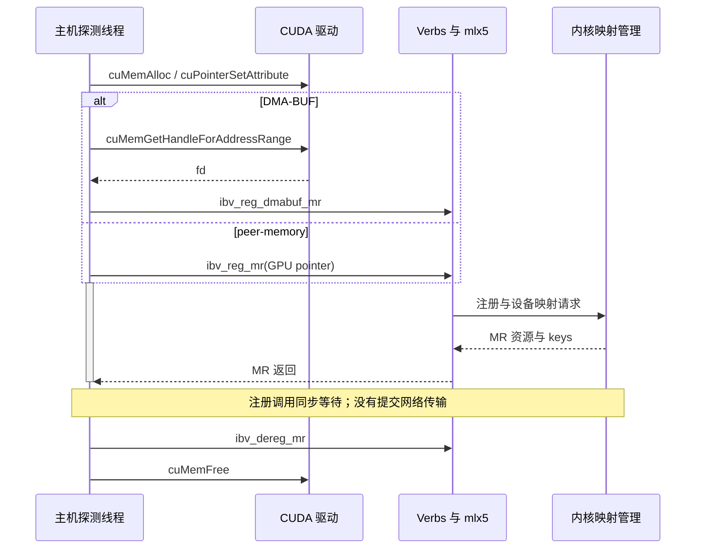
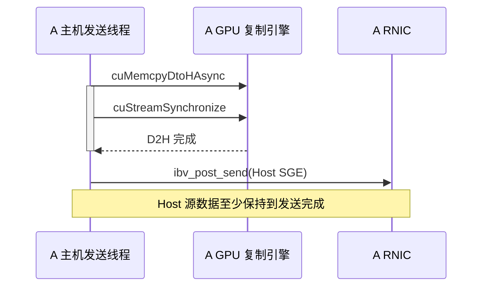
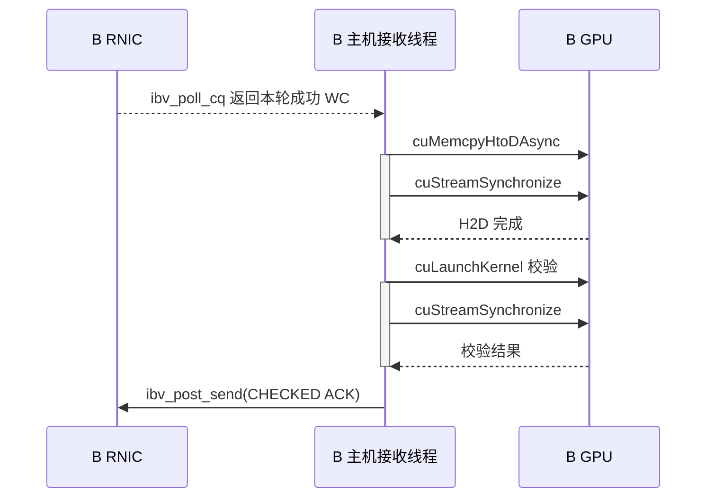

---
tags:
  - 高性能存储
  - AI-GPU-数据路径
  - GPUDirect-RDMA
  - 实验
aliases:
  - GPU-NIC 环境验证
  - GPUDirect RDMA 最小实验
priority: P0
status: 笔记完成，硬件实验待执行
created: 2026-09-19
updated: 2026-09-19
perftest_commit: b513a77278c8061ca6c4dcd1a95d08801c6e7623
---

# GPU–NIC 环境验证与最小实验

> **本篇要交付的不是一张漂亮的带宽截图，而是一条能复核的证据链：选中了哪对 GPU/NIC，显存通过哪种机制注册，网卡确实访问了该内存，GPU 在正确的同步边界后读到了本轮数据，与真正的 Host staging 相比节省了什么。**
>
> 范围：两台 Linux 主机、每台一块离散 NVIDIA GPU 和一个可用 RDMA 端口，先用单进程、单 GPU、单 QP 建立正确性基线。DMA-BUF 与 peer-memory 分开验证。本文没有在真实 GPU/RNIC 上执行；命令、源码入口与 API 契约已核对，实验结果栏有意留空。

[[8.12 GPUDirect RDMA]] 解释“为什么 NIC 能访问显存”；本篇补“怎样证明当前机器真的走通”。注册、保护域与 key 的基础见 [[4.4 内存注册与零拷贝]]；GPU 生产者何时结束、消费者何时启动，则沿用 [[8.11 cudaMemcpy 与 CUDA Stream]] 的完成语义。不要把这三件事合并成一次 `ibv_reg_mr()` 调用。

## 1. 六道验收门：上一道通过，不代表下一道通过

| 门 | 要回答的问题 | 最低证据 | 不能替代它的证据 |
|---|---|---|---|
| G0 设备身份 | 用的是预期 GPU、NIC、端口吗？ | GPU UUID/BDF、RDMA device/BDF、端口和 GID | “机器上能运行 nvidia-smi” |
| G1 平台路径 | 驱动、固件、PCIe 路径适合这个组合吗？ | 版本清单、拓扑、链路状态、实际能力查询 | GPU 型号名字；单个 PIX 标签 |
| G2 注册通路 | 是 DMA-BUF，还是 peer-memory？ | 导出/导入日志，或 GPU 指针注册日志 | 只看 `nvidia_peermem` 是否加载 |
| G3 网络传输 | 提交的操作完成了吗？ | 实际选中 GPU、注册成功、成功 WC、无异步错误 | `ibv_post_send()` 返回 0 |
| G4 数据消费 | GPU 读取的是正确的本轮内容吗？ | 有覆盖量的校验；轮次、长度、数据比对 | 只有带宽；只校验不变的首字节 |
| G5 工程对照 | direct 比 staging 的收益来自哪里？ | 同端点、同负载、同计时边界的对照 | GPU 测试与普通 Host 测试相减 |

这里的门是**本文设计的实验判据**，不是某个厂商 API 的六个返回状态。允许记录“G2 失败、未进入 G3”，不允许将失败静默改成 Host buffer 后继续打印“GDR PASS”。

![[图片/SVG/8_8_8_26_1.svg|900]]

图中上半部判断设备路径，下半部区分两条注册控制路径。两条路径最后都产生 RNIC 可使用的映射，但它们的入口、依赖和失败位置并不相同。

## 2. 冻结实验身份：版本号也是输入变量

### 2.1 采用可复现快照，而不是“装最新版本”

本篇 perftest 示例固定到上游提交 `b513a77278c8061ca6c4dcd1a95d08801c6e7623`，其提交者时间为 **2026-09-03**，该提交的 `configure.ac` 版本为 **6.30**。这是阅读与复现实验的快照，不是对生产驱动升级的建议。这个快照已经包含 GPU `--data_validation`；旧发行包可能没有，必须检查实际二进制。两台主机使用相同提交和一致的构建选项。[^pt-version][^pt-readme]

设备能力不能仅由 CUDA Toolkit 版本推断。`nvidia-smi` 展示的 CUDA 版本不是本机 `nvcc` 的安装版本；编译时头文件、运行时驱动库、内核模块、rdma-core/provider、RNIC 固件均应单独记录。容器还会多出设备透传、库挂载与权限变量，所以第一轮建议在受控裸机环境完成，再迁移到容器复核。

### 2.2 只读采集：先保留原始输出，再写结论

下面在**两端分别执行**。`logs-A` 与 `logs-B` 不应混在一起。设备命名和 CUDA ordinal 可能不同，不要求两个节点都叫 `mlx5_0`、GPU 都是 0。

```bash
mkdir -p logs
uname -a > logs/kernel.txt
cat /proc/driver/nvidia/version > logs/nvidia-kernel.txt
nvidia-smi -L > logs/gpu-list.txt
nvidia-smi -q > logs/gpu-detail.txt
nvidia-smi topo -m > logs/topology.txt
nvcc --version > logs/cuda-toolkit.txt 2>&1
rdma link show > logs/rdma-link.txt
ibv_devinfo -v > logs/verbs-capabilities.txt
lspci -D -t > logs/pcie-tree.txt
lspci -Dnnk > logs/pci-drivers.txt
lsmod > logs/modules.txt
ulimit -l > logs/memlock.txt
```

为什么保留全量输出？只截 `grep RDMA` 的一行会丢掉端口状态、MTU、固件、GPU 模式等上下文。`nvcc` 不存在仅表示本环境缺编译工具，不能直接判定驱动不能运行 CUDA；反过来 `nvcc` 存在也不能证明驱动或 GDR 可用。

为选中的 NIC 建立 BDF、网口、NUMA 的映射。下面变量必须替换为本机的值；`numa_node=-1` 表示未知，不能解释为 NUMA 0。

```bash
DEV=mlx5_0
NETDEV=ens5f0
readlink -f "/sys/class/infiniband/$DEV/device"
cat "/sys/class/infiniband/$DEV/device/numa_node"
ls "/sys/class/infiniband/$DEV/device/net"
ethtool -i "$NETDEV"
ip -br addr show dev "$NETDEV"
find "/sys/class/infiniband/$DEV/ports/1/gid_attrs" -maxdepth 2 -type f \
  -print -exec cat {} \;
```

最后一项用于把 GID、RoCE 类型和关联 netdev 对起来。`-x 3` 不是可跨机器复制的真理：GID index 是本端表索引，IPv4/IPv6、VLAN、RoCEv1/v2 都会改变选择。其地址语义接续 [[4.26 RoCEv2 报文与地址体系：Ethernet、VLAN、IP、UDP、BTH、GID、Traffic Class 与 MTU]]。

建议把下表填进实验记录，不必先搭一个监控系统。

| 记录项 | A 端 | B 端 |
|---|---|---|
| GPU 名称 / UUID / PCI BDF / ordinal | 待填 | 待填 |
| GPU 驱动版本 / open 或 proprietary 模块 | 待填 | 待填 |
| Toolkit / 实际加载 libcuda 路径 | 待填 | 待填 |
| NIC 名称 / BDF / 固件 / link_layer | 待填 | 待填 |
| RDMA device / port / GID / RoCE 类型 | 待填 | 待填 |
| CPU 亲和 / NIC NUMA / GPU 路径 | 待填 | 待填 |
| Kernel / rdma-core / provider 实际路径 | 待填 | 待填 |
| perftest SHA / configure 参数 | 固定快照后记录 | 同左 |
| IOMMU / ACS / PCIe 速率与宽度 | 待填 | 待填 |
| 测试路径 / 消息大小 / QP / 深度 / 迭代 | 待填 | 待填 |

## 3. 拓扑是候选筛选，不是通过证书

### 3.1 同交换芯片通常有利，但“必须 PIX/PXB”过于绝对

NVIDIA 的 GPUDirect 文档区分仅经过 PCIe switch、经过单个 CPU/IOH、跨 CPU 互连三类路径。仅经 switch 通常最有利；经过主桥的某些平台也能工作，但 peer read 可能受限；跨 socket 路径风险更高。这些都是**平台相关的路径判断**，不能用一个固定折扣替代实测。[^gdr-topology]

| `nvidia-smi topo -m` 常见标签 | 读法 | 本实验如何处理 |
|---|---|---|
| PIX | 至多一个 PCIe bridge | 优先候选，仍需注册和双方向验证 |
| PXB | 多级 PCIe bridge，不穿越 host bridge | 优先候选，核对上联共享带宽 |
| PHB | 穿越 PCIe host bridge | 不自动判死；验证具体平台支持和 peer read |
| NODE | 同 NUMA node 内不同 host bridge 的路径 | 核对 CPU/IO 拓扑，不能等同单 switch |
| SYS | 跨 NUMA 节点/处理器互连 | 作为高风险对照，不先拿它建立基线 |

GPU↔GPU 的 P2P 测试或 `cudaDeviceCanAccessPeer` 针对的是 GPU 对，**不能直接替代 GPU↔NIC 的能力和注册验证**。GPU 与 NIC 在同一 NUMA 节点，也不能证明二者一定共用同一个 PCIe root 或可用 P2P 路径。

### 3.2 检查链路、IOMMU、ACS，但不要盲目修改

对实际 GPU/NIC 以及它们上游桥执行 `lspci -s <BDF> -vv`，对比 `LnkCap` 与 `LnkSta`。降速、降宽和共享上联均会限制吞吐；“GPU 是 PCIe Gen5”不代表端到端路径每一段都运行在预期速率。

经典 GPUDirect PCIe 路径对地址翻译有约束。IOMMU 是否可用、是否需要 passthrough，应按平台、驱动和所选路径核对；ACS 可能改变 P2P 路由。**不要在共享服务器上直接关闭 ACS/IOMMU、使用 ACS override，或卸载正在被业务使用的 GPU/RDMA 模块。**这些操作会改变隔离与 DMA 安全边界，应由管理员在维护窗口按供应商支持配置验证。[^gdr-topology]

## 4. 两条显存注册路径：DMA-BUF 与 peer-memory

### 4.1 它们改变的是内存如何导出/导入，不是 RDMA 的网络协议

| 维度 | DMA-BUF 路径 | peer-memory 路径 |
|---|---|---|
| 应用侧显存 | 普通 device allocation，先查支持 | 普通 device allocation，核对驱动组合 |
| 中间表示 | GPU 驱动导出的 DMA-BUF fd | GPU 虚拟地址进入 GPU peer-memory 集成 |
| CUDA 侧关键入口 | `cuMemGetHandleForAddressRange()` | 分配及必要的 CUDA 同步属性 |
| Verbs 注册入口 | `ibv_reg_dmabuf_mr()` | `ibv_reg_mr()` / provider 的 MR 路径 |
| 常见依赖 | GPU DMA-BUF export、内核与 RNIC importer 支持 | GPU 驱动、`nvidia-peermem` 与 RDMA 栈匹配 |
| 是否必须加载 `nvidia_peermem` | 否，不能拿它做必要条件 | 此路径通常需要对应 peer-memory 集成 |
| 典型失败位置 | capability → export → import MR | GPU 指针 → peer-memory → MR |
| 成功后 | 本地 MR、lkey/rkey、HCA 地址范围 | 同左 |

NVIDIA GPU Operator 文档推荐 DMA-BUF，并列出相应软件/硬件先决条件；perftest README 给出 CUDA ≥11.7、open kernel module 等使用条件。这些是**入场条件**，不是“版本足够新就一定能用”。还需要目标 GPU 的能力、具体 allocation 的可导出性、RNIC 导入支持与实际 DMA 验证。[^operator][^pt-cuda]

对原始 verbs 调用而言，GPU MR 失败不会自动帮你分配一块 Host buffer；但 UCX、NCCL 或推理传输引擎可能另选 staging 路径。因此，“应用能够传数据”和“应用使用 GDR”是两个结论。框架回退策略必须看框架日志和选路，不能由 `ibv_reg_mr()` 的性质反推。

### 4.2 四种“地址”不能混为一谈

**GPU VA** 是 CUDA allocation 的虚拟地址；**DMA-BUF offset** 是在导出对象内的偏移；**HCA IOVA** 是该 MR 向 RNIC 暴露的地址范围；**底层 DMA 地址** 由驱动映射管理。示例中可以有意令 IOVA 数值等于 GPU VA，但这是一种地址选择，不证明底层物理地址与 GPU VA 相同。

注册 DMA-BUF 时要让 `offset` 与 `iova` 具有相同的页内偏移，并遵守导出 API 的对齐要求；`length` 必须位于有效导出范围内。远端交换的是**本次 MR 的 HCA 地址、rkey、长度和代次**，不是 fd，也不是任意一次旧 allocation 的地址。fd 只在本机相关进程和驱动导入过程中有意义。[^reg-mr][^cuda-memory]

`lkey` 用于本地 SGE 的访问校验，`rkey` 用于允许的远端访问。不要把 key 当成永久身份；同一个虚拟地址释放后重用，原 MR/远端元数据也必须失效。注册缓存的代次与回收问题接续 [[4.12 rkey lkey 生命周期]]。

### 4.3 先收窄内存类型

第一轮使用普通 `cuMemAlloc` device memory；不要一上来混入 Managed Memory、异步内存池、CUDA IPC 导入、VMM 大页、多 GPU 映射、MIG 或集成 GPU。它们可能有各自支持条件，不能由普通离散 GPU 的成功直接推广。

能力查询也必须结合 Toolkit 与平台语义。特别是 NVIDIA CUDA 13.x 文档对部分 GPUDirect 属性增加了平台说明：**不把某一个 `GPU_DIRECT_RDMA_SUPPORTED` 整数当作所有 GPU、所有 DMA-BUF 路径的唯一裁判**。DMA-BUF 支持位、实际导出返回值、MR 返回值和真实传输要分别记录。[^gdr-api]

在支持多种硬件映射路径的平台上，还应记录导出的 `flags`。`CU_MEM_RANGE_FLAG_DMA_BUF_MAPPING_TYPE_PCIE` 在受支持的平台上请求 PCIe BAR1 映射，否则返回错误；它不是所有旧 Toolkit 都有的通用开关。下文 probe 取 `flags=0`，验证默认可导出路径，**不据此声称强制选择了 PCIe BAR1**。多路径并用还可能涉及独立 ordering domain，不能用一个 flush 覆盖所有路径的顺序。[^cuda-memory][^cuda-flush]

## 5. 实验 A：只证明显存能注册，不接网络

### 5.1 为什么值得单独做 MR probe

如果连两台主机、配置 RoCE、初始化 CUDA、创建 QP 一起做，错误只会表现为“程序没跑起来”。MR probe 删除了 QP、GID、交换机和对端，只回答：**本进程、这块 GPU、这个 RNIC、这条注册机制是否成功？**它不能证明 DMA 或数据正确，但能把 G2 失败从网络排障里隔离。

以下 C++17 程序固定分配 1 MiB 的测试窗口，依次试 `dmabuf` 或 `peermem`，不进行自动回退。适用头文件基线为 CUDA Toolkit ≥11.7 和提供 `ibv_reg_dmabuf_mr` 的 rdma-core。各代码块按顺序拼接成 `gpu_mr_probe.cpp`；分段是为了看清资源依赖。

**第一段：错误报告保留 API 名称。**CUDA 返回码与 `errno` 是两套机制，不能全部用 `perror()` 解释。

```cpp
#include <cuda.h>
#include <infiniband/verbs.h>
#include <unistd.h>
#include <cerrno>
#include <cstdint>
#include <cstdlib>
#include <cstring>
#include <iostream>
#include <memory>
#include <stdexcept>
#include <string>

void ck(CUresult rc, const char* where) {
    if (rc == CUDA_SUCCESS) return;
    const char* name = nullptr;
    cuGetErrorName(rc, &name);
    throw std::runtime_error(std::string(where) + ": " +
                             (name ? name : "unknown CUDA error"));
}
void syscheck(bool ok, const char* where) {
    if (!ok) throw std::runtime_error(std::string(where) + ": " +
                                      std::strerror(errno));
}
```

**第二段：给 verbs 资源加 RAII。**返回裸指针的 C API 不代表业务代码必须传播所有权；`unique_ptr` 管理销毁，且析构不抛异常。

```cpp
template<class T, int (*Release)(T*)>
struct VDelete {
    void operator()(T* p) const noexcept {
        if (p && Release(p) != 0)
            std::cerr << "verbs cleanup failed\n";
    }
};
using VContext = std::unique_ptr<ibv_context,
    VDelete<ibv_context, ibv_close_device>>;
using Pd = std::unique_ptr<ibv_pd, VDelete<ibv_pd, ibv_dealloc_pd>>;
using Mr = std::unique_ptr<ibv_mr, VDelete<ibv_mr, ibv_dereg_mr>>;
struct Fd {
    int value = -1;
    Fd() = default;
    Fd(const Fd&) = delete;
    Fd& operator=(const Fd&) = delete;
    ~Fd() { if (value >= 0 && ::close(value) != 0)
        std::cerr << "close DMA-BUF fd failed\n"; }
};
```

**第三段：CUDA primary context 的引用必须活得比 allocation 久。**通过 RAII 管理引用计数；这里单线程执行，不覆盖调用者原有 CUDA context 的复杂恢复语义。

```cpp
struct Primary {
    CUdevice device;
    explicit Primary(int ordinal) {
        ck(cuInit(0), "cuInit");
        ck(cuDeviceGet(&device, ordinal), "cuDeviceGet");
        CUcontext context = nullptr;
        ck(cuDevicePrimaryCtxRetain(&context, device), "primary retain");
        const auto rc = cuCtxSetCurrent(context);
        if (rc != CUDA_SUCCESS) {
            cuDevicePrimaryCtxRelease(device);
            ck(rc, "cuCtxSetCurrent");
        }
    }
    Primary(const Primary&) = delete;
    Primary& operator=(const Primary&) = delete;
    ~Primary() {
        if (cuDevicePrimaryCtxRelease(device) != CUDA_SUCCESS)
            std::cerr << "primary release failed\n";
    }
};
```

**第四段：保留分配基址，注册窗口单独对齐。**释放时使用原始 allocation，而不是对齐后的子区间。多分配一页让窗口完全位于 allocation 内；不把这里的主机页对齐泛化为所有 GPU/VMM allocation 的注册规则。

```cpp
struct DeviceBuffer {
    CUdeviceptr base = 0;
    explicit DeviceBuffer(std::size_t bytes) {
        ck(cuMemAlloc(&base, bytes), "cuMemAlloc");
    }
    DeviceBuffer(const DeviceBuffer&) = delete;
    DeviceBuffer& operator=(const DeviceBuffer&) = delete;
    ~DeviceBuffer() {
        if (base && cuMemFree(base) != CUDA_SUCCESS)
            std::cerr << "cuMemFree failed\n";
    }
};
VContext open_nic(const std::string& name) {
    int count = 0;
    using List = std::unique_ptr<ibv_device*,
        decltype(&ibv_free_device_list)>;
    List devices(ibv_get_device_list(&count), ibv_free_device_list);
    syscheck(static_cast<bool>(devices), "ibv_get_device_list");
    for (int i = 0; i < count; ++i) {
        auto* d = devices.get()[i];
        if (name == ibv_get_device_name(d)) {
            VContext ctx(ibv_open_device(d));
            syscheck(static_cast<bool>(ctx), "ibv_open_device");
            return ctx;
        }
    }
    throw std::runtime_error("RDMA device not found: " + name);
}
```

**第五段：先绑定 GPU，再打开指定 NIC。**下列变量的声明顺序决定正常退出时的逆序销毁：MR → fd → PD → NIC context → GPU allocation → CUDA primary context。MR probe 不创建任何可能仍在 DMA 的 QP，因此可以直接逆序清理。

```cpp
void run(const std::string& mode, const std::string& nic, int gpu) {
    Primary primary(gpu);
    const auto page_raw = ::sysconf(_SC_PAGESIZE);
    if (page_raw <= 0) throw std::runtime_error("invalid page size");
    const auto page = static_cast<std::size_t>(page_raw);
    if ((page & (page - 1)) != 0)
        throw std::runtime_error("non-power-of-two page size");
    constexpr std::size_t bytes = 1U << 20;
    if (bytes % page != 0)
        throw std::runtime_error("test length not page-aligned");
    DeviceBuffer allocation(bytes + page);
    const CUdeviceptr addr = (allocation.base + page - 1) &
                            ~static_cast<CUdeviceptr>(page - 1);
    unsigned int sync = 1;
    ck(cuPointerSetAttribute(&sync, CU_POINTER_ATTRIBUTE_SYNC_MEMOPS,
                            allocation.base), "SYNC_MEMOPS");
    auto context = open_nic(nic);
    Pd pd(ibv_alloc_pd(context.get()));
    syscheck(static_cast<bool>(pd), "ibv_alloc_pd");
    Fd fd;
    Mr mr;
    const int access = IBV_ACCESS_LOCAL_WRITE |
                       IBV_ACCESS_REMOTE_WRITE | IBV_ACCESS_REMOTE_READ;
```

`SYNC_MEMOPS` 是 allocation 级 CUDA 一致性设置，**不是网络完成通知，也不是对一个已运行 kernel 的万能 fence**。本程序没有 producer kernel，它只是显式记录注册前的保守设置；实际传输还要经过第 7 节的边界。[^gdr-order]

**第六段：两种注册入口互斥。**DMA-BUF 先查询支持再导出；这里导出窗口的 offset 取 0，IOVA 有意选为窗口地址。peer-memory 则将同一 device window 交给 `ibv_reg_mr`。

```cpp
    if (mode == "dmabuf") {
        int supported = 0;
        ck(cuDeviceGetAttribute(&supported,
            CU_DEVICE_ATTRIBUTE_DMA_BUF_SUPPORTED, primary.device),
            "DMA_BUF_SUPPORTED");
        if (!supported) throw std::runtime_error("DMA-BUF unsupported");
        ck(cuMemGetHandleForAddressRange(&fd.value, addr, bytes,
            CU_MEM_RANGE_HANDLE_TYPE_DMA_BUF_FD, 0), "export DMA-BUF");
        mr.reset(ibv_reg_dmabuf_mr(pd.get(), 0, bytes,
            static_cast<std::uint64_t>(addr), fd.value, access));
        syscheck(static_cast<bool>(mr), "ibv_reg_dmabuf_mr");
    } else {
        mr.reset(ibv_reg_mr(pd.get(), reinterpret_cast<void*>(addr),
                            bytes, access));
        syscheck(static_cast<bool>(mr), "ibv_reg_mr GPU pointer");
    }
    std::cout << "MR_ONLY_PASS mode=" << mode << " nic=" << nic
              << " gpu=" << gpu << " bytes=" << bytes
              << " iova=0x" << std::hex << addr
              << " lkey=0x" << mr->lkey << " rkey=0x" << mr->rkey
              << std::dec << '\n';
}
```

这里 `reinterpret_cast` 只是适配 verbs 的地址参数，不会让 GPU 指针变成 CPU 可解引用的内存。不要加 `std::memset(reinterpret_cast<void*>(addr), ...)`，也不要对这样的指针使用 CPU inline payload 拷贝。

**第七段：命令行错误直接停止，不默默换设备。**原始异常文字要保留在实验日志里，特别是 export 失败和 MR import 失败不可合并。

```cpp
int main(int argc, char** argv) {
    try {
        if (argc != 4)
            throw std::runtime_error(
                "usage: gpu_mr_probe dmabuf|peermem RDMA_DEVICE GPU_INDEX");
        const std::string mode = argv[1];
        if (mode != "dmabuf" && mode != "peermem")
            throw std::runtime_error("invalid registration mode");
        std::size_t used = 0;
        const std::string index = argv[3];
        const int gpu = std::stoi(index, &used);
        if (used != index.size() || gpu < 0)
            throw std::runtime_error("invalid GPU index");
        run(mode, argv[2], gpu);
        return 0;
    } catch (const std::exception& e) {
        std::cerr << "MR_ONLY_FAIL " << e.what() << '\n';
        return 1;
    }
}
```



图里没有对端，也没有数据 CQE：这正是 `MR_ONLY_PASS` 不等于“GPU RDMA 已验证”的原因。

构建时优先由已安装驱动提供 `libcuda.so`。**不得把 CUDA `stubs` 目录作为运行时库目录**；缺链接用开发库或驱动开发包解决。下面路径按本机 Toolkit 安装位置调整。

```bash
c++ -std=c++17 -O2 -Wall -Wextra gpu_mr_probe.cpp \
  -I/usr/local/cuda/include -libverbs -lcuda -o gpu_mr_probe
./gpu_mr_probe dmabuf mlx5_0 0 2>&1 | tee logs/mr-dmabuf.txt
# 仅在管理员确认 peer-memory 软件栈可用后单独执行：
./gpu_mr_probe peermem mlx5_0 0 2>&1 | tee logs/mr-peermem.txt
```

在脚本中用 `set -o pipefail`，否则 `tee` 成功可能掩盖 probe 非零退出。这个 probe 只证明小窗口注册；增加到真实 KV block 池规模后还要再测注册资源占用和回收。

## 6. 实验 B：从 Host 基线走到显存 RDMA

### 6.1 在两端构建同一个 perftest

下列命令不执行 `sudo make install`，避免覆盖系统工具。编译依赖至少包括 C 工具链、autoconf/automake/libtool/pkg-config、verbs/RDMA CM 开发文件；GPU 校验还要有匹配的 CUDA Toolkit 与 runtime 开发库。具体依赖包名以操作系统为准。

```bash
set -euo pipefail
git clone https://github.com/linux-rdma/perftest.git
cd perftest
git checkout --detach b513a77278c8061ca6c4dcd1a95d08801c6e7623
./autogen.sh
./configure --enable-cudart 2>&1 | tee configure-output.txt
make -j"$(nproc)"
git rev-parse HEAD
./ib_write_bw --version
./ib_write_bw --help | grep -E 'cuda|dmabuf|data_validation|inline'
find . -name 'libperftest_kernels.so*' -print
```

`--help` 中有参数只证明该二进制认识选项，不证明 CUDA kernel plugin 已加载。GPU 校验使用的 `libperftest_kernels.so` 需位于动态加载器可找到的位置；未安装时找到它的实际目录，将该目录加入本次命令的 `LD_LIBRARY_PATH`，同时保留正确的 CUDA runtime 库路径。不要把另一版本的同名插件混进来。[^pt-readme]

### 6.2 统一“协议参数”，分别填写“本地选择”

在 A、B 各自的 shell 里设置以下变量。`PEER` 在客户端填写服务器可达地址；以下是 **RoCE 示例**，InfiniBand 原生网络要按实际 GID/LID/SM 配置调整。只复制变量名，不照抄设备和 GID 值。

```bash
set -o pipefail
mkdir -p logs
DEV=mlx5_0
PORT=1
GID=3       # 改为本端正确的 RoCEv2 GID index
GPU=0       # 核对实际输出的 GPU BDF / UUID
PEER=192.0.2.20  # 示例地址，替换为服务器地址
COMMON=(-d "$DEV" -i "$PORT" -x "$GID" -c RC -q 1 \
        -t 128 -Q 1 -I 0 -s 4096 -n 1000 --report_gbits)
```

`-I 0` 禁用发送 inline payload，避免 CPU 试图从 device pointer 拷贝数据。单 QP、单方向、小消息先降低故障定位维度；`-Q 1` 让第一轮完成追踪直观，后续优化再改变 CQ moderation。`-t 128` 同时满足这个快照校验模式的最小深度要求。[^pt-readme]

### 6.3 Host↔Host：排除基础 RDMA 链路问题

先在服务器启动第一条，再在客户端运行第二条。两条不是在同一机器上顺序执行。

```bash
# 服务器 B
./ib_write_bw "${COMMON[@]}" 2>&1 | tee logs/host-write-server.txt
# 客户端 A：在 A 的 shell 使用 A 的 COMMON / PEER
./ib_write_bw "${COMMON[@]}" "$PEER" \
  2>&1 | tee logs/host-write-client.txt
```

这一步失败时，优先检查端口、GID、MTU、可达性和权限，而不是先调 GPU 参数。Host↔Host 通过只说明该组 Host MR 与 RDMA 设置可用，不是 Host staging 的端到端结果。

### 6.4 DMA-BUF 的 GPU↔GPU RDMA WRITE

在两端显式加上两个参数，检查输出确实选择目标 GPU，并报告 DMA-BUF 注册。必要时在受控单次运行中跟踪注册 API，而不是仅看 banner。

```bash
# 服务器 B
./ib_write_bw "${COMMON[@]}" --use_cuda="$GPU" --use_cuda_dmabuf \
  2>&1 | tee logs/gpu-dmabuf-write-server.txt
# 客户端 A
./ib_write_bw "${COMMON[@]}" --use_cuda="$GPU" --use_cuda_dmabuf \
  "$PEER" 2>&1 | tee logs/gpu-dmabuf-write-client.txt
```

WRITE 的方向要说完整：客户端 RNIC **DMA 读本端 GPU**，经网络后服务器 RNIC **DMA 写服务器 GPU**。端到端低带宽可能是源端 peer read，也可能是目标写路径、网络或队列；不能全部叫“GPU PCIe 慢”。

peer-memory 对照使用同一组协议参数，**仅去掉 `--use_cuda_dmabuf`**，保留 `--use_cuda`；并记录匹配的 peer-memory 软件栈。两条路径分别出日志，失败就记录失败，不在本轮自动改用 Host memory。[^pt-cuda]

### 6.5 加上 READ 与角色互换，拆开读写方向

将两端命令里的 `ib_write_bw` 同时替换为 `ib_read_bw`，其余双方匹配参数保持一致。READ 时，发起端 GPU 是本地结果缓冲区，远端 GPU 是被读取源；RNIC 的 DMA 读/写角色相应变化。再交换 A、B 的 client/server 角色，可得到四个有方向的信息点。

| 运行 | 发起端本地 GPU | 对端 GPU | 主要暴露的端点路径 |
|---|---|---|---|
| A 发 WRITE 到 B | 源 | 目的 | A peer read + B peer write |
| B 发 WRITE 到 A | 源 | 目的 | B peer read + A peer write |
| A 发 READ 读 B | 目的 | 源 | B peer read + A peer write |
| B 发 READ 读 A | 目的 | 源 | A peer read + B peer write |

两行即使数据方向相同，也不代表 RDMA 协议行为和 outstanding 限制一样；READ 的发起与响应、read credits 等会改变吞吐。利用这种对照缩小问题，不把它当成精确隔离每一个硬件组件的实验。

## 7. 实验 C：正确性与 GPU 可见性是主线

### 7.1 固定快照已有校验模式，不能继续假设“perftest 永远不检查数据”

该 perftest 快照的 `--data_validation` 支持 `ib_write_bw` 和 `ib_read_bw`，Host 使用相应校验实现，GPU 使用 CUDA kernel plugin。它要求 RC、双方一致且不小于 32 的 tx depth，并使用 FETCH_AND_ADD 辅助信号。其前提比“普通 RDMA WRITE”更强，因此校验模式初始化失败不等于所有显存 WRITE 都不支持。[^pt-validation]

以下在上一轮 GPU DMA-BUF 命令上增加校验。使用固定大小，**不能同时使用 `-a`**；也不与 `--gpu_touch`、`--payload_file_path`、post list >1 等不兼容选项混用。

```bash
# 服务器 B
./ib_write_bw "${COMMON[@]}" --use_cuda="$GPU" --use_cuda_dmabuf \
  --data_validation --data_validation_debug \
  2>&1 | tee logs/check-server.txt
# 客户端 A
./ib_write_bw "${COMMON[@]}" --use_cuda="$GPU" --use_cuda_dmabuf \
  --data_validation --data_validation_debug "$PEER" \
  2>&1 | tee logs/check-client.txt
```

读输出时区分上游定义和自己的覆盖要求：

| 输出 | 上游含义 | 本篇如何记账 |
|---|---|---|
| `errors` | 确认的数据不匹配 | 非零即失败；保留首错位置、期望值与实际值 |
| `races` | 验证过程中被新数据覆盖的临时不一致 | 不自动判损坏；记录并分析负载重叠 |
| `skips` | 生产速度超过校验速度，部分 chunk 没校验 | 不判损坏，但不能声称全量覆盖 |
| `retries` | 临时不一致重新检查后正确 | 不自动判错；不能等同网络 retry counter |
| checked chunks / bytes | 实际验证工作量 | 必须为正；核对是否达到预定覆盖要求 |

因此 `VALIDATION: PASSED ... skips=42` 可以表示“被检查的数据通过”，却不能改写成“所有 1000 次数据均逐字节验证”。本篇严格 correctness run 追求可说明的全量覆盖；高吞吐 validation run 则如实给出覆盖量和遗漏，二者分栏。[^pt-counters]

如果校验器追不上，先缩小消息、减少竞争、改成受控的单次握手验证，不靠把 `errors=0` 放大加粗解决问题。性能数据应在关闭重校验后重新采集；不能把校验额外耗时混进“纯 RDMA 极限带宽”。

### 7.2 最小自写协议：一轮只能有一个数据槽的拥有者

当你扩展 [[4.10 rc_pingpong 最小程序]] 做逐轮校验，第一版建议用 **RC SEND/RECV**，或 **WRITE_WITH_IMM + 已预投的 receive credit**。理由不是 SEND 比 WRITE 更先进，而是接收方有明确的完成事件。普通 RDMA WRITE 本身不会自动在远端 CQ 生成接收完成；不能让接收 CPU 等一个不存在的 WC。[^verbs-send]

用 `epoch + sequence + payload length + pattern + guard bytes` 描述一轮。发送内容必须随轮次变化；接收区预填反模式；验证头尾保护区，避免“上一轮的数据刚好相同”或只检查首字节。这里的序列号是应用协议状态，不能用 GPU VA 或 rkey 冒充。

**基线生命周期：**接收方预投接收并宣告 READY → 发送 GPU 生产完成 → 提交网络操作 → 接收 CPU 观察成功完成 → 执行适合平台的 CUDA 可见性衔接 → 启动/等待校验 → 返回 CHECKED ACK → 才允许重用该槽。发送侧还要确保其本地发送完成，才能复用非 inline 源缓冲区。

![[图片/SVG/8_8_8_26_2.svg|900]]

图中三个完成域各有边界：CUDA producer event、接收 WC、CUDA consumer event。一个库的完成对象不会自动成为另一个执行域的依赖。

### 7.3 四种“同步”各管什么

| 同步点 | 解决的问题 | 不解决的问题 |
|---|---|---|
| 发送端 `cudaEventSynchronize` / `cuStreamSynchronize` | 本轮 GPU 生产者结束，数据不再被它修改 | 网络已完成 |
| 接收端成功 WC + 协议通知 | 传输层交付到约定阶段，可进入消费衔接 | 已运行 kernel 一定看到更新 |
| CUDA 可见性/提交边界，必要时 flush | 满足目标 GPU 读取第三方写入的顺序要求 | 对端已经停止所有未来写入 |
| consumer event / CHECKED ACK | 本轮校验或计算结束，槽可交还 | 其他 QP、其他代次的访问已全部结束 |

NVIDIA 的同步说明特别提醒：与外部 RDMA 写并发运行且读取同一区域的 kernel，可能观察到旧值、部分写入或乱序结果。基础实验应让网络写入与本轮 GPU 校验在生命周期上分离，而不是写一个永不退出的 kernel 自旋轮询 payload。[^gdr-order]

`cuFlushGPUDirectRDMAWrites()` 可将外部写入的可见性推进到指定 scope；应核对该平台支持的 flush 方式与 `GPU_DIRECT_RDMA_WRITES_ORDERING`。如果目标 scope 已被设备原生顺序保证覆盖，flush 可能是 no-op；如果 API/路径不支持，不可忽略错误后继续声称完成了同步。它也不替代远端完成通知或负责等待未来尚未到达的写。[^cuda-flush]

特别不要将 C++ `atomic_thread_fence`、`IBV_SEND_FENCE` 或 provider 的 `udma_from_device_barrier()` 当成 CUDA flush。它们服务的观察者、队列和地址域不同。对应的用户态 NIC 提交机制在 [[4.32 rdma-core 到设备 Provider 的提交路径]] 中展开。

### 7.4 如何证明校验器本身不是摆设

在隔离测试进程中设计两类负例：先在受控复制后人为改变一个 payload 字节，验证 checker 报错；再故意让接收方期待不同 sequence，验证它能区分旧轮次。这里只测试应用的数据比较逻辑，不向共享设备提交任意非法 DMA。

延迟 ACK 是另一个有价值的负例：消费者迟迟不返回 CHECKED，发送者应等待或超时并进入隔离状态，不能提前复用 buffer。**应用超时不等于网卡 DMA 已取消**，失败清理必须先停止新提交、隔离连接与槽、处理 outstanding WR，再销毁 MR 和 allocation；详见 [[4.19 RDMA 故障恢复与连接重建]] 的恢复边界。

## 8. 实验 D：真正的 Host staging 对照

### 8.1 先把错误对照排除

下面两次 perftest：一次不带 `--use_cuda`，一次带 `--use_cuda`，测的是 **Host MR 路径**与 **device MR 路径**。它们很适合排障，但前者没有 GPU producer/consumer，也没有 D2H/H2D，**不能命名为 GPU-to-GPU Host staging**。

真正 staging 的端点与 direct 相同，都从 A 的 GPU 已就绪数据出发，到 B 的 GPU 可以安全消费为止。不同之处在于是否插入两块 pinned Host buffer 以及两次拷贝。

![[图片/SVG/8_8_8_26_3.svg|900]]

图中 Host staging 的两段 Host DRAM 是数据面，不是 QP、CQ、元数据这类控制内存。Direct 仍可能有 CPU 提交和完成处理，“不经 Host payload 中转”不等于“主机完全不参与”。

### 8.2 用同一个 SEND/RECV harness，仅替换 buffer backend

这是对已有 ping-pong 的**明确扩展任务**，不是一个假装存在的 `--host-staging` perftest 参数。以下集成片段不是独立程序；连接、预投 RECV、提交 SEND 和检查 WC 使用同一个已验证的 RC harness，不能分别选择两个不同的框架再比较。

固定一套参数：一条 RC QP、一个数据槽、独立的小型 ACK buffer、相同 payload 与 sequence、无 inline、相同 CPU/GPU/NIC、相同预热与采样次数。注册和分配在计时前完成。资源表应按模式显式生成：

| 资源 | direct 模式 | staging 模式 |
|---|---|---|
| A GPU payload | CUDA device allocation | 同左 |
| B GPU destination | CUDA device allocation | 同左 |
| A 网络源 MR | GPU allocation 的 MR | pinned Host send buffer 的 MR |
| B 网络目的 MR | GPU allocation 的 MR | pinned Host recv buffer 的 MR |
| D2H | 无 | A GPU → A pinned Host |
| H2D | 无 | B pinned Host → B GPU |
| 校验/ACK | GPU 校验完成后 ACK | 同左 |

第一步，在 staging 模式为两端分别调用 `cuMemHostAlloc` 分配 pinned buffer，再用本端 PD 注册。pinned 对 CUDA 可 DMA 不等于已注册给 RNIC，两个登记不可互相替代。使用 RAII 管理 Host allocation 与 MR，先销毁 MR，再 `cuMemFreeHost`。其角色区别见 [[8.10 Host Device Memory 与 Pinned Memory]]。

第二步，在发送端 producer 已完成之后，staging 必须先结束 D2H 才允许 NIC 读取 Host buffer。以下变量来自该 harness：`host_send` 为 pinned 指针、`gpu_send` 为 device pointer、`copy_stream` 为 CUDA stream、`bytes` 为本轮长度。

```cpp
// staging 发送端：插入到已验证的 SEND 提交流程之前。
ck(cuMemcpyDtoHAsync(host_send, gpu_send, bytes, copy_stream),
   "staging D2H");
ck(cuStreamSynchronize(copy_stream), "D2H before NIC read");
// 随后的 ibv_post_send 使用 host_send 对应的 SGE 与 lkey。
// 不得仍填写 gpu_send 的地址或 GPU MR 的 lkey。
```



图揭示的等待是 staging 固有的串行依赖；直接把 `cuMemcpyDtoHAsync` 与 NIC read 同时提交会产生竞态，而不是“更好的 overlap”。

第三步，接收端先检查成功的接收 WC，再把 Host buffer 拷到目标 GPU。校验 kernel 必须在 H2D 之后执行；同一 stream 内可顺序排队，但本文串行基线显式等待，便于观察边界。

```cpp
// staging 接收端：已确认本轮 receive WC 成功且 sequence 匹配。
ck(cuMemcpyHtoDAsync(gpu_recv, host_recv, bytes, copy_stream),
   "staging H2D");
ck(cuStreamSynchronize(copy_stream), "H2D before validation");
// 随后启动同一份 GPU checker，等待其完成，再发送 CHECKED ACK。
// ACK 之前，不回收 host_recv，也不允许发送方覆盖对应槽。
```



这个对照实现的预期产物应是同一 harness 的两个 backend 与一份运行清单。本文提供扩展契约和 CUDA 接入片段，**不将尚未编写、编译和在真实双机运行的完整 harness 冒充已交付的可执行工具**。目前可直接照命令执行的部分是 MR probe 和固定 perftest 实验。

### 8.3 计时：用同一台主机的时钟，别拼跨机时间戳

串行往返的稳妥定义为：A 在 producer 就绪后记录 `t0`，A 收到 B 的 CHECKED ACK 且本地发送完成后记录 `t1`。`t1-t0` 包含正向传输、消费者/校验、反向 ACK 与 CPU 调度；它不是严格的一次单向 RDMA 延迟，但两种 backend 的定义一致。没有校准跨机时钟时，不用 `B.finish - A.start` 当一程延迟。

做吞吐对照时增加环形槽和 pipeline，但每槽仍需要 READY/IN_FLIGHT/CHECKED 的所有权状态；分阶段 CUDA event 时间只测对应 GPU stream 工作，不能用它独自覆盖网络、CPU 调度和远端处理时间。不要把整个 pipeline 吞吐和单槽串行延迟放在同一列。

### 8.4 一个只用于验算的量级模型

设单块为 1 MiB，网络有效搬运速率假设为 25 GB/s，两端拷贝也分别假设为 25 GB/s。这里的 GB 为十进制，MiB 为二进制，**所有数值都是模型假设，不是实测成绩**。

\[
T_{\mathrm{one\ stage}}=\frac{1,048,576}{25\times10^9}
\approx 41.94\ \mu s
\]

忽略控制与验证成本，串行 staging 的三段下界约为 125.83 μs，direct 的单段网络模型约为 41.94 μs。真实 direct 还受 GPU peer read/write、PCIe、RNIC 和协议限制，不能由模型宣布“三倍提升”。充分流水化后，吞吐上界更接近最慢阶段，**不能继续把三段时间简单相加推导稳态吞吐**。

Host staging 在发送端产生一次 GPU DMA 写 Host 与一次 NIC DMA 读 Host，在接收端产生一次 NIC DMA 写 Host 与一次 GPU DMA 读 Host。按 payload 口径是每端约 `2N` 的 Host 内存访问，两端合计约 `4N`，不含控制流量与缓存效应。这是排查主存带宽压力的流量账，不是精确硬件计数器的预测。

## 9. 性能矩阵：先改变一个变量

先在 4 KiB、64 KiB、1 MiB 三档建立记录，再增加大小、QP 数、batch、并发和拓扑对照。校验模式不能用 `-a`，因此每一档双方独立启动并保持大小相同。执行顺序、样本数和预热条件也应记录。

| 维度 | 基线 | 后续变量 | 要避免的混淆 |
|---|---|---|---|
| 内存 backend | 显式 DMA-BUF | peer-memory / 真 staging | 静默回退 |
| 网络方向 | A→B WRITE | 反向 / READ | 发起方向与数据方向混淆 |
| 消息 | 4 KiB | 64 KiB / 1 MiB / 真实 KV block | 校验开销比例改变 |
| QP / depth | 1 / 128 | 多 QP / 多 outstanding | 一次同时改变两个参数 |
| CPU placement | NIC 就近固定核 | 远端 NUMA | 混入线程迁移 |
| GPU/NIC pair | 最有希望的近端对 | PHB / SYS 对照 | 不同 GPU 本身能力不同 |
| 测量口径 | 热注册、热连接 | 冷注册、冷启动 | 把 pin/register 混进数据面 |
| correctness | 开启并报告覆盖 | 性能运行关闭 | validation 吞吐冒充纯传输吞吐 |

除 Gbit/s 外，至少记录平均/分位延迟（来自明确的采样定义）、CPU 时间、注册耗时、错误和校验覆盖。相关 RoCE 计数器按 [[4.29 RDMA Fabric Telemetry：NIC Counter、Switch Counter、Queue Occupancy、PFC Pause、ECN Mark、CNP 与 Drop Counter]] 采集**测试前后差值**；不同型号的 counter 名称和单位必须核对，不凭一个名字强行归因。

## 10. 故障定位：沿最早失败的边界向下找

| 症状 | 优先检查 | 不应直接下的结论 |
|---|---|---|
| CUDA 初始化失败 | 驱动库、设备权限、选中 GPU、容器映射 | “RoCE 网络坏了” |
| DMA-BUF capability 为 0 | GPU/平台/驱动和内存类型 | “装 peermem 必然修好 DMA-BUF” |
| export 失败 | CUDA 返回码、对齐、范围、allocation 类型 | “rkey 错误” |
| MR import 失败 | importer/provider/内核支持、access、fd、offset、资源限制 | “网络不通” |
| peer MR 失败 | peer-memory 集成与模块版本、GPU 映射资源 | “只要 modprobe 就行” |
| Host 成功、GPU 无完成 | GPU 路径、注册、权限、WC 与异步事件 | “肯定是交换机拥塞” |
| 成功 WC 但 GPU 数据错 | 生命周期、轮次、覆盖、GPU 可见性衔接 | “再加 C++ fence 就能解决” |
| READ 特别慢 | source peer read、read credits、方向和拓扑 | “GPU WRITE 性能也一定差” |
| 错误只发生在小包 | inline、scatter-to-CQE、GPU 指针 CPU 访问 | “大包通过所以正确” |
| 热运行好、重建后失败 | MR/远端代次、fd与allocation回收、资源泄漏 | “偶发问题无需复现” |

上游 perftest 已提示 GDR 异常时可验证 `MLX5_SCATTER_TO_CQE=0`。它控制某些接收/读结果的 inline scatter 行为，与发送 `IBV_SEND_INLINE` **不是同一个开关**。在单独一轮中设置并保存对照结果；不将它当作所有 provider、所有失败的通用修复。[^pt-known]

## 11. 完成标准与口述检查

本篇 P0 的完成标准是：有两端版本清单与拓扑；至少一条明确注册路径通过；Host 基线与 GPU 双方向传输有日志；GPU 校验实际执行且覆盖可解释；能准确说明 staged 对照还包含哪些阶段。没有双机 GPU/RNIC 时，可完成源码阅读、工具构建和协议设计，但实验状态仍写“硬件待验证”，不填想象中的带宽。

**问：显存注册成功为何不足以证明 GDR 可用？**注册只建立设备访问资源；还没验证数据经过所选网络、实际 DMA 到正确 allocation，更没验证 GPU 读取顺序和本轮内容。

**问：GPU buffer 为什么禁用发送 inline？**普通 provider inline 路径由 CPU 拷贝源 payload 到 WQE；普通 device pointer 不是可直接由 CPU 解引用的 Host buffer。零拷贝和 inline 是两种不同优化。

**问：接收 CQE 为什么不等于消费者结束？**CQE 描述网络操作完成；GPU 消费者可能尚未提交，或者尚未结束。槽的复用应由消费生命周期决定，而不是只由 NIC 进度决定。

**问：DMA-BUF 和 peer-memory 对照最大的陷阱是什么？**只记录 GPU 指针而不记录导出/注册机制，或失败后静默改用 Host memory，最后把不同数据路径的数字放进同一栏。

**问：真正 Host staging 的可辨认特征是什么？**网络两端 MR 指向 pinned Host buffer，GPU 与 Host 之间有明确 D2H/H2D，且这些步骤在同一个端到端口径内计时。

## 12. 来源与版本边界

下列资料用于 API 契约和源码定位；本文的验收门、实验矩阵、负例设计与带宽模型是基于这些契约编排的工程方案。动态文档访问日期为 **2026-09-19**；部署前按实际 GPU、驱动和平台重新核对，不把旧最低版本当生产推荐版本。

[^pt-version]: linux-rdma/perftest，固定提交 [b513a77278c8061ca6c4dcd1a95d08801c6e7623](https://github.com/linux-rdma/perftest/commit/b513a77278c8061ca6c4dcd1a95d08801c6e7623)，`configure.ac` 与双方参数协商变更。
[^pt-readme]: perftest 固定快照 [README](https://github.com/linux-rdma/perftest/blob/b513a77278c8061ca6c4dcd1a95d08801c6e7623/README)，构建、参数、测试方法和 CUDA runtime plugin。
[^pt-cuda]: perftest [README GPUDirect 部分](https://github.com/linux-rdma/perftest/blob/b513a77278c8061ca6c4dcd1a95d08801c6e7623/README) 与 [src/cuda_memory.c](https://github.com/linux-rdma/perftest/blob/b513a77278c8061ca6c4dcd1a95d08801c6e7623/src/cuda_memory.c)，GPU 选择、DMA-BUF 支持查询、普通 device allocation 与导出。
[^pt-validation]: perftest [README Data Validation](https://github.com/linux-rdma/perftest/blob/b513a77278c8061ca6c4dcd1a95d08801c6e7623/README)，适用操作、RC/深度要求、GPU 校验插件与不兼容选项。
[^pt-counters]: perftest [README Output Counters](https://github.com/linux-rdma/perftest/blob/b513a77278c8061ca6c4dcd1a95d08801c6e7623/README)，errors、races、skips、retries 的区分。
[^pt-known]: perftest [README Known Issues](https://github.com/linux-rdma/perftest/blob/b513a77278c8061ca6c4dcd1a95d08801c6e7623/README)，版本一致性与 scatter-to-CQE 提示。
[^operator]: NVIDIA，[GPUDirect RDMA and GPUDirect Storage — GPU Operator](https://docs.nvidia.com/datacenter/cloud-native/gpu-operator/latest/gpu-operator-rdma.html)，DMA-BUF 与 legacy 路径的部署前提；其部署矩阵有产品/版本上下文。
[^gdr-topology]: NVIDIA，[GPUDirect RDMA — Supported Systems / PCI BAR sizes](https://docs.nvidia.com/cuda/gpudirect-rdma/index.html#supported-systems)，PCIe switch、host bridge、跨处理器路径和映射约束。
[^gdr-order]: NVIDIA，[GPUDirect RDMA — Synchronization and Memory Ordering](https://docs.nvidia.com/cuda/gpudirect-rdma/index.html#synchronization-and-memory-ordering)，SYNC_MEMOPS、CPU 发起的 CUDA 顺序边界与并发读取数据竞态。
[^gdr-api]: NVIDIA，[GPUDirect RDMA Change Log](https://docs.nvidia.com/cuda/gpudirect-rdma/index.html#change-log)，CUDA 13.x 对 DMA-BUF 和部分平台属性的说明；不推广 Tegra 特有结论到所有离散 GPU。
[^cuda-flush]: NVIDIA，[CUDA Driver API — Device Management](https://docs.nvidia.com/cuda/cuda-driver-api/group__CUDA__DEVICE.html)，`cuFlushGPUDirectRDMAWrites`、scope 与设备原生 ordering 的关系。
[^reg-mr]: linux-rdma/rdma-core v57.0 固定提交 [libibverbs/verbs.h](https://github.com/linux-rdma/rdma-core/blob/18696ad67a90a8e36621570d8a006abc598b6a13/libibverbs/verbs.h) 与 [providers/mlx5/verbs.c](https://github.com/linux-rdma/rdma-core/blob/18696ad67a90a8e36621570d8a006abc598b6a13/providers/mlx5/verbs.c)，MR API、HCA 地址及 provider 注册入口；[固定版本 MR 手册](https://github.com/linux-rdma/rdma-core/blob/18696ad67a90a8e36621570d8a006abc598b6a13/libibverbs/man/ibv_reg_mr.3) 明确说明 DMA-BUF offset/IOVA 的页内偏移约束。
[^verbs-send]: rdma-core 固定提交 [libibverbs/verbs.h](https://github.com/linux-rdma/rdma-core/blob/18696ad67a90a8e36621570d8a006abc598b6a13/libibverbs/verbs.h) 与 [providers/mlx5/cq.c](https://github.com/linux-rdma/rdma-core/blob/18696ad67a90a8e36621570d8a006abc598b6a13/providers/mlx5/cq.c)，SEND、WRITE_WITH_IMM 的完成与普通 WRITE 的区别。

[^cuda-memory]: NVIDIA，[CUDA Driver API — Memory Management](https://docs.nvidia.com/cuda/cuda-driver-api/group__CUDA__MEM.html)，`cuMemGetHandleForAddressRange` 的参数类型、主机页对齐、DMA-BUF fd 与 PCIe mapping flag；以及 Host/Device 内存分配和拷贝 API。
